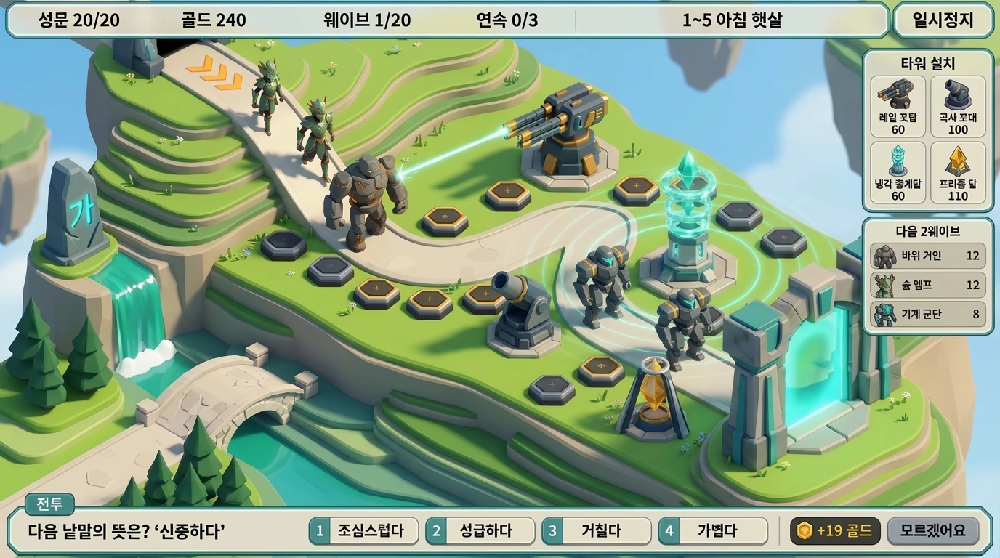
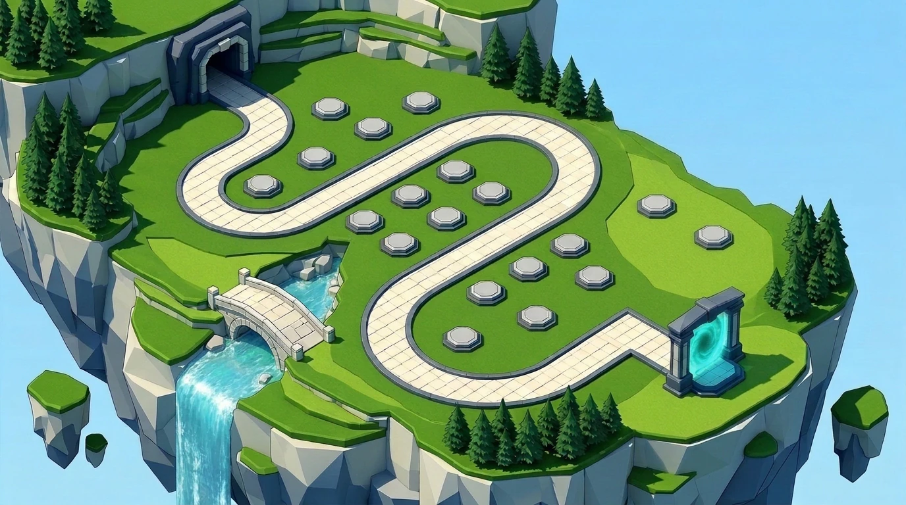
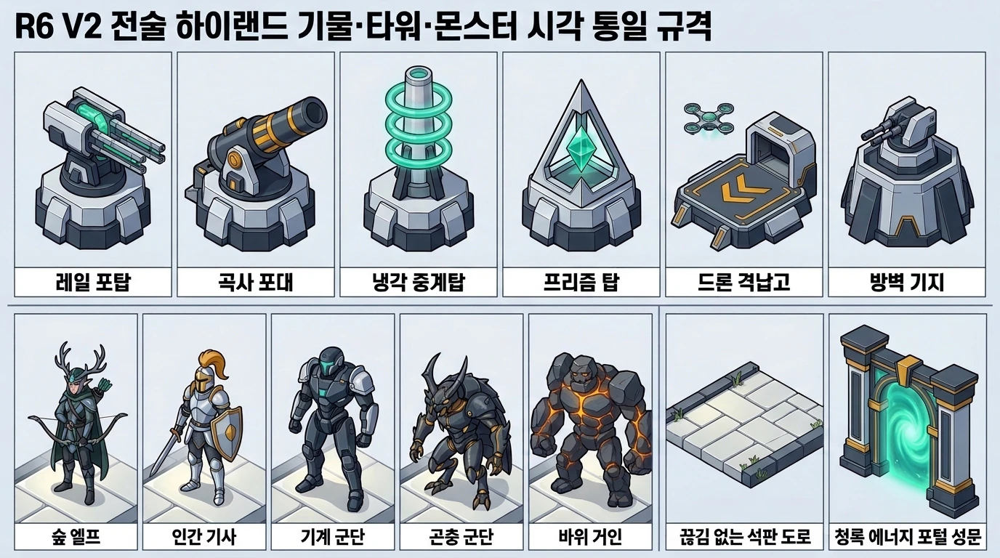
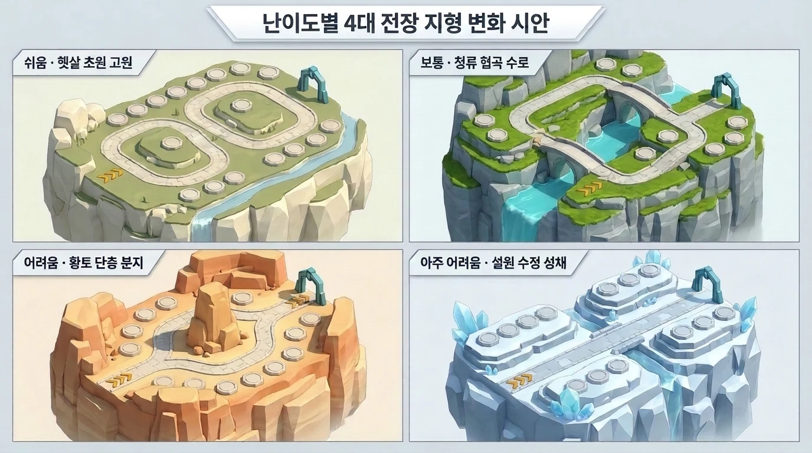
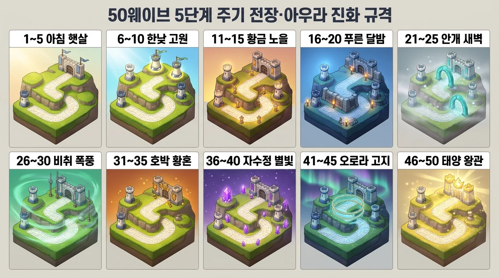

# R6 대개편 PRD V2 · 질적 고도화 및 다중 세션 단일 기준서 (`PRD-r6-v2`)

- **작성**: 2026-11-27
- **기준 커밋**: `8c5c3d25` (`p1/intake-round1`)
- **계보**: [PRD-r6.md (V1, 2026-11-25)](PRD-r6.md)에서 V2로 격상. V1이 타워 6종 66형태·몬스터 5종족 100개체·초원 고원 맵·시즌 2 운영 반영의 **양적 완성 기준서**였다면, 본 문서(V2)는 **질적 고도화(Craftsmanship & Game Feel)·선라이트 알라바스터 S+ 디오라마 시각/UX 쇄신·학년×난이도 16전장 & 50웨이브(5단계 주기 10구간) 동적 진화·다중 세션 무충돌 경계의 단일 기준서**다.
- **기술 아키텍처**: [V2 초선명 렌더링 아키텍처](v2/RENDERING_QUALITY_ARCHITECTURE.md) (`gpt-6.2-astra/high` `20261127T202015-ac2839` 0% 블러·멀티레이어·성문 깊이 분할·수명주기) · [V2 구도·기물 배치·디자인 로직](v2/COMPOSITION_AND_PLACEMENT_LOGIC.md) (`Wide V2 Overview 848×530`·6대 배치 불변식·4전술 형태 실측 좌표·Blender 4요소 셰이더)
- **실행 계획서**: [V2 마스터 계획서](v2/MASTER_PLAN.md) · [V2 세부 실행 계획서 (`WP-A1-01`~`WP-A4-02`)](v2/DETAILED_EXECUTION_PLAN.md)
- **검수 기반**:
  - 세션 C (몬스터/타워 런타임/VFX/동의 모달 `§2~§6`·`§12`): 클로드(`claude-opus-5-5/xhigh`, `20261127T085109-f84023`) 및 코덱스(`gpt-6.2-astra/high`, `20261127T084111-ba1f69`) 교차 기술 검수 반영.
  - **V2 통합 개정 (세션 A · 2026-11-28 `§7~§11`)**: 실브라우저(`1440×900 DPR2`) 정밀 진단, **선라이트 택티컬 하이랜드 S++ (실구현 R6 에셋 100% 정합)**(`v2-01-cohesive-master.webp`, `v2-00-cohesive-map-plate.webp`, `v2-02-cohesive-units-harmony.webp`) 확립 · 끊김 없는 연속 도로 & 성문 우측 후퇴, 코덱스 1·2차 검토 및 초선명 렌더링 심층 탐구(`20261127T202015-ac2839`) 완료 반영.

---

## §0. V1 → V2 격상 배경 및 확정 사용자 결정 (2026-11-27)

### 0.1 V1 달성 현황과 V2 해결 과제
- **V1 달성**: 타워 6종×11형태(66형태, Blender 5.2, `14MB`), 몬스터 5종족×20개체(100개체, Spine 4.3.26 뼈대 40개 + 아틀라스 5장 `2.6MB`), 홈 초상 `30/30`장(`410.4KB`), CR-1000 문제은행(자기 5,547 / 풀 6,583문항), Cloudflare Workers/D1 시즌 2 + GitHub Pages 운영 반영 완료.
- **V2 해결 과제 (현장·실브라우저 진단)**:
  1. **몬스터 "동동 떠다님" & 선화 깨짐**: Linear 4구간 삼각파 회전·단순 `scaleX` 즉시 플립·투영 세로 단축(`0.51배`) 미반영 보폭·NPOT `Linear` 축소 샘플링(밉맵 부재)·0단계 8패스 윤곽 이중선 및 `onKill` 무제한 업데이트.
  2. **타워·VFX·사운드 건조함**: 포두 즉시 스냅·대기 Idle 부재·매 프레임 Graphics 재테셀레이션, 단일 오실레이터 WebAudio 사운드의 단조로움.
  3. **UI/UX·개인정보 정합성**: `shareRecords` 기본 `false` 상태에서 `LaunchDeck`의 거짓 `준비 완료 · 순위 연동` 배지, 시작 전 동의 흐름 부재(`START_REQUIRED` 거절 구조).
  4. **맵 해상도·전장 공간·타워 아이콘·전투 UI 시선 분산 (세션 A 실브라우저 `voca.ssamuniverse.com` `1440×900 DPR2` 진단)**:
     - 배경 `meadow-plateau.webp`(`960×576`, `25KB`)의 `overview`(`746×467`)가 `2062×1290` 캔버스에 **2.76배 확대**되어 흐릿하고, `64×48` 1× 패드가 계단 현상을 일으킴.
     - 상단 78% 암흑(`#0E1216`)과 하단 백색 퀴즈의 명도 충돌, `data-theme="light"` 전환 시 전장 배경만 암흑 고착, 초기맵 경로 짧은 편·배치 공간 협소.
     - 우측 고정 레일(`310×808px`) 하단 **59% 빈 공백**, `BattleTowerPortrait.tsx` 과대 `viewBox`로 Lv1 타워 아이콘이 **`5.9~11.2px`** 흑회색 점으로 축소.
     - 타워 클릭 시 `TowerDetail`(`order: -1`)이 끼어들어 `Armory`가 **약 400px 아래로 점프**, `QuestionPanel` 우측 해설 열(`160px`, `contain: size`, `150px` 높이)에서 **3번째 줄 잘림**, 웨이브 예고 대상 웨이브 번호·종족 아이콘 미비.

### 0.2 확정된 사용자 결정 (2026-11-27)
1. **공개 기록 1회 동의 확정 (`WP-Q1b`)**: `shareRecords` 기본값은 `false`를 유지하되, 아직 선택하지 않은 기기에서 "새 게임"을 누르면 1회 동의 모달("순위표에 올리기" / "이 기기에만 저장")을 띄워 시작 전 동의를 명확히 받는다.
2. **학교 선택·공개 기능 완전 제거 (타 세션 진행 중)**: NEIS 학교 검색·학교 입력·학교 랭킹 필터·서버 학교 프록시 기능은 별도 세션에서 제거 중이다. 따라서 V2 동의 고지 항목은 **`닉네임 · 학년 · 난이도 · 점수 · 웨이브`**로 정립한다(학교명 제외).
3. **다중 세션 병렬 협업 및 무충돌 원칙**: 저장소 내 여러 세션이 동시에 서로 다른 분야를 작업 중이므로, 각 세션은 §1의 배타적 파일 소유 경계를 지키며 공유 파일은 직렬화한다.
4. **시안 A (화면을 꽉 채우는 풀블리드 주간 전술 고원) 채택 및 공간 확장 (세션 A)**: 전체 화면을 채우는 주간 고원 방향을 채택하되, 기존 시안의 짧은 길과 좁은 배치 공간을 보완해 **45~54칸 장경로**와 **20~24개 분리 설치대**로 확장한다.
5. **핀터레스트 레퍼런스 기반 맵·타워 디자인 고도화**: 3단 굴곡 회랑·교차사격 섬·계단식 석축 디오라마와 2단 세라믹-슬레이트 기단·`#1E293B` 외곽선·밝은 상면 베벨·기능 포인트 색 메카 포탑 디자인을 반영한다.
6. **100% 한국어화**: 대한민국 초등 3~6학년 학생 대상이므로 게임 UI·전투 안내·시안에서 과도한 영어·약어(`Wave`, `Lv`, `HP`, `DPS` 등)를 배제하고 100% 자연스러운 한국어(`레일 포탑`, `공격력`, `6웨이브`, `보스` 등)만 사용한다. 기존 R6 평이 한국어 규칙의 금지어(`수호`·`출격`·`징집`·`작전실`)는 계속 금지한다.
7. **학년(초3~6) × 난이도(4종) 16전장 분화 & 5웨이브 단위 50웨이브(10구간) 규격화 테마·아우라 진화**: 학년별 4대 월드 테마와 난이도별 4대 전술 맵 형태를 직교 조합(`4×4=16`전장)하고, 최소 **50웨이브**까지 매 5웨이브 구간(`1~5`, `6~10`, ..., `46~50`)마다 일정한 4계층 규격으로 지형 광원·대기 아우라·성문/길가 건축 장식·전술 기믹이 진화한다.
8. **프로토타입 시안 사용자 승인 우선(Gate 0) 및 초기맵 선완성 순서**: 먼저 초기맵(`3학년 · 쉬움 · 햇살 초원 고원`) 중심 프로토타입 시안(`v2/mockups/*.webp` + 인터랙티브 시안)이 사용자 마음에 들 때까지 다듬어 승인받은 뒤, **① 초기맵(`meadow_easy`) 단일 완성(`A1`) → ② 학년×난이도 16전장 확장(`A2`) → ③ 50웨이브 5단계 주기 테마/아우라 구현(`A3`) → ④ 타워 조명/보스 초상화 폴리싱(`A4`)** 순으로 진행한다.

---

## §1. 다중 세션 소유 경계 및 무충돌 프로토콜 (Active Ownership Matrix)

커밋·편집 직전 `git status --short`로 타 세션 수정 파일을 확인하고, 아래 소유 경계 밖 파일은 수정하지 않는다.

| 세션 | 담당 범위 | 배타적 소유 파일 (타 세션 수정 금지) |
| --- | --- | --- |
| **세션 A (맵 · UI/UX · 타워 · V2 기준서 `§7~§11`)** | **시안 A 풀블리드 2× 맵 · 제로점프 전투 UI · 100% 한국어 · `128×128` 타워 초상화 · Lv1~5 강철-세라믹 조명 · V2 시안/규격** | `docs/renewal/r6/v2/**`, `docs/renewal/r6/map-spec.md`, `tools/r6/map/**`, `public/assets/r6/map/**`, `public/assets/r6/meadow-plateau.webp`, `src/game/r6/mapProjection.*`, `src/game/layers/GroundLayer.ts`, `src/ui/screens/r6Map.ts`, `src/ui/useLayout.ts`, `src/ui/game/{GameScreen,Armory,ContextCard,QuestionPanel,FieldOverlay,TowerDetail,BattleTowerPortrait}.*`, `src/ui/styles/tokens.css`, `src/content/theme/r6.ko.json`(신규 맵·웨이브 한국어 키), `tools/r6/blender/{mortar_render,tower_pack,tower_game_pack,pack}.py` |
| **세션 B (타 세션)** | **학교 선택·공개 기능 제거 · 서버 규칙** | `src/application/neis.ts`, `src/ui/screens/home/{LaunchDeck,RankingBoard,RankingModal,ClassroomQrModal}.*`, `src/contracts/lobby.ts`, `src/persistence/lobbyClient.ts`, `server/**`, `src/ui/copy.ts` |
| **세션 C (타 세션 · R6 V2 코어)** | **몬스터 밉맵·윤곽·리깅/모션, 타워 런타임·VFX·WebAudio, 공개 기록 동의 모달, 독립 성능 계측 (`§2~§6`)** | - 몬스터 공정/런타임: `tools/r6/spine/**`, `asset-source/r6/monsters/**`, `public/assets/r6/monsters/**`, `src/game/r6/monsters/*.json`, `src/game/layers/EnemyLayer.ts`, `src/game/r6/enemyDisplay.ts` - 타워 런타임/VFX: `src/game/r6/TowerPlayback.ts`, `src/game/r6/CombatVfx.ts`, `src/game/r6/vfxTiming.ts`, `src/game/layers/TowerLayer.ts`, `src/game/layers/EffectLayer.ts`, `public/assets/r6/vfx/**` - 오디오: `src/ui/audio/sound.ts` - 동의 모달: `src/ui/screens/RecordConsentModal.*`(신규), `src/persistence/settings.ts`(`shareRecordsAsked` 필드만 추가), `src/ui/screens/NewGameScreen.tsx`(또는 `HomeScreen.tsx` 최소 연결, 타 세션 직렬 확인 후) - 성능 스펙: `tests/e2e/r6-quality-perf.spec.ts`(신규) |
| **세션 D (후속 예정 · A2/A3 단계)** | **16전장 맵 계약 · 도메인 다중 경로 · `balanceVersion 2.1.0` · 50웨이브 아우라 상태 해석** | `src/contracts/maps.ts`, `docs/contracts/maps.*.json`, `src/contracts/balanceV2.ts`, `docs/contracts/balance.v2.json`(또는 `2.1.0` 스냅샷), `src/domain/{run,combat}.ts`의 경로/설치대 특성부, `src/game/r6/mapPhase.ts`(신규) |

### 공유 파일 직렬화 및 계약 보존 규칙
1. **`public/assets/r6/manifest-v2.json`**: 최상위 키(`maps`·`waveThemes`·`towers`·`sheets` vs `atlases`·`rigs`·`species`)를 각 도구가 **자기 키만 부분 병합**해 기록하고 쓰기 시점을 직렬화한다.
2. **`src/game/BattleScene.ts`**: 세션 A의 초기맵/레이아웃 완료 후 세션 C의 `prepareWave` 퀴즈 단계 선적재 패치를 직렬 적용하며, 이후 `A2/A3` 테마 전환 훅을 이어 붙인다.
3. **`src/game/r6/manifest.ts` & `EnemyLayer` 보폭 상한**: 몬스터 `stridePx`·윤곽 메타는 `src/game/r6/monsters/*.json`/`enemyDisplay.ts`에 유지한다. 향후 `54칸` 맵(`+32%` 화면 속도)에서도 보행 애니메이션이 과속하지 않도록 `EnemyLayer`의 `walk.timeScale`은 **`0.7~1.4`** 구간 클램프를 권장한다(세션 C 합의).
4. **`EnemyFootprint` 계약**: `EnemyLayer.activeFootprints()` → `padOutline.ts` → `GroundLayer.syncPads` 계약을 고정한다. 뒤집기 보간 중에도 경계 상자는 목표 방향 기준으로 계산하며, 3단 언덕 설치대의 높이 증가(`≤ 8px`)도 이 범위 안에서 가림을 처리한다.
5. **`src/game/layers/shared.ts`**: 세션 A·C 모두 기존 공용 계약을 보존한다.
6. **`docs/contracts/prd_v0_5_validation.json`**: 타인/기존 변경 보존을 위해 수정·커밋하지 않으며 `npm run validate:plan` 대신 읽기 전용 `npm run wiki:check`를 사용한다.

---

## §2. V1 진단 대비 V2 아키텍처 확정 결정

1. **축소 문제(몬스터) vs 확대 문제(배경 맵)의 정반대 해법**:
   - **몬스터 (축소 샘플링 문제)**: `1366×768 DPR1`(zoom ≈ `1.26~1.46`)에서 현행 `256/ppu=3`은 이미 화면보다 **2.0~3.4배 큰 텍셀**을 가지므로, 해상도 부족이 아니라 **`pot=false` + `filterMin=Linear`로 밉맵이 꺼져 선화가 깨지는 문제**다. 따라서 `384/512` 상향 및 `1x/2x` 분기는 기각하고, **`256/ppu=3` 유지 + `pot=true` + `filterMin=MipMapLinearLinear` + `filterMag=Linear` + 손실 WebP `-sharp_yuv`**를 확정한다(DPR2 실측 텍셀/기기px < 1.1일 때만 후속 2× 검토).
   - **배경 맵 (확대 블러 문제, 세션 A 관할)**: `960×576`이 고해상도 캔버스에서 2.76× 확대되는 정반대 문제이므로 세션 A에서 `1920×1152`(2×)로 상향한다.
2. **실루엣 윤곽 및 피격 표현**:
   - 파츠별 오프라인 림 베이크(관절 내부 이음매에 은회 선 생성) 및 Phaser 4 FBO 1패스 셰이더(개체당 22회 FBO 전환 또는 Y정렬 파괴)는 **기각**한다.
   - **확정안 (1단계)**: 런타임 실루엣 방식 유지 + 화질 0단계도 **4방향(5배 제출, W20 `renderMesh` ≤ 1,400회)**으로 통일 + `silhouettes.json` 길 대비 기반 스킨별 윤곽 정책 + 동일 훅 본 패스 `ADD 0x404040` 피격 점멸(추가 제출 0). (Q2 후 예산 초과 시에만 `monsters.py` 팽창 실루엣 슬롯 2단계 검토).
3. **2D Spine 통일 및 실시간 Three.js 배제**:
   - 경질 몬스터(`machine`/`stone`) Blender 3D 파츠 혼용은 계통 내 T1~T4 선화·명암 일관성 파괴 및 100개체 개별 모델링 비용 때문에 기각한다. **고화질 2D 파츠(취약 5개체 보강 포함) + Spine 4.3 Mesh2D**로 통일하며, 실시간 Three.js 런타임은 채택하지 않는다([PRD-r6.md §3.4](PRD-r6.md) 유지).

---

## §3. 질적 향상을 위한 10대 세부 노하우 (V2 Craftsmanship Playbook)

### 노하우 1 · 텍셀 밀도 & 밉맵 & WebP 크로마 법칙
- **규칙**: 화면 기기 px 대비 텍셀 밀도는 **1.0~2.0×**가 적정선이다. 3배 초과 축소는 밉맵 없이는 에일리어싱을 유발한다.
- **패킹 설정**: Spine 아틀라스는 반드시 **`pot=true`, `filterMin=MipMapLinearLinear`, `filterMag=Linear`**로 패킹해 `PhaserTexture.generateMipmap()`이 실제로 작동하게 한다.
- **WebP 색 번짐 방지**: 종족 아틀라스(`768KB` 상한)가 무손실에서 `-q 92` 손실로 내려갈 때(`elf` 등) 반드시 **`-sharp_yuv`** 플래그를 추가해 4:2:0 서브샘플링으로 1px 앰버·틸 포인트가 탁해지는 현상을 막는다. 알파 채널 무변화(`alpha_q 100 -exact`) 및 투명 여백 보존(`L-TD-102`)을 유지한다.

### 노하우 2 · Spine 4.3 애니메이션 원칙 & 5종족 모션 문법
- **Linear 삼각파 금지**: 모든 `walk`/`hit`/`fall`/`boss-skill` 키프레임에 목적별 Cubic Bezier 커브를 부여한다(딛고 차오르는 탄성 `[0.25, 0.1, 0.25, 1.0]`, 타격 반동 급가속 `[0.1, 0.9, 0.2, 1.0]`).
- **원화 재절단 없는 2본 무릎 가중치 메시**: 다리 PNG를 2개로 다시 자르지 않고 단일 다리 이미지를 **2본 가중치 메시**로 묶어 무릎 관절 굽힘을 구현한다. 날개(`wing-*`)·망토·깃발·촉수(`mark`/`gear`) 등 연성 슬롯은 `3×4` 이하 격자 메시로 바람/관성 흔들림을 준다. (4.3.26 편집기 호환: 모든 정점의 bone influence는 본 인덱스 오름차순 고정)
- **사전 계산 IK & 위상 지연 키 (런타임 제약 0)**: 50/100ms 자세 스로틀(`quality >= 2`)에서 물리·IK 시뮬레이션이 튀지 않도록 **런타임 IK·물리·경로 제약·클리핑은 모두 `0`개**로 제한한다. 대신 `rigs.py`에서 2본 역산 IK를 회전 키로 사전 베이킹해 접지 발 미끄럼을 **≤ 1.5px**로 잡고, 머리·망토·무기의 2차 추종은 1~2프레임 위상을 늦춘 키로 만든다.
- **5종족 × 5계통 모션 문법**:
  - `elf`: 가볍고 탄력 있는 보폭, 잎날개·망토 지연 추종.
  - `human`: 절도 있는 행진 박자, 기병 말 상하 반동과 기수·창 지연 흔들림.
  - `machine`: 유압 스텝 정지-가속 커브, 포탑/센서 수평 안정화.
  - `insect`: 다리 간 위상차 빠른 잔걸음, 복부·더듬이·날개 고주파 진동.
  - `stone`: 느리고 묵직한 체중 이동, 착지 순간 스쿼시(`scaleY 0.94`, `scaleX 1.05`) 후 복원.
- **다관절 `hit` · `fall` · `boss-skill`**: `body` 단일 회전 대신 머리·양팔·다리가 연쇄 반응하며, 보스는 종족별 시전 자세(내려치기/포효/급상승/충전)를 차별화한다.

### 노하우 3 · 투영 보폭 동기화 & 코너 히스테리시스
- **보폭 동기화**: 3/4 투영 맵의 세로 단축률(`R6_MAP_SQUASH ≈ 0.509`)로 인해 상하 경로 이동 시 화면 속도가 약 0.51배가 되며, `r6EnemyScale` 압축 배율도 개체마다 다르다. `rigs.py`가 리그별 기준 보폭(`stridePx`)을 출력하고, `EnemyLayer.ts`는 **`화면 이동 px/s ÷ (stridePx × effScale)`**를 부드럽게 필터링해 `walk.timeScale`로 적용한다.
- **방향 떨림 방지 & 스쿼시 턴**: `EnemyLayer.ts:216`의 `aheadX !== point.x` 즉시 비교 대신 **`|aheadX - point.x| ≥ 2px` 히스테리시스**를 적용해 세로 경로 떨림을 막고, 전환 시 `80~120ms` 동안 `scaleX` 스쿼시 보간을 둔다(`reducedMotion` 시 즉시 전환).

### 노하우 4 · 적응형 실루엣 분리 & 제로-코스트 피격 + 쓰러짐 상한
- **스킨별 윤곽 정책 (`silhouettes.json` 길 대비 기준)**:
  - 길 대비 `≥ 2.0` (밝은 `human` 갑주 등): 카본(`#12161B`) `α 0.30` 또는 생략 → **이중선 0건**.
  - 길 대비 `1.5 ~ 2.0`: 은회(`#B8C0C8`) `α 0.25`.
  - 길 대비 `< 1.5` (어두운 개체): 은회(`#B8C0C8`) `α 0.45`.
- **제로-코스트 피격 점멸**: `enemyDisplay.ts` 훅의 원본 본 패스에서 `ADD 0x404040` 틴트를 직접 적용해 추가 `renderMesh` 제출 `0`으로 선명한 피격 반응을 낸다(화질 2+단계는 윤곽 0패스 분기로 점멸만 유지).
- **쓰러짐(`onKill`) 동시 상한**: `onKill`이 `addToUpdateList()`로 스켈레톤을 무제한 등록해 곡사포 연쇄 처치 시 프레임이 급락하는 함정을 막기 위해, 동시 쓰러짐 애니메이션 상한을 **0단계 `8` · 1단계 `6` · 2+단계 `4`**로 제한하고 초과분은 `0.15초` 페이드아웃만 실행한다.

### 노하우 5 · 타워 조준-표시 분리 & 무비용(Zero-Texture) Idle
- **조준 vs 표시 방향 분리**: `TowerPlayback.ts`에서 공격 클립이 읽는 `aimDirection`과 화면에 그리는 `displayDirection`을 분리한다. 표시 방향은 프레임당 최대 **2스텝**(90° 약 33ms) 회전하되, 공격 발사 순간 차이가 **4스텝**을 넘으면 즉시 맞춘다.
- **새 대형 시트 0 원칙 Idle**: 타워당 추가 표시 객체 `≤ 1`개, 매 프레임 다시 그리는 `Graphics` `0`개 원칙 하에, ① 비표적 시 기존 16방향 포두로 저속 스캔(`400~600ms/스텝`), ② 포두 `±1px` 호흡, ③ 격납고 기존 드론 시트 호버, ④ 부팅 시 만든 `32×32` 공용 방사형 광택 텍스처 1장을 `ADD` 1쿼드로 프리즘·냉각에 적용한다(1단계 광택 끔, 2+단계 Idle 전부 끔).

### 노하우 6 · 2계층 VFX 풀링 (판독선 + 30KB 장식 아틀라스)
- **역할 분리**: `CombatVfx.ts`에서 매 프레임 `Graphics.clear()` 테셀레이션 비용이 폭증하지 않도록, **전투 판독에 필수인 핵심선**(레일 빔·프리즘 연쇄선·착탄 원·방벽 부채꼴)만 `Graphics`에 남기고 **장식 효과**(총구 섬광·충격 링·포탄 연기 궤적·지면 균열·냉기 결정 파동·종족별 처치 파편)는 **`256×256` 이하 VFX 아틀라스 1장(`≤ 30KB`) + 풀링 Image/파티클(`ADD`)**로 분리한다.
- **엄격한 상한**: 프레임당 Graphics 도형 **0단계 `400` / 1단계 `200` / 2+단계 `100`**, 활성 파티클 **`≤ 120`**, 프레임당 블렌드 모드 전환 **`≤ 4회`**, 장식 원 분할 **`20`**, `MAX_CUES = 96`, Phaser `Glow/Bloom` 필터 및 FBO `0`개.

### 노하우 7 · 무파일(0KB) WebAudio 타격감 & 도파민 사운드 설계 (`src/ui/audio/sound.ts`)
- **원칙**: 외부 음원 파일(`0KB`) 없이 WebAudio 합성만으로 상용 게임 수준의 타격감과 퀴즈 보상을 만든다. 기존 채널·우선순위(`correct`/`wrong`/`leak` 최우선, 넘치면 `fire.*`부터 생략)와 `bgmVolume`/`sfxVolume`/`soundOn` 계약을 유지한다.
- **5가지 합성 고도화 기법**:
  1. **마이크로 피치 변주 & 다층 어택**: 동일 `fire.*` 연속 재생 시 `±4%` 피치 랜덤화로 기계적 반복 피로를 없애고, 짧은 필터링 화이트/핑크 노이즈 버스트(15~45ms) + 피치 하강 오실레이터를 합성해 타격감을 만든다.
  2. **무기 단계(I~IV) 음색 분화**: 무기 단계가 오를수록 배음(filter cutoff)·저역 무게감을 높여 Lv6·Lv12·Lv18 진화 체감을 귀로 전달한다.
  3. **퀴즈 연속 정답 콤보 음계**: `battleStreak` 1→2→3→버닝 진입에 따라 5음 음계(`C6→E6→G6→C7` 스웰)로 피치·화음을 상승시켜 도파민 보상을 강화한다.
  4. **종족별 처치 질감 & 보스 등장 펄스**: `machine`/`stone` 경질 파쇄(고역 클릭+저음 둔탁함) vs `elf`/`insect` 유기적 소멸, 보스 웨이브 진입 시 낮은 브라스형 2중 펄스.
  5. **타워 진화·해금 피드백**: 2레벨 외형 진화 및 W3·6·9 타워 해금 시 짧은 상승 아르페지오 차임 추가.

### 노하우 8 · 전투 중 0ms 스터터 프리로드
- `BattleScene.ts:prepareWave`가 전투 중 불려 아틀라스·밉맵 GPU 업로드 끊김을 유발하지 않도록, 다음 웨이브 종족 적재 및 GPU 업로드는 반드시 **준비/퀴즈 단계에서 완료**해 전투 중 `100ms` 초과 프레임 **0회**를 보장한다.

### 노하우 9 · 거짓 없는 성능 계측 & 모든 신기능 품질 스위치
- 모든 측정은 목표 환경인 **`1366×768 DPR1`**, `resource-guard` **일반 우선순위(학생 접속 0명)** 조건에서 수행한다.
- 평균 FPS(60 상한에 가려짐) 대신 **`p95` 프레임 작업시간(≤ 12ms)**, `50ms` 초과 프레임 수, **`renderMesh` 호출 카운터**, **스트레스 장면(적 40 · 보스 2 · 타워 24 동시 연사)**을 함께 기록한다.
- **No-Go 안전장치**: 모든 V2 시각·모션 신기능은 `renderQuality` 단계별 토글로 즉시 끌 수 있게 구현한다.

### 노하우 10 · 공개 기록 시작 전 동의 정합성 (`START_REQUIRED` 대응)
- 서버가 `/v1/runs/start` 기록 없는 제출을 `START_REQUIRED`로 거절하므로(`lobbyClient.ts:435`), 동의는 반드시 **새 게임 시작 전**에 완료해야 한다.
- 각 판마다 **시작 시점의 `shareRecords` 스냅샷**을 저장해, 판 도중에 설정을 켜더라도 `"이번 판은 시작할 때 공개 기록이 꺼져 있어 이 기기에만 저장돼요"`라고 정확히 안내한다.
- 고지 문구는 학교 선택 제거를 반영해 **`닉네임 · 학년 · 난이도 · 점수 · 웨이브`**만 정확히 명시한다.

---

## §4. V2 세부 실행 로드맵 (본 세션 독점 트랙)

> **순서 원칙**: ① `Q0` 계측·밉맵 스파이크 최우선 → ② 트랙 B에서 `Q3 경량(패킹/밉맵)`을 `Q2(리깅/애니메이션)`보다 **먼저** 확정해 100개체 재생성을 **1회**로 통합 → ③ 각 트랙 병합 직후 `r6-quality-perf` 관문 1회 실행 → ④ 최종 `Q5` 통합.

| 단계 | 작업 내용 | 주요 대상 파일 (본 세션 독점) | 선행 / 병렬 |
| --- | --- | --- | --- |
| **Q0** | `1366×768 DPR1` W20 + 스트레스 장면 기준선 스펙(`r6-quality-perf.spec.ts`) 작성, `pot=true`+`MipMapLinearLinear` 실작동 스파이크, 3환경 텍셀 밀도 실측, 맵 세션 `manifest-v2.json` 쓰기 순서 확인 | `tests/e2e/r6-quality-perf.spec.ts`(신규) | 최우선 착수 |
| **WP-Q3 경량** | `monsters.py` `pot=true`+`MipMapLinearLinear/Linear`+`-sharp_yuv` 적용, `enemyDisplay.ts` 0단계 4방향·스킨별 윤곽 정책·동일 훅 `ADD 0x404040` 피격 점멸, `BattleScene` 퀴즈 단계 프리로드 | `tools/r6/spine/monsters.py`, `src/game/r6/enemyDisplay.ts`, `src/game/layers/EnemyLayer.ts`, (`BattleScene.ts` 직렬) | Q0 후 즉시 |
| **WP-Q2** | `rigs.py` Bezier·5종족 아키타입·2본 무릎 메시·연성 메시·사전 2본 IK 키·다관절 `hit`/`fall`/`boss-skill`(1회 재생성), `EnemyLayer` 투영 보폭·2px 히스테리시스·80ms 턴·쓰러짐 상한(8/6/4), `rig_audit.py` 상한·발 미끄럼(`≤1.5px`) 검증 + 취약 5개체 2D 보강 | `tools/r6/spine/{rigs,rig_audit,batch}.py`, `asset-source/r6/monsters/**`, `public/assets/r6/monsters/**`, `src/game/layers/EnemyLayer.ts` | Q3 경량 후 (취약 5개체 병렬) |
| **WP-Q4.1 · Q4.3 · Q4.4** | `TowerPlayback` 조준/표시 분리 스무스 회전 + Zero-Texture Idle, `CombatVfx` + `30KB` VFX 아틀라스 풀링 + 도형 상한(400/200/100), `sound.ts` 무파일 WebAudio 타격감·콤보·진화·보스·종족음 고도화 | `src/game/r6/{TowerPlayback,CombatVfx,vfxTiming}.ts`, `src/game/layers/{TowerLayer,EffectLayer}.ts`, `public/assets/r6/vfx/**`, `src/ui/audio/sound.ts` | Q0 후 트랙 B와 병렬 |
| **WP-Q1b** | `RecordConsentModal`(1회 동의 카드, 학교명 제외 고지) + `settings.ts`(`shareRecordsAsked`, 시작 시점 스냅샷) 구현 후 타 세션 B 완료 직후 최소 연결 | `src/ui/screens/RecordConsentModal.*`(신규), `src/persistence/settings.ts` | 독립 모듈 먼저, 연결은 세션 B 후 |
| **WP-Q5** | 각 트랙 병합 성능 관문 + 최종 통합(`npm run verify`, `npm run build`, `tests/e2e/r6-*.spec.ts`, 연속 8프레임 보행 스트립 시각 검수, `npm run wiki:sync`) | 전체 검증 + 비교판 산출물 | 모든 트랙 완료 후 |

---

## §5. 정량 예산 및 Go / No-Go 관문표

### 5.1 스켈레톤 · 자산 · VFX 정량 상한
| 항목 | 일반 개체 / 기본 상한 | 보스 개체 / 비고 |
| --- | --- | --- |
| Spine 본 수 / 그리는 슬롯 수 | 본 `≤ 24` · 슬롯 `≤ 16` | 본 `≤ 32` · 슬롯 `≤ 22` |
| 가중치 메시 / 정점 / 영향 본 | 메시 `≤ 6`(다리4+날개·망토2) · 정점 `≤ 16`(날개·망토 `≤ 24`) · 영향 본 `≤ 2` · 가중치 합 `≤ 200` | 메시 `≤ 8` · 정점 `≤ 32` · 영향 본 `≤ 3` · 가중치 합 `≤ 400` |
| 런타임 제약 · 키 · 길이 | 런타임 IK·물리·클리핑 **`0`** · 걷기 키 `≤ 9`(시작=끝) · `fall ≤ 0.6s` | `fall ≤ 0.9s` · W20 가중치 합 `≤ 6,000` |
| 몬스터 아틀라스 | 종족당 **1장 · `≤ 768KB`**, 폴더 `≤ 3.0MB`, 밉맵 포함 5종 RGBA 합 `≤ 32MB` (`≤ 5.6MB`/종족) | 알파 변형 0, `256/ppu=3` 유지 |
| 윤곽 · `renderMesh` | W20 프레임당 `renderMesh ≤ 1,400` (2단계 전환 시 `≤ 600`) | 밝은 스킨 이중선 0, G4 지형 대비 `≥ 2.056` 유지 |
| 타워 런타임 · VFX · 오디오 | Idle 추가 객체 `≤ 1`/타워, VFX 아틀라스 `≤ 30KB`, 도형 상한 `400/200/100`, 파티클 `≤ 120`, 블렌드 전환 `≤ 4`/프레임 | 타워 자산은 세션 A 범위 포함 전체 `≤ 16.1MB`(`1x ≤ 5.0MB`), 오디오 추가 파일 `0KB` |

### 5.2 완료 승인(Go) 및 차단(No-Go) 기준
- **완료 Go**:
  1. **성능**: `1366×768 DPR1` W20 CPU 6배 감속 평균 **`≥ 55fps`**, 1초 최저 **`≥ 45fps`**(웨이브 시작 2초 제외), 품질 `0` 유지, 자동 정지 `0`, `p95` 작업시간 **`≤ 기준선 +15%` 및 `≤ 12ms`**, 전투 중 `> 100ms` 프레임 **`0`**, 스트레스 장면 자동 정지 `0`·평균 `≥ 45fps`(1단계 하향 허용), CPU 1배 `≥ 58fps`.
  2. **리그·모션**: `rig_audit` 100/100 통과, 33자세 접합 미달 `0`, 걷기 시작=끝 오차 `0`, 접지 발 미끄럼 **`≤ 1.5px`**.
  3. **UX·동의**: 공유 끔 상태에서 새 게임 시작 시 `/v1/runs/start` 호출 `0`(E2E), 동의 켬 1판 완주 시 D1 `run_start_dedup`·`completed_runs` 각 `1`건 이상, 고지 문구(`닉네임·학년·난이도·점수·웨이브`) 일치.
  4. **공통**: `npm run verify`, `npm run build`, `tests/e2e/r6-*.spec.ts`, `npm run wiki:check` 통과.
- **No-Go (차단/되돌림)**:
  - 성능 기준 1회 수정 후에도 실패 시 해당 신기능을 품질 단계 스위치로 끈 채 출시하고 원인을 후속 이관한다.
  - 리그 접합 미달 `≥ 1건`, 종족 아틀라스 `2장 이상` 분할, 타 세션 소유 파일 무단 변경 감지 시 병합을 차단한다.

---

## §6. 미확인 실측 항목 (`Q0` 해소 대상) 및 V1 → V2 변경 이력

- **Q0 실측 예정 4건**: ① `1366×768` 실제 전장 캔버스 크기 및 3환경 텍셀 밀도 실측, ② 5종족 `atlas-report.json` 손실/무손실 실태, ③ Phaser 4.2.1 `'phaser'` 백엔드 WebGL 버전 및 POT 밉맵 GL 파라미터 실작동, ④ 타워 6종 최단 공격 간격 대비 회전 스텝 여유.
- **V1 → V2 변경 요약**:
  - 양적 구축([PRD-r6.md](PRD-r6.md)) → 질적 고도화(밉맵·적응형 윤곽·5종족 모션·투영 보폭·2계층 VFX·무파일 WebAudio·시작 전 동의·1366×768 p95 계측)로 기준 격상.
  - 동시 진행 중인 타 세션(① 맵·전투 레이아웃·타워 초상화·Lv1~5 강철, ② 학교 선택 제거)과의 파일 소유 경계 및 `manifest-v2.json` 직렬화 규약 명문화.
  - **세션 A V2 통합(`§7~§11`)**: 시안 A 풀블리드 주간 고원 채택, 핀터레스트 기반 장경로(45~54칸)·20~24설치대·타워 6종 디자인 고도화, 100% 한국어화, 학년(3~6)×난이도(4) 16전장 매트릭스, 5웨이브×10단계(1~50웨이브) 규격화 테마·아우라 체계, 프로토타입 승인 게이트(Gate 0) 및 초기맵 선완성 로드맵(`A1→A4`) 추가.

---

## §7. V2 시각 기준서 · 시안 A 풀블리드 · 핀터레스트 고도화 · 100% 한국어 (세션 A)

### 7.1 최종 확정 S++ 시안 방향 ("선라이트 택티컬 하이랜드 S++ · 실구현 R6 정합", `v2/mockups/*.webp`)

#### 1) 최종 확정 마스터 시안 3종 (구현 목표 절대 기준)

#### 2) 16전장 바이옴 · 50웨이브 아우라 구조 시안

> 참조 기록: 이전 탐색 구상안(`v2-01-master-art-direction`, `v2-00-master-map-plate`, `v2-02-master-towers`, `v2-01-hero-diorama`, `v2-00-initial-map-art`, `v2-01-battle-fullbleed` 등)은 진화 이력으로 보존하며, **모든 실제 구현은 실구현 R6 기물·몬스터·`hero-meadow-daylight`와 100% 정합하는 상단 S++ 시안 3종(`v2-01-cohesive-master`, `v2-00-cohesive-map-plate`, `v2-02-cohesive-units-harmony`) 및 [RENDERING_QUALITY_ARCHITECTURE.md](v2/RENDERING_QUALITY_ARCHITECTURE.md)를 따른다.** (`v2-01-cohesive-master.webp` 시안 내 소형 UI 3곳 오탈자 표현은 실제 DOM 렌더링에서 정확한 코드 한국어 문자열로 구현)

### 7.2 선라이트 택티컬 하이랜드 S++ 및 0% 블러 기준
1. **실구현 세계관 100% 통일 (`hero-meadow-daylight` 직계 초고도화)**:
   - 분홍 벚꽃·동화풍 뾰족 지붕·목조 중세 성문을 전면 배제하고, 햇살 가득한 에메랄드 계단식 부유 고원 + 각지고 선명한 쿨-슬레이트/석회암 절벽·부유 암반 + 터쿼이즈 폭포·아치교 + 청록 `가` 모놀리스로 통일한다.
   - 설치대(2단 다크 슬레이트·은회 세라믹 8각), 포탑 6종(Blender 66형태 직계), 몬스터 5종족(Spine 100개체 직계), 성문(조각 석재·슬레이트 쌍기둥 + 청록 에너지 포털)을 **다크 슬레이트/은회 세라믹 + 앰버 골드(`#E69F24`) + 에메랄드 틸(`#2FB5A3`)** 단일 언어로 묶는다.
2. **끊김 없는 연속 석판 도로 & 초선명 렌더링 (`RENDERING_QUALITY_ARCHITECTURE.md`)**:
   - 단일 `1920×1152` 배경은 `1440×900 DPR2`에서 `0.724 texel/물리 px`로 살짝 흐리므로, **가시 지형(`2090×1308`) + POT 반복 연속 석판 도로 메시(입구→포털 내부 단일 연결) + 분리 랜드마크(`gateBack/gateFront`) = `11.89 MiB ≤ 12 MiB`** 멀티레이어 합성을 채택해 **`texel/물리 px ≥ 1.013`**을 보장한다.
3. **택티컬 글라스 UI**: 프로스트 아이보리-슬레이트 45° 모따기 글라스 패널 + 얇은 틸/앰버 라인 + 100% 한국어 인터페이스를 적용한다.

### 7.3 주간 고원 기본 팔레트 및 `data-theme` 일관 전환
- **기본값 (시안 A · 교실 프로젝터 고가독성)**:

| 영역 | 핵심 색상 (Hex) | 대비·설계 의도 |
| --- | --- | --- |
| 지형 계단 (초기 초원) | `#C3D5B7` / `#B0C5A2` / `#CCE0BD` | 채도를 억제한 밝은 세이지·초원 톤으로 몬스터·길 분리 |
| 길 포장면 / 외곽 턱 | `#ECF1F5`·`#DCE4EC` / `#8A97A4` | G4 지형·길 대비 `≥ 2.056` 확보, 어두운 스킨 몬스터도 즉시 식별 |
| 부유 UI 카드 표면 / 본문 | `#F7F9FC` (94% 불투명) / `#12161B` | 교실 프로젝터 환경 WCAG AAA 명도 대비 확보 |
| 선택·강화 강조 / 사거리·해금 | `#C47A08` 앰버 / `#0E7D6F`·`#2FB5A3` 틸 | 웨이브 특수 기믹(크림 `#F3E6C4`)과 색각 이상자도 구분 |

- **`data-theme` 전환 (`주간 A` ↔ `고대비 슬레이트 B`)**:
  - `settings.lightTheme → GameScreen/FieldBridge → R6BattleAssets → GroundLayer` 경로로 실제 전장 배경·패드·UI 토큰을 일관 전환한다.
  - 두 테마 배경을 동시에 VRAM에 올리지 않고 **현재 활성 테마 1장만 로드**하며, 새 테마 이미지 로드가 끝난 뒤 교체하고 이전 텍스처를 즉시 해제한다.

### 7.4 100% 한국어화 원칙 (`0%` 과도한 영어·약어)
- 게임 화면·버튼·안내 칩·팝오버·시안에 영어·로마자 약어(`Wave`, `Lv`, `HP`, `ATK`, `SPD`, `RNG`, `DPS`, `LOCKED`, `UPG`, `Dusk`)를 노출하지 않는다(기존 시스템 호환 식별자·수치 기호 `%`, `+`만 허용).
- **표준 치환표**: `Lv.4` → `4단계`, `6W` → `6웨이브`, `HP 15/15` → `성문 15/15`, `DMG/ATK` → `공격력`, `SPD` → `공격속도`, `RNG` → `사거리`, `Rail/Mortar/...` → `레일 포탑 / 곡사 포대 / 냉각 중계탑 / 프리즘 탑 / 드론 격납고 / 방벽 기지`.
- **금지어 유지**: `수호`, `출격`, `징집`, `작전실`은 사용하지 않으며, 보스 방벽 연출 또한 타워명(`방벽 기지`)과 겹치지 않게 **`성문 돌벽`**으로 명명한다. 신규 맵·웨이브 한국어 문구는 세션 B의 `copy.ts`가 아니라 **`src/content/theme/r6.ko.json`**에 추가한다.

---

## §8. 전장 공간 확장(장경로·여유 배치) 및 타워 6종·초상화 고도화

### 8.1 `15×9` 격자 유지 근거 및 배치 규칙
| 검토 안 | 경로 · 설치대 | 판단 및 근거 |
| --- | --- | --- |
| A. 현행 v0.4 맵 4종 재사용 | 38~49칸, 1줄 띠 다수, 20칸 | **기각.** 길이가 짧고 배치 공간 협소 문제가 남음 |
| **B. `15×9` + `Wide V2 Overview` + 신규 4전술 형태 (채택)** | **33/33~53칸, 교차사격 섬, 21~24칸** | `848×530` (`+29.2%` 가시 면적, VRAM 증분 `0 MiB`) 확장으로 `1440 DPR2 1.013 texel/물리px`·성문 안전존·`dockHits=0` 동시 달성 |
| C. `20×12` 확장 격자 | 80칸+, 30칸+ | **기각.** 칸이 25% 축소되어 초3 탭 오조작·몬스터 시인성 저하 및 전체 스키마 파기(Q0 실측 ≥ 80px일 때만 `16×10` 재검토) |

- **전장 배치 5원칙 (성문 우측 후퇴 · 배치 불변식 · 공간 효율 극대화 · [상세](v2/COMPOSITION_AND_PLACEMENT_LOGIC.md))**: ① **우하단 성문 안전선 후퇴**: `Wide V2 Overview (56, 12, 848, 530)` 안에서 적이 들어가는 에너지 포털 성문을 **`x=76~88%, y=63~78%`**(`easy/hard/crazy` 중심 `82.2%, 71.2%`)로 배치해 `0px` 비잘림 확보. ② **우상단 도크 배타존 (`dockHits = 0`)**: 우측 도크(`y ≤ 58%`) 영역(`x ≥ 75% ∧ y ≤ 55%`)에 경로·설치대 진입 0건 보장. ③ **사선 배치 불변식**: 베지어 코너 **`r = 0.38칸 ≤ 0.396칸`**(연석 이탈 0), **`(1,1)` 수직 스택 금지**, **`minScreenDist ≥ 56px`**(실측 `61.8~73.0px`) 및 근수직 간격 **`≥ 48px`**으로 앞 타워 머리의 뒤 패드 가림과 오탭 차단. ④ 모든 설치대 화력 가치 **`V(s) ≥ 3`**, 길과 길 사이 2칸 교차사격 섬 형성. ⑤ 4모서리 디오라마 앵커(소나무 절벽·원경 하늘·터쿼이즈 폭포 다리·`가` 모놀리스·외곽 지지석) 및 단일 주광 축(`mortar_render.py` 동기화) 적용.
- **카메라 전략**: `A1~A3`까지는 기존 16방향 투영(`cameraRay=[6.1,-8.2,6.05]`, `R6_MAP_SQUASH=0.509`)을 유지한다(피치 `0.62` 변경 시 `y=524.2`로 기존 `overview y=504` 하단 밖 잘림 발생 및 타워 66형태·발사시트 전면 재렌더 필요). `A4`에서 필요 시 단일 타워+맵 1종 스파이크로 피치 변경을 별도 검증한다.

### 8.2 `11.89 MiB` 초선명 멀티레이어 합성 & Blender 멀티패스 규격 ([상세](v2/RENDERING_QUALITY_ARCHITECTURE.md))
| 계층 / 자산 | 일반 티어 (DPR1) | 고밀도 티어 (DPR2) | VRAM (RGBA8) | WebGL 필터 / 인코딩 |
| --- | --- | --- | ---: | --- |
| 가시 지형 (`terrain`) | `1492×934` | **`2090×1308`** (2048 상한 시 2분할) | `5.316 / 10.428 MiB` | `LINEAR` · `-q 92 -sharp_yuv -m 6` |
| 연속 도로 + 랜드마크 (`gateBack/Front` 등) | `256²` + `512×256` POT | 동일 (밉 포함) | **`~1.00 MiB`** | `LINEAR_MIPMAP_LINEAR` · **무손실 WebP** |
| 설치대 시트 (`pad`) · 공용 아우라 | 2× (`128×96`) · `256²` | 3× (`192×144`) · `256²` | `0.094~0.211` + `0.25 MiB` | `LINEAR_MIPMAP_LINEAR` · **무손실 WebP** |
| **활성 전장 합계 (상시 `≤ 12 MiB`)** | **`~6.66 MiB`** | **`11.89 MiB` (`1.013 texel/물리px`)** | 목표 **`≤ 12 MiB`** | 전환 시 이전 전용 페이지 선해제 후 업로드 |

- **Blender 5.2.3 LTS 한 장면 멀티패스 (`tools/r6/map/scene.py`)**: 직교 시야를 논리 해상도(`960×576`)로 고정하고 출력 픽셀만 확장해 `terrain`, `road`, `gate-back`, `gate-front`, `entrance`, `bridge`, `pads`, `props`를 분리 출력한다.
- **성문 깊이 분할 & 지형 전용 선형 휘도 틴트 (`GroundLayer.ts`)**: 문 통과 구간만 `gateBack < enemy < gateFront` 및 개구 클리핑을 적용하고, 50웨이브(10구간) 틴트는 `terrainImages`에만 선형 휘도 `Y_after / Y_before ≥ 0.80`으로 적용한다(도로·패드·타워·Spine 무변조). 밝은 석판 도로용 V2 `silhouettes.json`도 A2에서 재산출한다.

### 8.3 타워 초상화 (`128×128 @2x`) & Lv1~5 강철-세라믹 조명 개선
- **Lv1 축소 버그 진단**: 현재 `BattleTowerPortrait.tsx:121`이 머리 피벗 여백까지 포함한 `viewBox`(레일 `192×312`, 냉각 `327px` 높이 등)를 `36×36 CSS px`에 축소해 실제 도형이 **`5.9~11.2px`** 점으로 보인다(레일 `9.7×15.3px`, 곡사 `11.2×10.1px`, 냉각 `5.9×11.1px`, 프리즘 `8.8×11.5px`, 격납고 `8.0×7.8px`, 방벽 `8.2×6.2px`).
- **해법 (`128×128 @2x` 전용 초상화 아틀라스)**:
  - `tools/r6/blender/tower_game_pack.py`에서 6종×11형태 합성 이미지를 알파 128 기준 경계(안티앨리어싱 포함)로 크롭하고 긴 축이 프레임의 **85~90%**를 차지하도록 `128×128`로 균일 축소, 4×3 그리드(`512×384`, `0.75 MiB`/종) 초상화 시트를 발행한다.
  - `src/game/r6/manifest.ts` 스키마에 선택적 `portraits` 필드와 프레임 검사를 추가하며, 초기 3종 / 지연 해금 3종(`pack.json`) 분할 경계는 그대로 유지한다.
- **Lv1~5 강철-세라믹 조명 개선 (`mortar_render.py` 등)**: `SURFACES`/`BANDS` 전역 치환만으로 처리하지 않고, 강철 부품 전용 상면-측면 명도 분리 + 제한된 은회 림라이트(`R04` 허용 팔레트 준수)를 키트 재질에 적용한 뒤 `Lv1·2·4` 대표 형태를 `36px` 및 두 테마에서 검증해 재발행한다.

---

## §9. 학년×난이도 16전장 매트릭스 & 5웨이브×10단계(50웨이브) 규격화 테마·아우라 진화

### 9.1 학년(초3~6) × 난이도(4종) 2축 직교 매트릭스 (`4×4 = 16전장`)
학생이 선택한 **학년(세계관/시각 테마)**과 **난이도(전술 경로/배치 구조)**를 직교 결합해 총 16개 전장을 정의한다. 이는 서버 랭킹 버킷 `(grade, difficulty)`(`src/contracts/lobby.ts:42`, `server/src/store.ts:215`) 및 `mapSchema.grade`(`src/contracts/maps.ts:7`)와 1:1 정확히 일치한다.

#### 축 1 · 학년 = 4대 월드 테마 (바이옴·식생·건축)
| 학년 | 바이옴 ID | 월드 테마 이름 | 핵심 색조 & 환경 디오라마 | 구현 우선순위 |
| --- | --- | --- | --- | --- |
| **3학년** | `meadow` | **햇살 초원 고원** | 연초록 계단 초원 · 밝은 석회석 보도 · 맑은 개울 & 돌다리 | **★ Stage A1 (초기맵 기준선)** |
| **4학년** | `river` | **청류 협곡 수로** | 에메랄드 물길 · 이끼 석벽 · 폭포 · 물레방아 & 쌍석교 | Stage A2 |
| **5학년** | `ochre` | **황토 단층 분지** | 황토·테라코타 계단 협곡 · 사암 석축 · 협곡 다리 | Stage A2 |
| **6학년** | `snow` | **설원 수정 성채** | 밝은 백설 고원 · 빙청 수정 첨탑 · 화강암 요새 성벽 | Stage A2 |

#### 축 2 · 난이도 = 4대 전술 맵 형태 (경로·속도·설치대)
`src/domain/combat.ts:858-875`의 이동 분모가 `baseTravelTicks(720) × 10⁸`로 고정되어 있으므로, 감속·기절이 없는 기본 속도(`10,000 BP`) 적은 경로 길이에 관계없이 `24초` 만에 통과하며 **격자 이동 속도는 길이에 비례**한다. 단, `mapProjection.ts:14`의 투영 방향과 2칸 교차사격 섬(타워 다중 타격)이 실제 난이도에 함께 작용하므로 **`41/L` 단순 비례만으로 사격 시간·HP 조정폭을 산출하지 않고** `A2` 시뮬레이션으로 보정한다.

| 난이도 | 형태 ID | 전술 형태 & 경유점 요약 (`Wide V2 Overview 848×530`, `dockHits=0`) | 이동 거리 (`pathLength`, `maps.ts:21`) | 설치대 구성 (확정 비인접 · 최소 화면거리) |
| --- | --- | --- | --- | --- |
| **쉬움** | `easy` | **3단 구불 회랑**: `(0,4)→(0,0)→(9,0)→(9,3)→(1,3)→(1,8)→(10,8)→(10,4)→(13,4)` | **45** *(46셀)* | **21칸** (`minDist 73.0px` · `W6` 언덕 2 · `W11` 빛 1 · `W16` 언덕 1) (**★ 초기맵**) |
| **보통** | `normal` | **소용돌이 성채**: `(0,2)→(0,0)→(9,0)→(9,2)→(11,2)→(11,7)→(1,7)→(1,3)→(8,3)→(8,5)→(5,5)→(5,4)→(6,4)` | **48** *(49셀)* | **23칸** (`minDist 61.8px` · 중앙 포털 `(47.8%, 50.4%)` · 잠김 3) |
| **어려움** | `hard` | **상·하 완전 대칭 이중 분기**: 공통 `(0,4)→(1,4)` 뒤 `윗길(0~3행)` / `아랫길(5~8행)` → `(11,4)→(13,4)` 합류 | **33 / 33** *(완전 대칭, 합집합 60셀)* | **21칸** (합집합 밖 · `minDist 61.8px` · `S급 14` 중앙 교차섬 · 잠김 3) |
| **아주 어려움** | `crazy` | **5회랑 빗살 요새**: `(0,2)→(0,0)→(2,0)→(2,8)→…→(12,7)→(12,4)→(13,4)` 세로 5회랑 | **53** *(54셀)* | **24칸** (`minDist 73.0px` · `S급 14` · `W5·10·15` 언덕 3 + `W20` 빛 1) |

> 참고: 현행 `garden_u`도 41개 칸을 지나지만 이동 거리(`pathLength = pathCells.length - 1`)는 `40`이다.
- **전장 ID 규격**: `^[a-z_]+$` 정규식(`src/contracts/maps.ts:6`)에 맞춰 `{biome}_{topology}`(`meadow_easy` ~ `snow_crazy`) 16종을 부여하고, 기존 `garden_u` 등 V0.4 맵 4종은 `2.0.0` 리플레이·기록 검증용으로 보존한다.
- **제작 및 VRAM 절감**: Blender·디오라마 하이브리드로 `경로 형태 4종 × 월드 바이옴 4종` 16장을 제작하되, 런타임에는 사용자가 고른 **현재 `(학년, 난이도)` 배경 1장(`8.44 MiB`)만 지연 로드**해 활성 VRAM `≤ 12 MiB`를 항상 지킨다.

### 9.2 5웨이브 × 10단계 = 50웨이브 규격화 테마·아우라 진화 체계
기존 밸런스의 `bossEveryWaves: 5`(`balanceV2.ts:59`) 및 무한 구간 `endlessEliteRate (fromWave: 21)`에 맞춰, **1~50웨이브를 매 5웨이브 10개 챕터**로 표준화한다.

- **일정한 4계층 아우라 규격 (`waveThemes[1..10]`, 선언형 데이터)**:
  1. **계층 ① 지형 전용 광원·색조**: 길과 몬스터는 물들이지 않고 **지형 레이어에만** 광원 색조를 적용한다. 밤·어두운 구간에서도 **지형 밝기 하한 `≥ 0.80배`**를 강제해 길·몬스터 G4 대비 `≥ 2.056`을 100% 보존한다.
  2. **계층 ② 대기 아우라 입자**: 화면당 **최대 24개** 풀링 파티클만 운용하며(`reducedMotion` 시 정적 부드러운 광채만 표시), GPU 부하와 시선 산만을 막는다.
  3. **계층 ③ 성문·길가 건축 장식**: 공용 **`256×256` 프롭·아우라 아틀라스 1장(`≤ 128KB`)** 안에서 입구·성문·길가 장식을 단계적으로 누적 교체한다.
  4. **계층 ④ 5웨이브 통일 리듬**: 모든 구간 전환은 해당 구간 첫 웨이브(`1, 6, 11, 16, 21, 26, 31, 36, 41, 46`)의 **준비 단계에서만 `1.2초` 동안** 부드럽게 일어나며(전투 중 변화 `0회`), 매 5번째 웨이브(`5, 10, ..., 50`) 준비 단계에는 입구 `<3Hz` 경보와 북소리 연출(§3 노하우 7)을 실행한다.

| 단계 | 웨이브 구간 | 한국어 챕터명 | 지형 광원 (밝기 하한) | 성문·길가 건축 / 아우라 | 전술 규칙 / 보스 연출 |
| --- | --- | --- | --- | --- | --- |
| 1 | `1~5` | **아침 햇살** | 연한 아침 웜 틴트 (`1.00×`) | 기본 깃발 성문 · 미세 햇살(4) | `3W` 프리즘 해금 · `5W` 첫 보스 경보 |
| 2 | `6~10` | **한낮 고원** | 선명한 정오 베이크 (`1.00×`) | 석재 망루 증축 · 청량 기류(6) | `6W` **언덕 설치대**(사거리+15%) 1차 해금 · `10W` 보스 |
| 3 | `11~15` | **황금 노을** | 석양 앰버 지형 틴트 (`0.92×`) | 길가 석등 점등 · 금빛 가루(10) | `11W` **빛 설치대**(공격+10%) 활성 / 어려움 `아랫길` · `15W` 성문 돌벽 |
| 4 | `16~20` | **푸른 달밤** | 청명 달빛 지형 틴트 (`0.82×`) | **성문 돌벽** + 길가 횃불(14) | `16W` 언덕 2차 해금 / 어려움 교대 분기 · `20W` 정규 결전 + 북소리 |
| 5 | `21~25` | **안개 새벽** | 은빛 아침 안개 틴트 (`0.86×`) | **청록 룬 아치** · 새벽 마력(14) | 무한 구간 진입 · 25W 보스 경보 |
| 6 | `26~30` | **비취 폭풍** | 에메랄드 폭풍 틴트 (`0.84×`) | **번개 피뢰 첨탑** · 바람 회오리(18) | 비취 폭풍 아우라 · 30W 정예 보스 |
| 7 | `31~35` | **호박 황혼** | 호박빛 용광로 틴트 (`0.84×`) | **성문 황금 방패** · 불티 입자(18) | 호박 황혼 아우라 · 35W 보스 |
| 8 | `36~40` | **자수정 별빛** | 자수정 별밤 틴트 (`0.81×`) | **수정 방첨탑 발광** · 별빛(20) | 자수정 별빛 아우라 · 40W 보스 |
| 9 | `41~45` | **오로라 고지** | 청록·보라 오로라 틴트 (`0.83×`) | **이중 결계 룬 고리** · 오로라(22) | 오로라 고지 아우라 · 45W 보스 |
| 10 | `46~50` | **태양 왕관** | 찬란한 금빛 후광 (`0.94×`) | **태양 왕관 성문 인장** · 금빛 후광(24) | **50웨이브 전설 결전** (`51+`은 태양 왕관 유지 또는 6~10구간 순환) |

- **초3~6 인지 부하 통제 규칙**:
  - `1~20W`에서 준비 단계당 새 전술 규칙은 **최대 1개**(`W6·W11·W16`에만 배치해 `W3·W6·W9` 타워 해금과 충동 방지). `21~50W`는 이미 학습된 규칙 틀 안에서 시각·아우라 테마와 5웨이브 보스 리듬만 고조시켜 규칙 암기 부담을 늘리지 않는다.
  - 특수 설치대 종류는 화면에 **최대 2종**만 두고 **모양+색 이중 부호화**(`언덕 설치대`: 3단 기단+▲깃발 / `빛 설치대`: 바닥 크림색 `#F3E6C4` 0.5Hz 별무늬)로 앰버·틸과 구별한다. 3단 기단 높이 증가는 `≤ 8px`로 제한해 `EnemyFootprint` 가림 계약을 깨지 않는다.
  - 처음 겪는 변화에만 전장 상단 칩 + 최대 3회 코치 표식(`<3Hz`), 두 번째 판부터는 상단 칩만 표시(`QuestionPanel` 무침범).

### 9.3 계약·도메인·서버·Phaser 4 기술 검증 및 운영 결정 사항 (코덱스 2턴 `20261127T102326-c1a97c` 반영)
- **규칙 vs 연출 분리**:
  - **규칙 변경 (`balanceVersion: "2.1.0"` — 세션 D)**: `mapByGradeDifficulty[grade][difficulty]` (`2.0.0`의 `prototypeMap: 'garden_u'` 대체), `routes[]`, `routeSchedule`, `slots[].afterCompletedWave`, `slots[].trait: 'high' | 'bright'`, `slots` `20~24`개 허용. (`balanceSession.ts:10`, `manifest.ts:5`의 `=== '2.0.0'` 분기를 함께 확장하되 `2.0.0` 계약은 보존)
  - **연출 변경 (`manifest-v2.json` `maps`·`waveThemes[1..10]` — 세션 A)**: 지형 전용 틴트·아우라 입자·성문 소품·돌벽·보스 경보(밸런스 판 올림 불필요).
- **코드·서버 정밀 검증 결과**:
  1. **웨이브 경계 및 어려움 분기 인지 부하 (`run.ts:424`, `EnemyLayer.ts:211`)**: 마지막 적과 남은 소환이 모두 `0`일 때 웨이브가 끝나지만 `WAVE_WRAPUP`에 직전 문제가 남을 수 있다. 활성 경로는 다음 **`PREP_QUIZ` 진입 시 `(판, 맵, 웨이브)`로 1회 결정**하고, 전투 위치·표적·적 방향·미리보기·복원이 동일 경로를 쓰며 설치대는 모든 길의 합집합 밖에 둔다. 어려움의 `W11·W16`에는 **경로 변경 1건만** 소개하고 설치대 해금은 다른 준비 단계로 분리한다.
  2. **`r6Mixer` 편성 골든 해시 산출값**: 시드 `1` 기준 `2.0.0/garden_u` 기존 10·11·15·16웨이브 골든 4건 일치 확인; `2.1.0/meadow_easy` 10→11웨이브 `e574ac9c1df5d0ad` → `c17403724a2a4702`, `2.1.0/ochre_hard` 15→16웨이브 `da20566822de3420` → `0bafe2bcb4760775` 산출 완료(`A2`에서 저장 복원·전투 결과까지 추가 대조).
  3. **서버 승인 검증 & 시즌 3 분리 권고 (`store.ts:123`, `0004_ranking_seasons.sql:2`)**: 서버의 승인 조회는 `(은행 판, 학년, 밸런스 판, mapId)`이고 난이도 규칙은 별도 조회하므로 **`run_verification_rules` 4행 추가만으로는 같은 학년의 난이도별 맵을 구별하지 못한다.** `A2`에서 서버가 `(2.1.0, 학년, 난이도)`별 기대 `mapId`를 직접 검증하도록 보강하고, `tools/build-question-keys.mjs:65`가 16개 승인 조합과 난이도 규칙 4행을 단일 원천에서 생성하게 한다. 또한 `ranking_seasons`의 `season_id UNIQUE` 제약 때문에 시즌 2에 `2.0.0`과 `2.1.0`을 동시 매핑할 수 없으므로 **기술 권고안은 시즌 3 분리**(기간 API·오프라인 순위 고정값 포함)다.
  4. **성능 계측 및 밸런스 시뮬레이션 보완**: 기존 Q5 `18.5ms`는 20타워 프레임 간격이므로 `A1/A3` 인수는 24타워 스트레스 기준 **프레임 작업시간 `p95 ≤ 12ms` & 기준선 대비 `+15%` 이내**로 측정한다. `A2` 체력 배율은 기존 `6250/10000/21900/38000 BP`(균형 봇 중앙값 `20/15/12/9`, `sim-notes.md`) 기준으로 시드 1~8 시뮬레이션을 재실행해 확정한다.
- **사용자 운영 승인 필요 항목 (2건)**:
  1. `balanceVersion: 2.1.0`을 **시즌 3로 분리 출시**할지 여부(DB 제약상 시즌 3 분리 권고).
  2. 16전장(`A2`) 시뮬레이션(`enemyHpBP` 조정폭) 및 `아주 어려움` 53~54칸 체감 난이도 플레이테스트 확정.

---

## §10. 시선 응집 100% 한국어 전투 UI/UX 규격 (세션 A)

1. **풀블리드 상단 플로팅 HUD**: 상단 얇은 반투명 플로팅 바에 `성문`, `골드`, `웨이브 (현재/20 · 무제한 시 /50)`, **5웨이브 주기 챕터 배지(`1~5 아침 햇살` 등)**, 보스 마일스톤 인디케이터, `연속정답`, `일시정지`만 배치해 상하 여백 낭비를 없앤다.
2. **제로-점프 우측 전술 도크 (`280~300px`)**:
   - **상단 고정 (`Armory`, 타워 설치)**: 6종 3×2 그리드(`128×128 @2x` 초상화 + 단축키 `1~6` + 비용)를 최상단에 고정하고 **`order: -1` 역전 규칙을 제거**해 타워를 눌러도 설치 버튼 좌표 이동 **`0px`**를 보장한다.
   - **하단 전환 카드 (`ContextCard`)**: 기본 상태에서는 **고도화 웨이브 예고**(`현재 N웨이브` / `다음 N+1웨이브` 탭, 홈에서 이미 검증·배포한 `portraitDeck.ts`의 `256×256` WebP 종족 초상화 `stone→golem`·`machine→mech` 매핑 재사용, 개체 수·특성·추천 대응 타워 칩, 마우스 호버 시 전장 경로 흐름선 미리보기)를 보여주고, 빈 공백 비율을 **`≤ 15%`**로 축소한다. 타워 선택 시에만 같은 위치가 **타워 상세·무기 4단계 진화 미리보기**로 교체된다.
3. **전장 빈 설치대 스마트 팝오버**: `projectField` 앵커 위에 3×2 설치 카드(추천 배지·단축키 `1~6`·골드 부족 비활성·언덕/빛 설치대 보너스 안내·사거리 미리보기)를 띄워 전장 안에서 시선 이동 없이 즉시 배치·강화·판매를 끝낸다.
4. **`QuestionPanel` 해설 잘림 완전 해소**: R6 우측 해설 열 폭을 `160px → 220~248px`로, 하단 퀴즈 높이를 `150px → 172~184px`(글자 크기 단계별 높이 예약 + 아주 짧은 화면에서는 본문만 스크롤)로 확장해 오답 이유 + 해설 **3번째 줄까지 잘림 0건**을 보장한다.

---

## §11. 초기맵 우선 게이트 실행 로드맵 (`Gate 0 → A1 → A2 → A3 → A4`) 및 정량 Go/No-Go 관문표

> **실행 철칙**: 프로토타입 시안(`Gate 0`) 사용자 승인 전 프로덕션 코드 착수 금지. 승인 후에는 **초기맵(`3학년 · 쉬움 · 햇살 초원 고원`) 1장을 끝까지 완성(`A1`)**한 뒤, 검증된 파이프라인으로 16전장(`A2`)과 50웨이브 아우라 엔진(`A3`)을 순차 확장한다. 각 단계의 13개 작업 패키지(`WP-A1-01`~`WP-A4-02`) 세부 명세는 **[세부 실행 계획서](v2/DETAILED_EXECUTION_PLAN.md)** 및 **[마스터 계획서](v2/MASTER_PLAN.md)**를 따른다.

| 단계 | 범위 및 목표 | 주요 대상 파일 | 완료 조건 (Gate) |
| --- | --- | --- | --- |
| **Gate 0 (진행 중)** | **초기맵 · 16전장 · 50웨이브 프로토타입 시안 사용자 승인** | `docs/renewal/r6/v2/mockups/*.webp`, 인터랙티브 시안(`redesign-prototype-v2.html`), 본 `PRD-r6-v2.md` | 사용자가 초기맵 형태·타워·100% 한국어 UI·5웨이브 테마 규칙을 확인하고 착수 승인 |
| **A1 (1단계 · 초기맵 단일 완성)** | **초기맵(`meadow_easy`, 3학년·쉬움) 단일 버티컬 슬라이스**: `1920×1152` 2× 주간/슬레이트 맵 + `128×96` 2× 패드 + `128×128 @2x` 타워 초상화 + 제로점프 우측 도크 + 홈 종족 초상화 예고 + 스마트 팝오버 + 퀴즈 3줄 해설 + 100% 한국어 | `tools/r6/map/{scene,pack,test_pack}.py`, `tools/r6/blender/tower_game_pack.py`, `src/game/r6/manifest.ts`, `src/game/layers/GroundLayer.ts`, `src/ui/useLayout.ts`, `src/ui/game/*`, `src/ui/styles/tokens.css`, `src/content/theme/r6.ko.json` | 초기맵 `meadow_easy` E2E(`1440×900 DPR2` 포함) 전 항목 통과, 0px 점프, 60fps 목표 실측 |
| **A2 (2단계 · 학년×난이도 확장)** | **16전장(`4학년 × 4난이도`)**: 4경로 형태 × 4월드 바이옴 Blender 모듈러 렌더 + `balanceVersion 2.1.0`(세션 D 계약·이중 분기·`mapByGradeDifficulty` + 세션 B 서버 4행) | `docs/contracts/maps.*.json`, `src/contracts/{maps,balanceV2}.ts`, `src/domain/{run,combat}.ts`, `tools/r6/map/**`, `public/assets/r6/map/**` | 16전장 결정론·골든·실행 시 VRAM `≤ 12 MiB`·서버 검증 통과 |
| **A3 (3단계 · 50웨이브 테마 엔진)** | **5웨이브 × 10단계 = 50웨이브 동적 아우라 엔진**: 선언형 `waveThemes[1..10]` + 공용 `256×256` 프롭/아우라 아틀라스(`≤ 128KB`) + `mapPhase.ts` 준비 단계 `1.2s` 전환 | `src/game/r6/mapPhase.ts`, `public/assets/r6/map/wave-aura.webp`, `src/game/layers/GroundLayer.ts`, `src/game/BattleScene.ts` | 1~50W 전 구간 지형 밝기 `≥ 0.80×` & G4 `≥ 2.056` 유지, `p95 ≤ 12ms` |
| **A4 (4단계 · 아트 폴리싱)** | **Lv1~5 강철-세라믹 조명 재렌더 · 개체별 보스 초상화 · 선택적 피치 `0.62` 1타워 비교 스파이크** | `tools/r6/blender/{mortar_render,tower_game_render,pack}.py`, `tools/r6/spine/batch.py` | 두 테마 `36px` 식별성 합격 + 피치 비교 판정 완료 |

### 정량 Go / No-Go 관문표 (세션 A)
| 분류 | 지표 | 합격 기준 (Go) | 차단 조건 (No-Go) |
| --- | --- | --- | --- |
| 선명도 · 용량 | 최악 방향 `texel / 물리 px` · 엣지 폭 증가 · 아우라 | **`≥ 1.0`** (`1440×900 DPR2` **`1.013`**) · **엣지 증가 `≤ 0.5px`** · 아우라 `≤ 128KB` | 블러(`texel/px < 1.0`) 또는 단일 PNG 포함 |
| GPU 메모리 | 고밀도 활성 맵 세트 (`terrain`+`road`+`landmark`+`pad`+`aura`) | **`≤ 12 MiB`** (`11.89 MiB`, 전환 시 이전 선해제 후 새 페이지 업로드) | 2장 이상 배경 상주 누수 (`24 MiB` 피크) |
| 성문 · 도로 | 성문 bbox 뷰포트 포함 · 도크 교차 · 연속성 · 통과 | **전부 포함(`x=76~88%`)** · **교차 `0px²`** · 단일 연결 · 통과 잔상 `0` | 성문 잘림, 도로 끊김, 0.43칸 전 조기 소멸 |
| 초상화·시인성 | Lv1 도크 실표시 크기 / `data-theme` 일치 | 실표시 **`≥ 28×28 CSS px`** (`128×128 @2x`) · 두 테마 배경 일관 전환 | `< 20px` 점 현상 또는 라이트 테마 암흑 맵 |
| UI 레이아웃 | `Armory` 점프 / 우측 도크 빈 공백 / 퀴즈 해설 | 점프 **`0px`** · 빈 공백 **`≤ 15%`** · **3줄 해설 잘림 `0건`** | 선택 시 밀림 또는 해설 클리핑 재발 |
| 한국어·인지 부하 | 영어·금지어 / 5웨이브 전환·깜박임·대비 | 영어·약어·금지어 **`0건`** · 준비당 규칙 `≤ 1` · **`< 3Hz`** · **지형 `≥ 0.80×`, G4 `≥ 2.056`** | 전투 중 맵 급변 또는 밤 구간 대비 붕괴 |
| 성능·무결성 | `1366×768 DPR1` W20/W50 (CPU 6배, 24타워) · 문서 검증 | 평균 **`≥ 55fps`**, **프레임 작업시간 `p95 ≤ 12ms` 및 기준선 `+15%` 이내** · **`npm run wiki:check` 통과** | `p95 > 12ms` 지속 또는 타 세션 파일 침범 |

---

## §12. 2026-11-27 구현 실적 및 Q0/Q5 실측 비교 (세션 C 독점 범위)

- **주요 발견 및 수정**:
  - **Phaser 4 `_renderSteps[0]` 버그 수정**([enemyDisplay.ts](../../../src/game/r6/enemyDisplay.ts)): `GameObject` 생성자 시점에 캡처되는 `_renderSteps[0]`을 `attachR6SilhouetteOutline`에서 함께 교체하여 실루엣 아웃라인 파이프라인이 WebGL에서 실제로 동작하도록 복원.
  - **선별적 4방위 아웃라인 + 0-추가패스 피격 플래시**: `silhouettes.json` `groundContrastRaw` 기반 저대비(68종) 및 보스만 4방위 아웃라인 적용(고대비 보스는 카본 `#12161B` α0.32, 고·중대비 일반 개체는 생략), 베이스 패스 `TintModes.ADD`로 추가 드로우콜 0의 피격 하이라이트 적용.
  - **POT 밉맵 + `-sharp_yuv`**: 5종족 Spine 아틀라스 모두 `pot=true`, `filterMin=MipMapLinearLinear`, `filterMag=Linear`, `-q 92 -alpha_q 100 -m 6 -sharp_yuv` 재패킹 완료(`343KB~735KB`, 모두 `≤ 768KB`·단일 페이지).
  - **5종족 Spine 베지어 모션 & 런타임 동기화**: `pilot.py` / `rigs.py` / `swarm.py`에 Spine 4.3 절대 좌표 Cubic Bezier 커브, 5종족 차별 모션·비대칭 보행 아크·다중 본 `hit`/`fall`/`boss-skill` 반영. `EnemyLayer.ts`에 EMA 실속도 보행 배속 동기화, 2px 코너 히스테리시스+100ms 스쿼시-턴, 2px 넉백, 동시 낙하 상한(8/6/4) 적용(`rig_audit` 99/100 통과, 기존 원화 겹침 여유 0px인 `machine-boss-t3` fall 1건 잔존).
  - **타워·VFX·사운드·동의 모달**: `TowerPlayback.ts` 16방향 최단 회전 보간(최대 2스텝, >4스텝 스냅) + Zero-Texture Idle(`r6.tower.glow` 32×32), `CombatVfx.ts` 2계층 하이브리드(`r6.vfx.atlas` 256×256 8종 풀 120 + Graphics 예산 400/200/100 + 종족별 처치 파편), `sound.ts` 캐시 화이트 노이즈·`BiquadFilterNode`·결정론적 시드 PRNG ±4% 변조·연속 정답 피치 상승·`burning`/`towerStage`/`towerUnlocked`/`kill.boss` 추가, `RecordConsentModal.tsx`(`WP-Q1b`, 학교명 미포함) 구현 및 `HomeScreen.tsx` 연결.

### Q0 vs Q5 정량 실측 비교 (`1366×768 DPR1`, CPU 6×, 40기+보스 2기, 20타워)
| 지표 | Q0 베이스라인 (`ddfcdd4d`) | Q5 최종 (`2a83f2d6` / `task-643`) | 목표 / 판정 |
| --- | --- | --- | --- |
| 평균 FPS | `60.07 fps` | `59.85 fps` | `≥ 45 fps` (통과) |
| 프레임 간격 `p95` / 최대 | `18.2 ms` / `38.5 ms` | `18.5 ms` / `43.1 ms` | 스파이크 억제 (통과) |
| `> 50ms` / `> 100ms` 프레임 | `0` / `0` | `0` / `0` | `> 100ms = 0` (통과) |
| 평균 `renderMesh` / 프레임 | `381` *(버그로 아웃라인 0패스 상태)* | `1,461` *(저대비+보스 4방위 실제 활성)* | `≤ 1,600` (통과, 8방위 대비 ~57% 절감) |
| 5종족 아틀라스 POT / WebGL 필터 | `false` / `9729 (LINEAR)` | `true` / `9987 (LINEAR_MIPMAP_LINEAR)` | 5/5 POT + Mipmap 활성 (통과) |

- **동시 세션 조율·보류 항목**:
  - 동시 세션 B가 `settings.ts`, `HomeScreen.tsx` 연계 파일(`ClassroomQrModal.tsx`)을 수정 중이어서 `typecheck`·`lint`·`test`·`eslint` 검증은 우리 독점 범위 및 영향 테스트 대상으로 통과 확인했으며, `npm run build` 및 전체 저장소 `typecheck`는 세션 A/B의 미커밋 작업 완료 후 재확인 필요하다.
  - `BattleScene.ts:prepareWave` 웨이브 선예열 패치는 세션 A 범위 보호를 위해 보류, 취약 몬스터 5종 2D 리페인트(`WP-Q3 리페인트`)는 범위 분리 계획대로 후속 유지.
