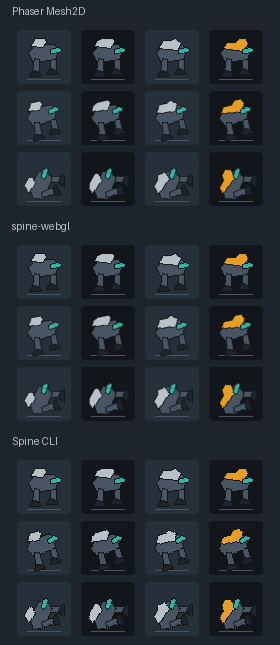
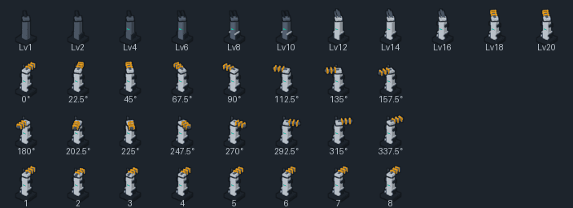

# R6 G2 제작 공정 시범

기준은 [R6 PRD](../PRD-r6.md) §3.3·§3.4·§4.4와 [R04 시안](../round3/concepts/R04/concept.md)이다. 레일 포탑 11형태와 기계 보행체 1계통을 기본 도형으로 만들었다. 부품 조립, 형식 변환, 에셋 크기와 런타임 부하를 확인하는 표본이다.

## 재생 방식

| 방식 | Phaser 4.2.1에서의 연결 | 운용 비용 |
| --- | --- | --- |
| 공식 `@esotericsoftware/spine-phaser-v4@4.3.13` | 기본 `phaser` 백엔드가 Spine 부착물을 Phaser Mesh2D로 그린다. 같은 아틀라스를 공유하고 개체별로 스킨과 동작을 고를 수 있다. | 맵 위 깊이 정렬·카메라·장면 수명주기를 Phaser에서 관리한다. 같은 major.minor의 Spine export가 필요하다. |
| `spine-webgl@4.3.13` 직접 연결 | 비교 페이지에서는 Phaser가 배경을 그리고 투명 WebGL 캔버스 하나가 위에서 보행체를 그린다. | 별도 컨텍스트·캔버스 자원을 쓰며 전장 요소 사이에 적을 끼워 그리려면 합성 또는 렌더러 통합이 필요하다. 성능 수치는 이 별도 캔버스 방식에 해당한다. |
| Spine CLI 프레임 시트 + Phaser 스프라이트 | 걷기·피격·쓰러짐을 12fps로 미리 내보내 Phaser 기본 애니메이션으로 재생한다. | Spine 브라우저 의존성이 없다. 스킨·동작·방향마다 프레임을 저장하며 개체별 혼합 동작은 별도 프레임이 필요하다. |

Mesh2D 백엔드는 공식 플러그인 4.3.11부터 Phaser 4.2.1 이상을 요구한다. 4.3.13의 npm peer 범위는 `^4.2.1`이다. WebGL을 사용한다. 제품에 런타임을 통합할 때 Spine 라이선스 조건을 적용한다. [공식 Mesh2D 지원 안내](https://eu.esotericsoftware.com/blog/phaser-mesh2d-in-spine-phaser-v4), [공식 Phaser 연동 문서](https://esotericsoftware.com/spine-phaser), [Spine Runtime 라이선스](https://esotericsoftware.com/spine-runtimes-license).

**G3 권고는 공식 플러그인 4.3.13의 Mesh2D 백엔드다.** 계통 하나에 스킨 4종이 파츠 텍스처를 공유하고, 지도·타워·적·효과 사이 깊이 정렬을 한 Phaser 장면에서 처리할 수 있다. 웨이브에 쓸 종족만 미리 적재하고 활성 개체 수에 맞춰 메모리를 관리한다. 프레임 시트는 저사양 기기에서 지속적인 CPU 병목이 확인될 경우의 대안이다. 종족 여럿을 올렸을 때 시트 메모리부터 확인한다.

### Chromium 측정

Apple M6, Playwright Chromium 156.0.8078.4, ANGLE SwiftShader에서 768×624 화면에 T1~T4를 30개씩 표시했다. 각 6초 동안 위상이 다른 걷기 동작 120개를 재생했고 1.5초 준비 구간을 제외했다. 두 FPS 열은 Chromium CPU 1배·4배다. 프레임 간격 p95와 CPU p95는 모두 4배에서 얻었다. 렌더 단계 CPU p95는 Phaser의 `prestep`부터 `postrender`까지 걸린 시간이며 직접 WebGL 경로의 그리기도 포함한다. [측정 원시값](G2-benchmark.json)

| 방식 | FPS 1배 | FPS 4배 | 4배 프레임 p95 | 4배 CPU p95 | 4배 20ms 초과 |
| --- | ---: | ---: | ---: | ---: | ---: |
| 공식 Mesh2D | 59.50 | 58.34 | 16.8ms | 6.0ms | 7 / 351 |
| 직접 WebGL | 59.84 | 59.84 | 16.8ms | 4.9ms | 1 / 360 |
| 프레임 시트 | 60.00 | 59.50 | 16.8ms | 4.3ms | 2 / 358 |

| 방식 | JS 번들 전체 / 시트 대비 증가량 (gzip, B) | 에셋 전송 (B) | 텍스처 RGBA8 (B) | GC 후 JS 힙 (B) |
| --- | ---: | ---: | ---: | ---: |
| 공식 Mesh2D | 448,622 / +68,958 | 4,324 | 12,144 | 9,373,884 |
| 직접 WebGL | 436,319 / +56,655 | 4,324 | 12,144 | 6,926,948 |
| 프레임 시트 | 379,664 / 0 | 7,703 | 1,204,224 | 6,502,056 |

번들은 동일한 Phaser와 시험 장면을 포함하는 esbuild 미니파이 결과를 gzip 9로 압축했다. 텍스처 메모리는 각각 66×46·672×448에 4바이트를 곱했다. 텍스처 업로드 복사본, 드라이버 할당과 프레임 버퍼는 별도다. 직접 WebGL은 추가 캔버스의 RGBA 컬러 버퍼 하나만 계산해도 약 1.83MiB가 든다. 힙은 120개체를 만든 뒤 CDP로 GC를 요청해 측정한 JS 사용량이다. 4배 평균 60fps 목표는 미달했고, 실기 크롬북 GPU·발열·수업 앱 동시 부하는 미측정이다.

Spine Professional 4.3.26에서 도형 파츠 8장으로 뼈 6개·슬롯 7개의 공유 리그를 만들고 `.spine`에서 편집용 JSON과 런타임 JSON·아틀라스를 다시 내보냈다. 프레임 시트는 발 피벗 `[28,46]`를 유지한 56px 셀을 쓴다. 스킨마다 걷기 12장, 피격 4장, 쓰러짐 7장으로 총 92장이다. 화면 캡처는 재생 방식마다 위에서부터 걷기·피격·쓰러짐, 왼쪽에서 오른쪽으로 T1~T4다.



## 타워와 포두 회전

[레일 포탑 레시피](../../../../tools/r6/schema/tower-recipe.example.json)에 Lv1·2·4·6·8·10·12·14·16·18·20과 부품 슬롯, 소재·무기 단계, 반동·연사·관통 값을 적었다. Blender는 고정 직교 카메라와 좌상단 방향광 기준의 3단 명암으로 면을 그린다. WebP 패킹에서 AA의 중간색을 R04 명도 단계에 맞추고 투명 알파와 바깥 1px 선을 유지한다.

포두는 동일 카메라로 **16방향**을 굽는다. 고정 몸체의 지면 피벗은 64px 셀의 `[32,50]`, 포두 회전축은 `[32,23]`이다. 게임 월드에서 +Y를 기준으로 한 조준 각도를 22.5° 간격으로 반올림하면 최대 오차는 11.25°다. 2D 탑뷰 회전은 포두 이미지 한 장만 쓰지만 기울어진 카메라에서는 포신의 길이와 보이는 면이 어긋난다. 16방향은 각도별 단축과 명암을 유지한다. 시범 공격은 Lv20의 한 방향에서 20fps·8프레임을 굽는다. 제품에서는 방향별 반동을 투영한 좌표와 총구 위치를 데이터화한 뒤, 움직이는 부품은 2D 변위로 재생하고 형태가 크게 바뀌는 동작에만 방향별 시퀀스를 굽는 방식을 검증한다.

몸체와 포두 WebP는 별개다. 두 피벗 사이 오프셋을 써서 배치하며 포두를 조준할 때에는 시트의 이미지만 교체한다. 포두가 높은 고정 장식을 가려야 하는지 타워별로 보고, 앞에 나와야 할 몸체 부품이 있으면 앞면 레이어를 추가한다.

Blender 5.2.3의 스크립트 내부 시간은 **0.50초**였다. 기동과 자원 대기 시간은 이 값에서 제외했다. 13개 WebP는 합계 **43,510B**, 그중 11개 포두 방향 시트는 **40,538B**다. Lv20 포두의 16방향 시트 한 장을 RGBA8로 풀면 256KiB다. 실제 타워에 적용할 때는 포두와 소재가 같은 단계의 시트를 재사용하고, 피벗 기준을 공유하는 촘촘한 아틀라스를 검증한다. 11형태의 정지 이미지가 서로 달랐고, 공격 8프레임 중 시작과 끝이 같은 자세로 돌아왔다. 13개 시트의 팔레트·프레임 규격·SHA-256 검사를 통과했다.

비교판 첫 줄은 Lv1~20, 가운데 두 줄은 Lv20 포두 16방향, 마지막 줄은 반동 8프레임이다. 어두운 바탕에서 초반 포탑의 카본 외곽선 대비가 낮아 실제 맵에서 축소 판독을 확인해야 한다.



## 스키마와 자동 검수

- [타워 레시피 스키마](../../../../tools/r6/schema/tower-recipe.schema.json)는 레벨과 단계 순서, 소재·무기 대응, 슬롯 ID, 공격 형식을 확인한다. 연사량·대상 수·관통은 밸런스 연동을 위한 입력이다. 현재 제품 수치 곡선 적용은 G3 범위다.
- [몬스터 개체 스키마](../../../../tools/r6/schema/monster-entity.schema.json)는 종족·계통·단계·리그·스킨·동작 목록을 확인한다. 일반 몬스터는 단계별 스킨과 공통 동작 3개, 보스는 전용 리그 ID와 기술 동작 1개를 쓴다. 보스 리그의 고유성은 개체를 모은 카탈로그에서 확인할 항목이다.
- 실루엣은 투명 알파를 피벗 기준으로 맞추고 48px에 축소한 뒤 알파 128 이상을 이진화한다. 다른 타워 계열 쌍에 IoU 0.55 미만을 요구한다. 같은 계열의 진화형은 별개의 그림으로 생성됐는지 확인한다.
- 팔레트는 R04 6색에 RGB 비율 0.74, 0.88, 1.00, 1.12를 적용한다. 알파 250 이상인 화소에서 허용 색마다 채널 차이 3 이내를 요구한다. 크기·정수 피벗·프레임 수·빈 칸과 매니페스트의 WebP 실형식·경로·ID·SHA-256을 함께 검사한다.
- 장면 비교는 같은 크기의 캡처를 R04 카본 위에 합성해 변경 화소 수와 RGB 채널 최대 차이를 보고한다. 실제 전장을 다루는 장면 기준 캡처는 G3에서 만든다.

## 재현

저장소 Node 의존성이 설치된 상태에서 실행한다. Python은 공용 Spine 스킬 환경의 Pillow를 사용한다. 브라우저는 저장소 Playwright 버전에 맞는 Chromium을 사용한다. 작업 폴더는 임시 경로이며 계산 결과와 생성 PNG는 이 폴더에 쓴다.

```sh
r6_spike="$(mktemp -d /tmp/tower-r6-g2.XXXXXXXX)"
r6_python="$HOME/.agents/skills/spine-authoring/runtime/.venv/bin/python"
r6_guard="$HOME/.local/bin/resource-guard"

npm install --prefix "$r6_spike/runtime" --ignore-scripts --no-audit --no-fund --save-exact \
  phaser@4.2.1 @esotericsoftware/spine-phaser-v4@4.3.13 @esotericsoftware/spine-webgl@4.3.13
"$r6_guard" status --profile avatar
"$r6_guard" run --profile avatar --wait-seconds 900 -- \
  "$r6_python" -B tools/r6/spine/pilot.py "$r6_spike/spine"
"$r6_guard" run --profile avatar --wait-seconds 900 -- \
  spine-cli -i "$r6_spike/spine/walker.spine" -o "$r6_spike/spine/frames-wide" \
  -e tools/r6/spine/bake.export.json
"$r6_python" -B tools/r6/spine/pack.py "$r6_spike/spine"
"$r6_guard" run --profile avatar --wait-seconds 900 -- \
  /Applications/Blender.app/Contents/MacOS/Blender -b --python-exit-code 1 \
  -P tools/r6/blender/render.py -- tools/r6/schema/tower-recipe.example.json "$r6_spike/tower"
"$r6_python" -B tools/r6/blender/pack.py "$r6_spike/tower"
"$r6_python" -B -m unittest discover -s tools/r6/qa -v
"$r6_guard" run --profile test --wait-seconds 900 -- node tools/r6/spine/run.mjs "$r6_spike"
```

브라우저 측정은 `benchmark.json`과 9개 장면 캡처를 남긴다. 같은 입력을 직접 보고 싶으면 마지막 명령에 `--serve`를 붙이고 표시되는 로컬 주소를 연다. QA 도구는 개별 실행도 지원한다.

```sh
"$r6_python" -B tools/r6/qa/check.py manifest "$r6_spike/tower/manifest.json"
"$r6_python" -B tools/r6/qa/check.py palette "$r6_spike/tower/rail-bodies.webp"
"$r6_python" -B tools/r6/qa/check.py silhouette /경로/실루엣-목록.json
"$r6_python" -B tools/r6/qa/check.py sprite /경로/아틀라스.webp /경로/스프라이트-규격.json
"$r6_python" -B tools/r6/qa/check.py scene /경로/기준.webp /경로/비교.webp --max-delta 0
```

실루엣 목록은 `[{"id":"rail-1","family":"rail","file":"rail.webp","pivot":[32,50]}, …]` 형식이다. 스프라이트 규격은 매니페스트 항목의 `sprite` 객체를 쓴다. 시범 WebP는 작은 팔레트의 색과 투명 알파를 유지하도록 무손실로 저장한다. PNG 내보내기 설정은 고정 크롭과 4개 스킨을 쓰도록 공식 예제에 맞췄다. [공식 CLI 문서](https://esotericsoftware.com/spine-command-line-interface), [공식 PNG 내보내기 예제](https://github.com/EsotericSoftware/spine-runtimes/blob/175a1e05073a406f305bde2621c065b8c2256c42/examples/export/png-0.5-frame-by-frame.json).

## 검증 결과

자동 검수 단위 시험 5개, JSON Schema 2020-12 예시 2개, 변경 경로의 ESLint, 세 방식의 브라우저 재생을 통과했다. 저장소 `verify`는 앱·시험·서버 타입 검사까지 통과했다. 기존 R6 시안 스크립트와 `spec/wave-mixer.mjs`의 ESLint `no-undef` 53건에서 중단되어 이후 전체 단위 시험과 콘텐츠 검사는 미실행이다.

## 양산 시간과 남은 검증

- 타워는 파츠 키트와 공격 방향을 확정한 뒤 형태당 레시피 조정·64px 판독·조준 검수 **10~25분**을 작업량 추정으로 잡는다. 공수는 재사용 부품으로 조립하는 시간을 기준으로 한다. 새 키트 모델링과 무기 단계별 동작 저작은 추가다.
- 몬스터는 파츠 시트와 리그가 준비된 상태에서 스킨 하나당 연결·동작·겹침 검수 **20~45분**, 새 계통의 관절·걷기 리깅은 **2~4시간**으로 가정한다. 첫 두 계통에서 작업 시간을 기록한 뒤 보정한다. 콘셉트·파츠 분리·보스 특수 동작에는 별도 공수가 든다.
- G1의 6계열 실루엣 점수와 실제 아트 시트 판독은 해당 입력으로 실행해야 한다. G3에서는 종족 단위 지연 적재와 미사용 텍스처 해제, 지도·투사체·UI를 포함한 장면의 저전력 크롬북 실기 성능, 고정 장식과 회전 포두의 겹침을 확인한다.
