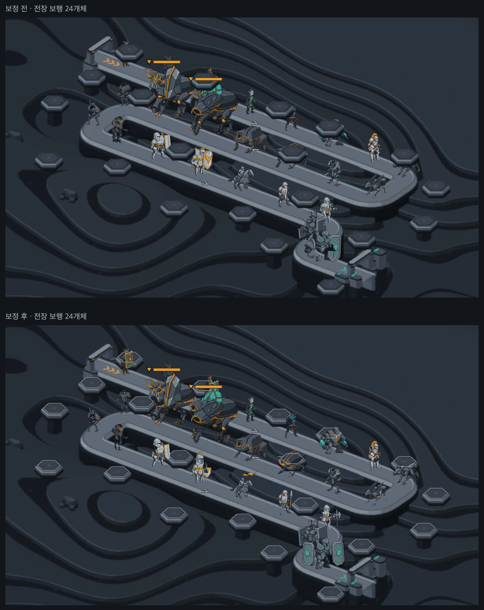

# R6 G4 몬스터 리그 보정

## 결과

- 100개체를 33자세씩 검사했다. 전체 파츠 교차 면적 기준 미달은 61→14개체, 회전축 주변 기준 미달은 61→23개체였다.
- 비평 1항의 14개체 중 12개체의 관절 부품 좌표를 바꿨다. 14개체 중 접합 면적 미달은 12→0개체였다.
- 비평 2항의 머리 7개체에 표시 순서나 위치를 적용했다. 7항의 장비 7개체는 크기·부착 위치를 조정하거나 반대쪽 방패를 복원했다.
- 비평 13항의 8개체는 전처리된 게시 아틀라스에서 기존 흰 잔여 기준을 확인했다. 기준 이상 잔여는 0→0개체였다.
- 배치·부착 보정 56개체를 반영했다. 조립 IoU 0.701 이상, 전용 스킨 100/100개체를 확인했다.

## 종족별 게시 결과

| 종족 | 접합 미달 전→후 | 회전축 미달 전→후 | WebP 크기 | 치수 | 커밋 |
| --- | ---: | ---: | ---: | --- | --- |
| elf | 15→2 | 15→3 | 723,048바이트 | 1730×269 | `0bd52073` |
| human | 13→2 | 13→3 | 398,244바이트 | 1953×332 | `2b3dec34` |
| machine | 11→3 | 11→4 | 370,686바이트 | 2014×348 | `10230fcf` |
| insect | 16→4 | 16→8 | 333,624바이트 | 1524×396 | `e5546f7a` |
| stone | 6→3 | 6→5 | 390,506바이트 | 2016×398 | `561ef6f0` |

## 전장 보행

같은 검수 편성 24개체를 위에서 보정 전, 아래에서 보정 후로 비교했다. 공유 브랜치의 전장 표시 변경도 함께 보일 수 있다. 표의 접합과 가림 수치는 아틀라스 픽셀로 직접 계산했다.

## 개체별 배치와 동작

최소 접합은 뼈 계층에서 연결된 두 파츠를 33자세로 움직였을 때 가장 작았던 알파 교차 면적이다. 머리와 장비는 상위 슬롯으로 가려진 화소를 제외하고 33자세 중 노출 비율이 가장 낮았던 자세를 기록했다.

| 개체 | 변경 | 조립 IoU | 최소 접합 전→후 (px²) |
| --- | --- | ---: | ---: |
| `elf-armored-t1` | arm-hand-near 배치 | 0.925 | 0→7 |
| `elf-armored-t2` | arm-hand-far, arm-hand-near, gear 배치 · 장비 본 `arm-hand-far` | 0.857 | 0→12 |
| `elf-armored-t3` | arm-hand-far, arm-hand-near 배치 | 0.947 | 0→15 |
| `elf-armored-t4` | arm-hand-far, gear 배치 · 장비 본 `arm-hand-far` | 0.830 | 0→14 |
| `elf-boss-t1` | arm-far, arm-hand-near, leg-foot-near 배치 | 0.818 | 0→10 |
| `elf-boss-t2` | leg-fore-foot-far, leg-fore-foot-near 배치 | 0.768 | 0→14 |
| `elf-boss-t3` | head, leg-foot-near 배치 | 0.703 | 0→0 |
| `elf-boss-t4` | leg-hind-foot-near, leg-hind-near 배치 | 0.795 | 0→10 |
| `elf-infantry-t1` | leg-foot-near 배치 | 0.872 | 0→12 |
| `elf-infantry-t2` | arm-hand-far 배치 | 0.823 | 5→12 |
| `elf-infantry-t4` | arm-hand-far 배치 | 0.774 | 0→14 |
| `elf-runner-t2` | head, leg-hind-foot-far 배치 | 0.829 | 0→7 |
| `elf-runner-t4` | head, leg-hind-foot-far 배치 | 0.826 | 0→14 |
| `elf-special-t1` | wing-near 배치 | 0.758 | 4→14 |
| `human-armored-t1` | arm-hand-far 배치 | 0.922 | 0→12 |
| `human-armored-t2` | arm-far, arm-hand-far, head 배치 · 머리 표시 순서 | 0.784 | 0→14 |
| `human-armored-t3` | arm-hand-far, arm-hand-near, head 배치 · 머리 표시 순서 | 0.854 | 0→12 |
| `human-armored-t4` | arm-hand-far 배치 | 0.930 | 0→12 |
| `human-boss-t2` | leg-fore-foot-near 배치 | 0.786 | 4→12 |
| `human-boss-t3` | arm-far, arm-hand-far, arm-hand-near, leg-foot-far, leg-near 배치 | 0.750 | 0→11 |
| `human-infantry-t1` | arm-hand-far, arm-hand-near, arm-near 배치 | 0.778 | 0→8 |
| `human-infantry-t2` | gear 배치 · 장비 본 `arm-hand-far` | 0.753 | 21→21 |
| `human-infantry-t3` | arm-far, arm-hand-near, gear 배치 · 장비 본 `arm-hand-far` | 0.735 | 0→13 |
| `human-infantry-t4` | arm-hand-far, arm-hand-near 배치 | 0.772 | 0→13 |
| `human-runner-t3` | gear, leg-fore-foot-near, leg-hind-foot-near 배치 | 0.808 | 0→11 |
| `human-runner-t4` | leg-fore-foot-far, leg-fore-foot-near 배치 | 0.773 | 0→14 |
| `insect-armored-t1` | leg-fore-far, leg-fore-foot-far, leg-hind-foot-near, leg-hind-near 배치 | 0.885 | 0→0 |
| `insect-armored-t2` | leg-fore-far, leg-fore-foot-near, leg-hind-foot-near 배치 | 0.929 | 0→0 |
| `insect-armored-t3` | body, leg-fore-far, leg-fore-foot-far, leg-fore-foot-near, leg-hind-far, leg-hind-foot-far, leg-hind-foot-near, leg-hind-near 배치 | 0.780 | 0→13 |
| `insect-armored-t4` | leg-fore-far, leg-hind-far, leg-hind-foot-far 배치 | 0.914 | 0→12 |
| `insect-boss-t3` | head, leg-fore-foot-near 배치 · 머리 표시 순서 | 0.809 | 0→16 |
| `insect-boss-t4` | head 배치 · 머리 표시 순서 | 0.822 | 0→10 |
| `insect-infantry-t1` | arm-hand-far, arm-hand-near, leg-far, leg-foot-far, leg-near 배치 | 0.703 | 0→0 |
| `insect-infantry-t2` | arm-hand-far, arm-hand-near, arm-near, leg-foot-far, leg-foot-near 배치 · 머리 표시 순서 | 0.759 | 0→11 |
| `insect-infantry-t3` | arm-hand-far, arm-hand-near, leg-foot-far, leg-foot-near, leg-near 배치 · 머리 표시 순서 | 0.750 | 0→11 |
| `insect-infantry-t4` | arm-hand-near, leg-foot-far, leg-near 배치 · 머리 표시 순서 | 0.730 | 0→11 |
| `insect-runner-t1` | head, leg-fore-far, leg-fore-foot-far, leg-fore-foot-near, leg-hind-foot-far, leg-hind-foot-near 배치 | 0.845 | 0→12 |
| `insect-runner-t2` | head, leg-fore-far, leg-fore-foot-far, leg-fore-foot-near, leg-fore-near, leg-hind-foot-far 배치 | 0.739 | 0→7 |
| `insect-runner-t3` | armor, head, leg-hind-foot-near 배치 · 머리 표시 순서 | 0.714 | 0→13 |
| `insect-runner-t4` | head, leg-fore-foot-near, leg-hind-foot-far 배치 | 0.768 | 0→7 |
| `insect-special-t4` | swarm-leg-1-near 배치 | 0.804 | 0→14 |
| `machine-armored-t1` | leg-hind-near 배치 | 0.892 | 0→13 |
| `machine-armored-t3` | leg-fore-foot-far, leg-hind-near 배치 | 0.889 | 0→12 |
| `machine-boss-t1` | leg-hind-foot-far, leg-hind-foot-near, leg-hind-near 배치 | 0.831 | 0→7 |
| `machine-boss-t2` | leg-hind-foot-far, leg-hind-foot-near, leg-hind-near 배치 | 0.817 | 0→9 |
| `machine-boss-t3` | head, leg-fore-foot-near, leg-hind-foot-near 배치 · 머리 표시 순서 | 0.789 | 0→11 |
| `machine-boss-t4` | leg-fore-foot-near, leg-hind-near 배치 | 0.804 | 0→14 |
| `machine-infantry-t2` | leg-near 배치 | 0.803 | 0→21 |
| `machine-infantry-t3` | 머리 표시 순서 | 0.917 | 28→28 |
| `machine-runner-t1` | leg-fore-foot-near, leg-fore-near, leg-hind-foot-far, leg-hind-foot-near, leg-hind-near 배치 | 0.728 | 0→0 |
| `machine-runner-t3` | leg-hind-foot-far 배치 | 0.837 | 0→14 |
| `stone-armored-t3` | arm-hand-far, arm-hand-near, arm-near, armor 배치 · 장비 본 `body` | 0.879 | 0→54 |
| `stone-armored-t4` | gear, leg-far 배치 · 장비 본 `arm-hand-far` · 왼쪽 방패 복원 | 0.870 | 8→18 |
| `stone-boss-t2` | arm-hand-near 배치 | 0.798 | 0→18 |
| `stone-boss-t4` | arm-hand-far, arm-hand-near 배치 | 0.719 | 0→0 |
| `stone-infantry-t2` | arm-far, arm-hand-near, arm-near 배치 | 0.772 | 0→215 |

### 머리와 장비

| 개체 | 항목 | 노출 전→후 |
| --- | --- | ---: |
| `human-armored-t2` | 머리 비율 | 98.5%→100.0% |
| `human-armored-t3` | 머리 비율 | 74.9%→100.0% |
| `insect-boss-t3` | 머리 비율 | 64.4%→100.0% |
| `insect-infantry-t2` | 머리 비율 | 5.2%→100.0% |
| `insect-infantry-t3` | 머리 비율 | 58.9%→100.0% |
| `insect-infantry-t4` | 머리 비율 | 35.7%→100.0% |
| `machine-infantry-t3` | 머리 비율 | 59.9%→100.0% |
| `elf-armored-t2` | 장비 화소 | 763→4,583 |
| `elf-armored-t4` | 장비 화소 | 662→5,157 |
| `human-infantry-t2` | 장비 화소 | 302→952 |
| `human-infantry-t3` | 장비 화소 | 373→1,364 |
| `human-runner-t3` | 장비 화소 | 67→2,139 |
| `stone-armored-t3` | 장비 화소 | 9,301→9,300 |
| `stone-armored-t4` | 장비 화소 | 11,100→9,203, 왼쪽 방패 8,696px |

## 추가 보정 대상 (100/100 통과 완료)

- 재작화 9개체(`stone-boss-t1`, `stone-boss-t3`, `stone-special-t4`, `machine-armored-t2`, `insect-boss-t1`, `elf-special-t3`, `elf-special-t4`, `human-boss-t1`, `human-boss-t4`)와 기존 미달 7개체를 모두 보정해 **33자세 접합 미달 0/100개체**(`rig_audit.py` 기준, 회전축 여유 미달 16개체: elf 3·human 2·machine 1·insect 6·stone 4)를 달성했다.
- 조립 IoU ≥ 0.70과 전용 스킨 연결은 100/100개체 통과다. 바닥 대비 보정 후 최종 종족별 아틀라스 크기는 `elf` 2017×237 (739,406바이트), `human` 2001×332 (416,356바이트), `machine` 2017×348 (410,900바이트), `insect` 1857×332 (373,456바이트), `stone` 1905×461 (451,874바이트)다.

| 개체 | 보정 부위 | 조립 IoU | 최소 접합 전→후 (px²) |
| --- | --- | ---: | ---: |
| `elf-boss-t3` | `arm-far`, `arm-hand-far`, `arm-hand-near`, 피벗 정렬 | 0.712 | 0→22 |
| `insect-armored-t1` | `leg-hind-foot-far`, `leg-hind-far` 배치 | 0.885 | 0→14 |
| `insect-armored-t2` | `leg-hind-foot-far`, `leg-hind-far` 배치 | 0.914 | 0→14 |
| `insect-infantry-t1` | `leg-foot-near`, `leg-near` 배치 | 0.767 | 0→8 |
| `machine-armored-t4` | `leg-fore-foot-far`, `leg-fore-far` 배치 | 0.879 | 0→17 |
| `machine-runner-t1` | `leg-fore-foot-far`, `leg-fore-far` 배치 | 0.708 | 0→12 |
| `stone-boss-t4` | `leg-far`, `arm-far` 배치·피벗 정렬 | 0.706 | 0→13 |

## 2차 재작화 6개체 재리깅

- 초상 2회차에서 원화가 바뀐 6개체(`9aa7992f`·`c7f7cdba`·`91375158`·`5c39a69d`)의 캐시를 무효화하고 흰 배경 전처리(`whiteKey`)를 적용해 재리깅했다. 100개체 전체 `rig_audit.py` 접합 미달 **0/100**, 흰 구멍 **0**, 내부 색 ΔE76 최대 **2.680**을 확인했다.
- 최종 아틀라스 크기: `elf` 1905×253 (733,326바이트), `human` 2001×332 (410,058바이트), `machine` 1762×396 (368,052바이트), `insect` 1825×332 (333,656바이트), `stone` 1841×461 (409,524바이트).
- 검수 장면: [6개체 보행](g4-final/rig6-walk.webp) · [W15 비교](g4-final/w15-battle.webp) · [W20 비교](g4-final/w20-battle.webp).

| 개체 | 변경 | 조립 IoU | 최소 접합 (px²) | 지형 / 길 대비 |
| --- | --- | ---: | ---: | ---: |
| `human-boss-t1` | 중립 앰버 독수리 문장 교체 재연결 | 0.738 | 10 | 3.180 / 1.830 |
| `insect-special-t1` | 전면 재작화 피팅·공용 피벗 유지 | 0.862 | 396 | 1.993 / 1.680 |
| `insect-infantry-t4` | 머리 명부 보강 재연결 | 0.733 | 11 | 1.718 / 1.567 |
| `elf-armored-t3` | 방패(`gear`→`arm-hand-far`) 추가 피팅 | 0.952 | 15 | 1.997 / 1.408 |
| `elf-special-t1` | 흰 줄 제거·명부 보강 재피팅 | 0.897 | 59 | 2.061 / 1.483 |
| `stone-runner-t1` | 용암 균열·시인성 보강 재연결 | 1.000 | 62 | 2.241 / 1.527 |

## 측정 기준

- 걷기 13자세, 걷기에 피격을 합성한 10자세, 쓰러짐 10자세를 Spine 런타임에서 읽었다.
- 소스 해상도 3px/단위와 알파 128을 사용했다. 최소 접합 면적 기준은 6px²이고, 회전축 중심 24px에도 같은 기준을 적용해 여유를 별도로 표시했다.
- 흰 잔여는 아틀라스 안의 불투명 RGB 240 이상이 24화소 이상 모인 영역을 검사했다.
- 조립 IoU와 768KiB 전송 예산은 종족 재묶음에서 확인했다. 각 종족 `REDO.md`에 배치와 아틀라스 해시를 기록했다.
- 기준 리그는 `115a392c`다. 각 종족의 수치는 아틀라스 게시 직후 측정했다.

## 실행한 검사

- Spine 도구 단위 시험 17건과 종족별 편집기 왕복·런타임 검사 5건을 통과했다.
- Chromium 전장 검수 편성 24개체에서 Mesh2D 보행, 피격, 쓰러짐과 보스 기술 트랙을 확인했다.
- `npm run verify`로 타입 검사, 린트, 단위 시험, 계획·문항·위키 검사를 통과했다.

[R6 PRD](../../PRD-r6.md) · [G4 몬스터 비평](../../review/G4-monsters-critique.md)
