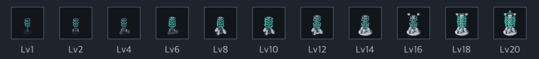

# R6 냉각 중계탑 Blender 렌더

틸 공명 고리는 Lv1에 세 개부터 Lv18에 다섯 개까지 늘어난다. 링에 곡면 클립을 붙이고, 하위 방열판과 냉매 탱크를 상위 형태에 남겼다. Lv20은 기단에 작은 금테 노즐을 두고 최상단 고리 위에 틸 결정을 띄웠다. [바이블 원화](../../../bible/sheets/tower-cryo.webp) · [Blender 부품과 Lv20 조립](../../../../../../asset-source/r6/towers/cryo/cryo-kit.blend) · [레시피](../../../../../../tools/r6/recipes/cryo.json)

## 스프라이트

| 시트 | 배열 |
| --- | --- |
| [몸체](cryo-bodies.webp) · [2배](cryo-bodies-2x.webp) | 11프레임, 레벨 순 6열 |
| [포두 Lv1~10](cryo-heads.webp) · [2배](cryo-heads-2x.webp) | 96프레임, 6레벨 × 16방향, 10열 |
| [포두 Lv12~20](cryo-heads-armored.webp) · [2배](cryo-heads-armored-2x.webp) | 80프레임, 5레벨 × 16방향, 10열 |
| [공격](cryo-attack.webp) · [2배](cryo-attack-2x.webp) | 무기 단계당 8프레임, 9fps |
| [완성 형태](cryo-forms.webp) · [2배](cryo-forms-2x.webp) | 11프레임, 레벨 순 6열 |

홀수·짝수 고리가 서로 반대로 돌면서 가운데로 모였다가 바깥으로 벌어진다. 마지막 프레임에서 대기 자세로 돌아온다.

[다시 렌더하기](../rail/review.md) 명령에서 `tower=cryo`를 사용한다.

## 실루엣 검수

[6종 48px 비교](../bastion/six-towers-iou.md) · [레벨별 색·면적·공격 검수](../bastion/six-towers-evidence.md)
