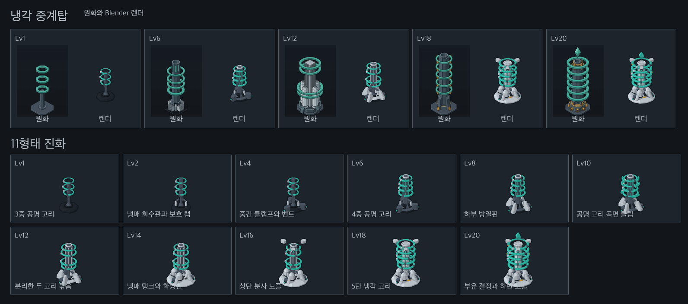

# R6 냉각 중계탑 Blender 렌더

팔각 기단 위 중앙 기둥과 틸 공명 고리가 층층이 선다. Lv1은 3중 고리, Lv6은 4중 고리다. Lv12는 가는 방열 핀과 위아래 두 쌍의 고리를 써서 중앙 여백을 확보했다. Lv18은 5단 고리, Lv20은 부유 결정과 분사대가 특징이다. 코어 상단에는 은회 테와 카본 안쪽을 넣고 부품 경계에는 무광 명암을 적용했다. [바이블 원화](../../../bible/sheets/tower-cryo.webp) · [Blender 부품과 Lv20 조립](../../../../../../asset-source/r6/towers/cryo/cryo-kit.blend) · [레시피](../../../../../../tools/r6/recipes/cryo.json)




## 스프라이트

| 시트 | 배열 |
| --- | --- |
| [몸체](cryo-bodies.webp) · [2배](cryo-bodies-2x.webp) | 11프레임, 레벨 순 6열 |
| [포두 Lv1~10](cryo-heads.webp) · [2배](cryo-heads-2x.webp) | 96프레임, 6레벨 × 16방향, 10열 |
| [포두 Lv12~20](cryo-heads-armored.webp) · [2배](cryo-heads-armored-2x.webp) | 80프레임, 5레벨 × 16방향, 10열 |
| [공격](cryo-attack.webp) · [2배](cryo-attack-2x.webp) | 무기 단계당 8프레임, 9fps |
| [완성 형태](cryo-forms.webp) · [2배](cryo-forms-2x.webp) | 11프레임, 레벨 순 6열 |

192px·384px 시트의 프레임·피벗 규칙은 레일 포탑과 같다. 냉각 비교판과 공격 견본은 8번 방향을 사용한다. 공격할 때 홀수·짝수 고리가 서로 반대 방향으로 돌면서 중심으로 모인다. 네 번째 프레임부터 바닥에 틸 동심원 두 겹과 얇은 은회 서리 파편이 퍼진다. 마지막 프레임에서 대기 자세로 돌아온다. [매니페스트](manifest.json)

[다시 렌더하기](../rail/review.md) 명령에서 `tower=cryo`를 사용한다.

## 실루엣 검수

192px WebP의 알파 채널을 48px로 축소하고, 알파 128 이상을 같은 지면 피벗에 정렬했다. 인접 단계는 IoU 0.92 미만이며, 새 단계마다 이전 윤곽 밖으로 나오는 부분이 있어야 한다. 타워 간 기준은 같은 레벨의 IoU 0.55 미만이다. 고정 카메라에서 각 타워의 비교 방향으로 렌더한 완성 형태를 썼다.

레일과 냉각의 인접 단계 20쌍과 같은 레벨 타워 비교 33쌍이 모두 통과했다. 두 타워의 WebP 스프라이트 시트 20개에서 팔레트 위반은 0개였다.

| 인접 레벨 | 레일 | 냉각 |
| --- | ---: | ---: |
| 1 → 2 | 0.8557 | 0.9048 |
| 2 → 4 | 0.9159 | 0.8750 |
| 4 → 6 | 0.7347 | 0.7053 |
| 6 → 8 | 0.8830 | 0.8842 |
| 8 → 10 | 0.8617 | 0.8155 |
| 10 → 12 | 0.6646 | 0.6279 |
| 12 → 14 | 0.8874 | 0.7586 |
| 14 → 16 | 0.8563 | 0.9096 |
| 16 → 18 | 0.6125 | 0.6492 |
| 18 → 20 | 0.8353 | 0.8006 |

| 레벨 | 곡사·레일 | 곡사·냉각 | 레일·냉각 |
| --- | ---: | ---: | ---: |
| 1 | 0.4242 | 0.3260 | 0.5255 |
| 2 | 0.4147 | 0.3249 | 0.4974 |
| 4 | 0.3995 | 0.3359 | 0.4760 |
| 6 | 0.4044 | 0.3542 | 0.5459 |
| 8 | 0.3863 | 0.3481 | 0.5123 |
| 10 | 0.3909 | 0.3758 | 0.4682 |
| 12 | 0.4592 | 0.4064 | 0.4725 |
| 14 | 0.4351 | 0.5053 | 0.5357 |
| 16 | 0.4574 | 0.4424 | 0.4591 |
| 18 | 0.4394 | 0.4662 | 0.5079 |
| 20 | 0.4067 | 0.5140 | 0.5178 |

저장소 루트에서 아틀라스의 같은 레벨을 비교한다.

```sh
"$HOME/.agents/skills/spine-authoring/runtime/.venv/bin/python" -B tools/r6/blender/tower_pack.py \
  docs/renewal/r6/tech/towers/mortar docs/renewal/r6/tech/towers/rail docs/renewal/r6/tech/towers/cryo
```

Blender 5.2.3 LTS에서 냉각 중계탑 11형태 렌더에 0.944초, 다섯 시트의 Blender 장면 조립과 PNG 저장에 총 13.701초가 걸렸다. 시작·자원 대기·WebP 패킹 시간은 별도로 든다.

48px에서는 Lv20 결정과 최상단 고리 사이의 여백이 작다. 전장 배경의 대비, 몸체와 포두 합성에서 앞뒤 가림, 실기기 성능은 미실행이다.
