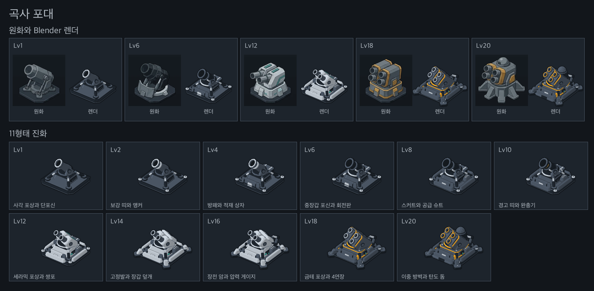
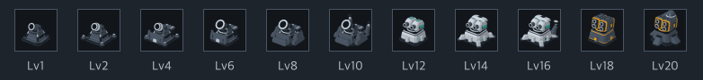

# R6 곡사 포대 Blender 렌더

기단 폭을 4.50에서 3.74 Blender 단위로 줄이고 포신을 받치는 구조를 높였다. Lv12는 세라믹 몸체와 쌍포 하우징, Lv18은 사각 장갑 몸체와 2×2 포열, Lv20은 네 방향 경사 스커트와 탄도 돔을 쓴다. Lv2의 모서리 앵커와 보강 띠, Lv4의 방패와 적재 상자, Lv8의 스커트와 공급 슈트, Lv10의 후방 완충기, Lv14의 고정발과 덮개, Lv16의 장전 암이 각 단계의 윤곽을 바꾼다. [바이블 원화](../../../bible/sheets/tower-mortar.webp) · [Blender 부품과 Lv20 조립](../../../../../../asset-source/r6/towers/mortar/mortar-kit.blend) · [레시피](../../../../../../tools/r6/recipes/mortar.json)

포구는 은회 테두리와 카본 안쪽으로 나눴다. Blender의 주변광 차폐로 장갑과 회전판이 맞닿은 면의 밝기를 낮추고, R04 색과 네 단계 무광 명암으로 마감했다. [Blender 매뉴얼](https://docs.blender.org/manual/en/latest/render/shader_nodes/input/ao.html)





## 시트와 피벗

| 시트 | 프레임 | 배열 | 피벗 192px / 384px |
| --- | ---: | --- | --- |
| [몸체](mortar-bodies.webp) · [2배](mortar-bodies-2x.webp) | 11 | 레벨 순 6열 | `[96,137]` / `[192,274]` |
| [포두 Lv1~10](mortar-heads.webp) · [2배](mortar-heads-2x.webp) | 96 | 6레벨 × 16방향 · 10열 | `[96,96]` / `[192,192]` |
| [포두 Lv12~20](mortar-heads-armored.webp) · [2배](mortar-heads-armored-2x.webp) | 80 | 5레벨 × 16방향 · 10열 | `[96,96]` / `[192,192]` |
| [발사](mortar-attack.webp) · [2배](mortar-attack-2x.webp) | 32 | 무기 단계별 1행 · 8프레임 · 20fps | 몸체와 같음 |
| [완성 형태](mortar-forms.webp) · [2배](mortar-forms-2x.webp) | 11 | 레벨 순 6열 | 몸체와 같음 |

포두 시트는 각 시트의 레벨 순서로 프레임을 묶고 레벨마다 +Y 방향에서 시작해 Z축 양의 방향으로 22.5°씩 회전한다. `headSheets`의 레벨 인덱스에 16을 곱한 뒤 방향 번호를 더하면 행 우선 프레임 번호가 된다. 포두 피벗을 몸체 셀의 `headAnchors2x` 좌표에 맞춘다. 192px 셀에서는 좌표를 절반으로 줄인다. Lv2와 Lv4의 강철 보강 띠, Lv10의 경고 띠, Lv14와 Lv16의 덮개, Lv20의 돔과 금테 포구가 회전 시트에 포함된다. [매니페스트](manifest.json)

발사 시트는 비교판과 같은 8번 방향을 Lv1·6·12·18에서 렌더했다. 포신을 대기 각도에서 62°까지 들어 올리고, 4번째 프레임(0.15초)에 포대 상부가 약 4px 내려간다. 발사 순간을 앰버 압력 고리로 표시하고 마지막 프레임에서 대기 자세로 돌아온다.

## 검수 결과

192px WebP 완성 형태를 48px로 줄였다. 알파 128 이상의 실루엣을 같은 지면 피벗에 놓고 기존 R6 QA의 IoU를 계산했다. 기준은 인접 IoU **0.92 미만**이며 새 형태에는 이전 윤곽 바깥으로 나온 화소가 있어야 한다. 10구간 모두 통과했다.

| 인접 레벨 | IoU |
| --- | ---: |
| 1 → 2 | 0.8734 |
| 2 → 4 | 0.8579 |
| 4 → 6 | 0.8512 |
| 6 → 8 | 0.8333 |
| 8 → 10 | 0.8768 |
| 10 → 12 | 0.6689 |
| 12 → 14 | 0.8281 |
| 14 → 16 | 0.9099 |
| 16 → 18 | 0.7576 |
| 18 → 20 | 0.8352 |

- WebP 시트 10개에서 R04 팔레트 위반 0. 해시·크기·프레임 수·피벗·빈 칸과 각 레벨의 포두 16방향을 검사했다. 2배 포두 시트의 최대 변은 3,840px이다.
- Mac mini의 Blender 5.2.3에서 384px 완성 형태 11개는 0.999초, 다섯 배치는 합계 13.494초였다. 장면 조립과 PNG 저장 시간이며 Blender 시작과 자원 대기는 제외했다.
- 원화보다 금테 색이 선명하다. 48px에서는 Lv10의 경고 띠와 Lv16의 압력 게이지가 작고, Lv14→16의 차이는 주로 높아진 장전 암에서 보인다. 게임 합성에서 포두와 몸체 부품의 앞뒤 가림, 실기기·전장 배경 가독성은 미실행이다.

## 다시 렌더하기

저장소 루트에서 실행한다. `--kit`을 주면 편집한 Blender 컬렉션을 읽는다. 이 옵션을 생략하면 파이썬으로 부품을 만들고 출력 폴더에 새 `.blend`를 저장한다. 새 PNG와 해당 배치의 `layout.json`은 같은 임시 폴더에 생긴다. `asset-source/r6/towers/mortar`에 이미 있는 PNG와 `layout.json`은 첫 렌더의 기록이다.

```sh
mortar_work="$(mktemp -d /tmp/tower-mortar.XXXXXXXX)"
mortar_python="$HOME/.agents/skills/spine-authoring/runtime/.venv/bin/python"
mortar_kit="asset-source/r6/towers/mortar/mortar-kit.blend"
mortar_reference="docs/renewal/r6/bible/sheets/tower-mortar.webp"

"$HOME/.local/bin/resource-guard" status --profile avatar
"$HOME/.local/bin/resource-guard" run --profile avatar --wait-seconds 900 -- \
  /Applications/Blender.app/Contents/MacOS/Blender -b -t 3 --python-exit-code 1 \
  --python tools/r6/blender/render.py -- \
  tools/r6/recipes/mortar.json "$mortar_work/png" --kit "$mortar_kit"
"$mortar_python" -B tools/r6/blender/pack.py "$mortar_work/png" \
  --out "$mortar_work/webp" --reference "$mortar_reference"
"$mortar_python" -B tools/r6/qa/check.py manifest "$mortar_work/webp/manifest.json"
```

비교판 글꼴은 macOS의 Apple SD Gothic Neo를 기본으로 사용한다. 다른 환경에서는 패킹 명령에 `--font`로 한글 글꼴을 지정한다.
