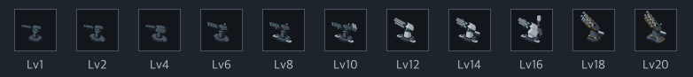

# R6 레일 포탑 Blender 렌더

팔각 기단과 기둥 하부를 넓혔다. Lv18부터 얇은 가속 고리와 틸 조준 슬릿이 달린 은회 장포신 두 줄을 쓴다. 옆 갑판, 세라믹 옆 장갑과 격자 추적 센서는 상위 형태에도 이어진다. [바이블 원화](../../../bible/sheets/tower-rail.webp) · [Blender 부품과 Lv20 조립](../../../../../../asset-source/r6/towers/rail/rail-kit.blend) · [레시피](../../../../../../tools/r6/recipes/rail.json)




## 스프라이트

| 시트 | 배열 |
| --- | --- |
| [몸체](rail-bodies.webp) · [2배](rail-bodies-2x.webp) | 11프레임, 레벨 순 6열 |
| [포두 Lv1~10](rail-heads.webp) · [2배](rail-heads-2x.webp) | 96프레임, 6레벨 × 16방향, 10열 |
| [포두 Lv12~20](rail-heads-armored.webp) · [2배](rail-heads-armored-2x.webp) | 80프레임, 5레벨 × 16방향, 10열 |
| [공격](rail-attack.webp) · [2배](rail-attack-2x.webp) | 무기 단계당 8프레임, 20fps |
| [완성 형태](rail-forms.webp) · [2배](rail-forms-2x.webp) | 11프레임, 레벨 순 6열 |

192px와 384px 셀을 제공한다. 포두는 +Y에서 시작해 Z축 양의 방향으로 22.5°씩 회전한다. 시트 내 레벨 인덱스 × 16 + 방향 번호가 프레임 번호다. 몸체 셀의 `headAnchors2x` 위치에 포두 피벗을 붙인다. 192px 셀에서는 좌표를 절반으로 줄여 반올림한다. 비교판과 공격 시트는 6번 방향을 사용한다. [매니페스트](manifest.json)

포구에서 짧은 십자 섬광이 두 프레임 보인다. 포신은 길이의 약 15~20% 후퇴했다가 돌아온다.

## 전장 시트

세 타워의 몸체와 포두는 192px·384px 셀로 내보낸다. 포두는 레벨별 시트에 16방향을 담는다. 무기 단계의 첫 레벨을 기준으로 각 방향의 공격 8프레임을 렌더한다. 같은 무기 단계에서 현재 레벨의 몸체에 공격 포두를 붙이고, 공격이 끝나면 현재 레벨의 대기 포두를 다시 표시한다. 공격 셀은 피벗을 유지한 채 공통 투명 여백을 잘라 전장 텍스처에 올린다. [전장 매니페스트 v2](../../../../../../public/assets/r6/manifest-v2.json)

판을 열 때 각 타워의 몸체 시트와 Lv1 포두 시트를 불러온다. 설치·강화하면 사용하는 포두와 무기 단계의 공격 시트를 추가한다. 이전 그림은 새 시트가 준비될 때까지 표시하고, 다른 타워도 쓰지 않으면 전장 텍스처에서 내린다. 형태가 바뀌면 포두가 0.6초 동안 제자리에 맞물리고, 무기 단계가 바뀌면 1.2초 동안 움직인다.

## 48px 실루엣

[6종 48px 비교](../bastion/six-towers-iou.md) · [레벨별 색·면적·공격 검수](../bastion/six-towers-evidence.md)

## 다시 렌더하기

저장소 루트에서 실행한다. 편집한 키트로 렌더하려면 `--kit`을 넘긴다. 이 옵션을 생략하면 파이썬으로 새 키트를 조립해 출력 폴더에 저장한다. `--forms-only`로 11형태만 미리 볼 수 있다.

```sh
tower=rail
tower_work="$(mktemp -d /tmp/tower-r6.XXXXXXXX)"
tower_python="$HOME/.agents/skills/spine-authoring/runtime/.venv/bin/python"

"$HOME/.local/bin/resource-guard" status --profile avatar
"$HOME/.local/bin/resource-guard" run --profile avatar --wait-seconds 900 -- \
  /Applications/Blender.app/Contents/MacOS/Blender -b -t 3 --python-exit-code 1 \
  --python tools/r6/blender/render.py -- \
  "tools/r6/recipes/$tower.json" "$tower_work/png" \
  --kit "asset-source/r6/towers/$tower/$tower-kit.blend"
"$tower_python" -B tools/r6/blender/pack.py "$tower_work/png" \
  --out "$tower_work/$tower" --reference "docs/renewal/r6/bible/sheets/tower-$tower.webp"
```

패킹은 WebP의 팔레트·해시·크기·피벗·빈 칸과 레벨마다 서로 다른 16방향을 검사한다. 비교판 글꼴이 필요한 환경에서는 `--font`로 한글 글꼴을 지정한다.

전장용 공격 렌더는 `tower_game_render.py`에 타워 ID, 부품 파일, 레시피, 새 출력 폴더를 지정해 만든다. 타워별 출력 폴더를 한곳에 모아 아래 명령을 실행한다. 출력 폴더의 `towers/`와 `manifest-v2.json`을 `public/assets/r6/`에 반영한다.

```sh
"$tower_python" -B tools/r6/blender/tower_game_pack.py \
  docs/renewal/r6/tech/towers "$tower_work/attacks" \
  public/assets/r6/manifest-v2.json "$tower_work/public"
```
