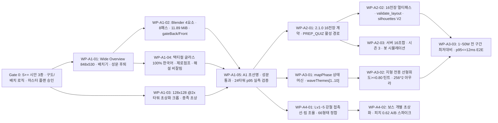

# R6 V2 세부 실행 계획서 (`DETAILED_EXECUTION_PLAN`) · `Gate 0 → A1 → A2 → A3 → A4`

- **상위 기준서**: [MASTER_PLAN.md](MASTER_PLAN.md) · [../PRD-r6-v2.md](../PRD-r6-v2.md)
- **연계 규격서**: [COMPOSITION_AND_PLACEMENT_LOGIC.md](COMPOSITION_AND_PLACEMENT_LOGIC.md) · [RENDERING_QUALITY_ARCHITECTURE.md](RENDERING_QUALITY_ARCHITECTURE.md)
- **작성일**: 2026-11-28 (구도/배치 불변식·코덱스 `gpt-6.2-astra/high` `20261127T202015-ac2839` 아키텍처·13개 WP 6항목 완전 명세본)

---

## §0. 전체 작업 의존성 흐름

---

## §1. Gate 0 · 시안 및 마스터 설계 승인 체크리스트

- [x] **S++ R6 정합 마스터 시안 3종**: [v2-01-cohesive-master.webp](mockups/v2-01-cohesive-master.webp), [v2-00-cohesive-map-plate.webp](mockups/v2-00-cohesive-map-plate.webp), [v2-02-cohesive-units-harmony.webp](mockups/v2-02-cohesive-units-harmony.webp)
- [x] **구도·배치·디자인·렌더링 기술 완결**: [COMPOSITION_AND_PLACEMENT_LOGIC.md](COMPOSITION_AND_PLACEMENT_LOGIC.md), [RENDERING_QUALITY_ARCHITECTURE.md](RENDERING_QUALITY_ARCHITECTURE.md), [MASTER_PLAN.md](MASTER_PLAN.md)
- [ ] **사용자 최종 승인**: 위 산출물과 인터랙티브 프로토타입 승인 즉시 `WP-A1-01` 착수 (Gate 0 전 `src/**`, `server/**`, `tools/**` 미수정)

---

## §2. Phase A1 · 초기맵(`meadow_easy`, 3학년·쉬움) 초선명 단일 완성

### `WP-A1-01` · `Wide V2 Overview (848×530)` · 성문 우측 후퇴 · 배치 불변식 검증기
1. **담당 / 선행 / 소유 경계**: 세션 A / `Gate 0` 승인 / 세션 A 배타 소유(`mapProjection.*`, `tools/r6/map/**`, `src/ui/useLayout.ts`, `src/ui/game/fieldGeometry.ts`)
2. **수정·신규 파일**: `src/game/r6/mapProjection.json`, `src/game/r6/mapProjection.ts`, `src/ui/screens/r6Map.ts`, `src/ui/useLayout.ts`, `src/ui/game/fieldGeometry.ts`, `src/ui/game/GameScreen.module.css`, `src/game/BattleScene.ts`(직렬 구간), `tools/r6/map/validate_layout.py`(신규)
3. **핵심 인터페이스 & 세부 구현 로직**:
   - `mapProjection.json`의 `overview`를 **`{ x: 56, y: 12, width: 848, height: 530 }`**로 확장(기존 `cameraRay=[6.1,-8.2,6.05]`, `pixelsPerCell=52`, `center=[480,286]` 불변 → +29.2% 가시 면적, VRAM 증분 `0`).
   - `resolveMapView(mapId, hostRect, selection): MapView`를 신설해 `BattleScene`, `GameScreen`, `FieldOverlay`, `InputLayer`가 단일 사양을 공유하고, 맵 메타데이터 `entry`, `exit`, `portalThreshold`, `portalInterior`, `lastApproach`, `gateAlphaBounds`, `padPivots`를 등록.
   - 초기맵(`meadow_easy`) 확정 구도 적용: `waypoints = (0,4)→(0,0)→(9,0)→(9,3)→(1,3)→(1,8)→(10,8)→(10,4)→(13,4)`(45칸), `gateCenter = (82.2%, 71.2%)`, 검증 완료 **21슬롯**(`minScreenDist = 73.0px`, `worstNearVertGap = 74.1px`, `dockHits = 0`).
   - 정지 전체보기에서만 최종 화면 평행이동을 물리 px에 맞추고 `roundPixels = false` 유지(Spine 보행 떨림 방지).
   - `validate_layout.py`: `dockHits==0`, `(1,1)` 스택 0, `minDist>=56px`, `worstVert>=48px`, `V(s)>=3`, `r<=0.396` 자동 검증 구현.
4. **완료 조건 (DoD)**: `validate_layout.py` 전 항목 통과, 3해상도에서 성문 bbox `x=76~88%, y=63~78%` 내 `0px` 잘림 및 도크 교차 `0px²`.
5. **범위 검증 명령**: `npx tsc --noEmit && python3 -B tools/r6/map/validate_layout.py --map meadow_easy && npm run test:e2e -- tests/e2e/layout.spec.ts`
6. **리스크 & 복구**: 기존 `garden_u` E2E 좌표 단언이 `746×467`을 하드코딩한 경우, `mapId === 'garden_u'` 레거시 프로필 분기를 유지해 `2.0.0` 테스트 호환성 보존.

### `WP-A1-02` · Blender 4요소 하이브리드 · 8패스 `11.89 MiB` 분리 합성 · `gateBack/Front`
1. **담당 / 선행 / 소유 경계**: 세션 A / `WP-A1-01` / 세션 A(`tools/r6/map/**`, `public/assets/r6/map/**`, `GroundLayer.ts`) + 직렬(`BattleAssets.ts`, `manifest-v2.json` 자기 키, `EnemyLayer.ts` 통과 훅 최소)
2. **수정·신규 파일**: `tools/r6/map/{scene,pack,test_pack}.py`, `public/assets/r6/map/**`, `public/assets/r6/manifest-v2.json`(`MapArt` 확장), `src/game/r6/BattleAssets.ts`, `src/game/layers/{GroundLayer,EnemyLayer,shared}.ts`
3. **핵심 인터페이스 & 세부 구현 로직**:
   - `scene.py` V2: ① `mortar_render.py:37` 주광 벡터 $\vec{L}$ 동기화, ② 4단 소프트-스텝 + `AO(Distance=0.45)` + `TexNoise(scale 18~42, ±4%)` + 선별 Freestyle(랜드마크·절벽 립·패드 ON, 잔디 OFF), ③ `ortho_scale`을 `848×530 / PPC` 논리 크기에 고정하고 출력 픽셀만 2×/3× 확장, ④ 베지어 코너 **`r = 0.38칸`** 고정, ⑤ 4모서리 디오라마 앵커(`(-2.47,2.02)`, `(9.14,-3.13)`, `(6.22,11.52)`, `(8.24,11.51)`, `(16.85,5.60)`) 배치.
   - 8패스 출력: `terrain`, `road`(POT `256²` 입구 원점 연속 UV → `portalInterior`), `gate-back`, `gate-front`, `entrance`, `bridge`, `pads`(4상태 2× `128×96`/3× `192×144`), `props`.
   - `pack_map(pass_set, budget): MapArt` + `chooseMapTier(view, physicalDpr, limits): MapTier`: 일반 `1492×934`(`5.316 MiB`), 고밀도 `2090×1308`(`10.428 MiB`, `2048` 상한 시 가로 2분할) + POT 랜드마크/도로(`1.00 MiB`) + 아우라(`0.25 MiB`) + 패드(`0.211 MiB`) = **`11.89 MiB ≤ 12 MiB`**.
   - 인코딩: `terrain` `-q 92 -sharp_yuv -m 6` NPOT `LINEAR`, 고주파 경계(`road`, `gate`, `pads`) **무손실 WebP** POT `LINEAR_MIPMAP_LINEAR` + 도로 `Anisotropy 1×/2×`.
   - `portalPassage(foot, progress, portal)` & 깊이 분할: 통과 구간(`signedDist >= -0.30`)에서 `gateBack(planeY - 0.5) < enemy(planeY + 4) < gateFront(planeY + 18)` 적용 + 포털 개구 클리핑(그림자·HP바·상태표시·윤곽 동시 처리, `leak` 1회).
   - 수명주기 `acquireMapArt(spec, view, signal)` / `releaseMapArt(handle)`: 새 파일 CPU 디코드 → 준비 화면 이전 페이지 선해제 → 업로드(`24 MiB` 피크 차단).
4. **완료 조건 (DoD)**: `test_pack.py` 연결 성분 `1`·매 px 이동선 피복·`12 MiB` 상한 통과, `1440×900 DPR2`에서 `texel/물리px ≥ 1.013`, 포털 통과 시 잔상 `0`.
5. **범위 검증 명령**: `python3 -B -m unittest discover -s tools/r6/map`
6. **리스크 & 복구**: `MAX_TEXTURE_SIZE = 2048` 구형 WebGL GPU에서 `2090×1308` 생성 실패 시 `chooseMapTier`가 자동으로 2분할 타일 또는 일반 티어(`1492×934`)로 폴백.

### `WP-A1-03` · 타워 6종 `128×128 @2x` 전용 초상화 아틀라스 & 홈 종족 초상화 연결
1. **담당 / 선행 / 소유 경계**: 세션 A / `Gate 0` (`WP-A1-01/02`와 병렬) / 세션 A 배타 소유
2. **수정·신규 파일**: `tools/r6/blender/tower_game_pack.py`, `src/game/r6/manifest.ts`, `src/ui/game/{BattleTowerPortrait,ContextCard,r6Forecast}.*`
3. **핵심 인터페이스 & 세부 구현 로직**:
   - `tower_game_pack.py`에 알파 `≥ 128` 타이트 크롭 + 2px AA 여유 + 긴 축 `112px(87.5%)` 스케일 정규화 + 하단 바이어스 `+4px` 배치 추가 → 종별 `4×3` 시트(`512×384`, `0.75 MiB`) 발행 + `portraits` 선택 필드 추가.
   - `towerPortrait(towerId, stage)`·`speciesPortrait(species, variant)` 구현, `BattleTowerPortrait.tsx`에서 과대 `viewBox` 대신 초상화 시트 직접 슬라이스 렌더, `ContextCard.tsx`는 홈의 30종 `256×256` 종족 초상화(`portraitDeck.ts` 재사용) 연결.
4. **완료 조건 (DoD)**: 도크 `36×36 CSS px`에서 Lv1~20 실표시 **`≥ 31×31 CSS px`**(하한 `≥ 28px`), 66형태 빈 프레임 `0`, 지연 해금 3종 경계 유지.
5. **범위 검증 명령**: `npm run validate:assets && python3 -B tools/r6/qa/check.py`
6. **리스크 & 복구**: 지연 해금 타워(`prism`/`hangar`/`bastion`) 초상화 미도착 시 기존 `outlines` 인라인 SVG 포백이 24×24에서 즉시 렌더.

### `WP-A1-04` · 택티컬 글라스 100% 한국어 UI · 제로점프 · `gateScreenBounds` 비겹침 · 해설 비잘림
1. **담당 / 선행 / 소유 경계**: 세션 A / `WP-A1-01`, `WP-A1-03` / 세션 A 배타 소유(`src/ui/game/*`, `src/ui/styles/tokens.css`, `src/content/theme/r6.ko.json`)
2. **수정·신규 파일**: `src/ui/styles/tokens.css`, `src/ui/game/{GameScreen,Armory,ContextCard,FieldOverlay,TowerDetail,QuestionPanel}.*`, `src/content/theme/r6.ko.json`
3. **핵심 인터페이스 & 세부 구현 로직**:
   - `tokens.css`: 프로스트 아이보리-슬레이트 45° 모따기 글라스 토큰 & `data-theme="light"`/`dark` 동기화 변수 정의.
   - `GameScreen.module.css`: `.rail .context { order: -1 }` 제거 → **`Armory` 선택 전후 위치 이동 `0px`**. 우측 도크 높이 `y ≤ 58%` 상한 및 빈 공백 `≤ 15%`.
   - `FieldOverlay.tsx`: `gateScreenBounds(view, alphaBounds): DOMRect`를 `Anchored` 회피 사각형(`clearZones`)에 추가해 성문과 팝오버 교차 `0px²` 보장.
   - `QuestionPanel.module.css`: `.seam .side` 폭 `220~248px`, `--desktop-quiz-height: 172~184px`(font scale별 예약) 확장 → 3줄 해설 잘림 `0건`.
   - `r6.ko.json`: 100% 한국어 치환(`4단계`, `성문`, `공격력`, `레일 포탑`) 및 금지어(`수호`·`출격`·`징집`·`작전실`) `0건`.
4. **완료 조건 (DoD)**: `Armory` 점프 `0px`, 성문–팝오버–도크 교차 `0px²`, `xlarge` 폰트에서 해설 3줄 비잘림, 영어 약어/금지어 `0건`.
5. **범위 검증 명령**: `npx tsc --noEmit && npx vitest run tests/unit/terms.test.ts`
6. **리스크 & 복구**: `shortLandscape` 등 극단적 저높이 뷰포트에서는 `.explainText { overflow: auto }` 스크롤 가드만 허용해 버튼 가림을 방지.

### `WP-A1-05` · Phase A1 초선명 · 성문 통과 · 24타워 `p95 ≤ 12ms` 통합 검증
1. **담당 / 선행 / 소유 경계**: 세션 A (+ C 성능 스펙 정합) / `WP-A1-02`, `WP-A1-04`
2. **수정·신규 파일**: `tests/e2e/r6-battlefield.spec.ts`
3. **핵심 구현 & 검증**: `1366×768 DPR1` · `1440×900 DPR2` · `1920×1080` 3해상도에서 ① 최악 축 `texel/물리px ≥ 1.0`, ② 엣지 폭 증가 `≤ 0.5 물리px`, ③ 성문 bbox 비잘림 & 도크 `0px²`, ④ 포털 통과 잔상 `0`, ⑤ 24타워 실연사 작업시간 `p95 ≤ min(12ms, 기준선 × 1.15)` 실측.
4. **완료 조건 (DoD)**: Phase A1 Go 기준 전 항목 1회 통과.
5. **범위 검증 명령**: `npm run verify && npm run build && npm run test:e2e -- tests/e2e/r6-battlefield.spec.ts tests/e2e/r6-vfx.spec.ts`
6. **리스크 & 복구**: `p95 > 12ms` 시 1단계 화질에서 도로 `Anisotropy 2× → 1×` 및 `2×` 패드 자동 하향으로 복구.

---

## §3. Phase A2 · 학년 3~6 × 난이도 4종 = 16전장 확장 (`balanceVersion 2.1.0`)

### `WP-A2-01` · `2.1.0` 16전장 계약 · 다중 경로 · `PREP_QUIZ` 활성 경로 결정
1. **담당 / 선행**: 세션 D (+ A) / `WP-A1-05`
2. **수정 파일**: `src/contracts/{maps,balanceV2}.ts`, `docs/contracts/{maps.v2_1.json,balance.v2.json}`, `src/domain/{run,combat,balanceSession}.ts`, `src/game/r6/manifest.ts`
3. **핵심 인터페이스 & 로직**: `mapArtFor(version, grade, difficulty)`, `activeRoute(map, wave)` 신설. `=== '2.0.0'`/`garden_u` 단일 분기를 확장하되 기존 `2.0.0` 리플레이·테스트 100% 보존. §4 확정 4대 전술 형태 좌표 투입, `WAVE_WRAPUP` 직후 다음 `PREP_QUIZ` 진입 시 `(시드, 맵, 웨이브)`로 1회 경로 결정(어려움 `W11·W16` 경로 교대 1규칙/단계 준수).
4. **완료 조건 (DoD)**: 16전장 스키마·경로 길이(`45 / 48 / 33·33 / 53`)·슬롯(`21~24`) 결정론 단위 테스트 통과.
5. **범위 검증 명령**: `npx vitest run tests/unit/maps.test.ts tests/unit/combat.test.ts`
6. **리스크 & 복구**: 직렬화 충돌 방지를 위해 `2.0.0` 세션은 `?balance=v2_0` 플래그로 즉시 전환 가능하게 유지.

### `WP-A2-02` · 16전장 S++ 멀티패스 양산 & 밝은 석판 V2 `silhouettes.json` 재산출
1. **담당 / 선행**: 세션 A / `WP-A2-01`
2. **수정 파일**: `tools/r6/map/{scene,pack,build_set.py}`, `public/assets/r6/map/**`, `src/game/r6/enemyDisplay.ts`
3. **핵심 인터페이스 & 로직**: `buildMapSet(biomes, routes, seed)`로 `4바이옴 × 4형태 = 16전장` 분리 패스 일괄 렌더 후 전 맵 `validate_layout.py` 자동 검증. **밝은 석판 도로용 V2 `silhouettes.json`**을 별도 산출해 100개체 × 16전장 양방향 보행 합성 대비 **`≥ 2.056`** 확인(`HIGH`/`MID` V2 테이블 분기). 런타임은 선택 맵 1종(`≤ 12 MiB`)만 적재.
4. **완료 조건 (DoD)**: 16전장 × 100개체 최소 G4 대비 `≥ 2.056`, 전 맵 `validate_layout.py` & `12 MiB` 상한 통과.
5. **범위 검증 명령**: `python3 -B tools/r6/map/validate_layout.py --all-16 && python3 -B -m unittest discover -s tools/r6/map`
6. **리스크 & 복구**: 특정 개체 대비가 `2.056` 미달 시 해당 개체만 `silhouettes.v2.json`에서 `silver(0.42)` 또는 `carbon(0.32)` 윤곽을 켠다(전수 일괄 활성화 금지).

### `WP-A2-03` · 서버 `(2.1.0, 학년, 난이도)` 검증 · 시즌 3 · `r6Mixer` & 균형 봇 시뮬레이션
1. **담당 / 선행**: 세션 B + D / `WP-A2-01` & **사용자 운영 승인(시즌 3 분리)**
2. **수정 파일**: `server/src/store.ts`, `server/migrations/0005_season3.sql`, `tools/build-question-keys.mjs`, `docs/renewal/r6/spec/sim-notes.md`
3. **핵심 인터페이스 & 로직**: `expectedMapId(version, grade, difficulty)`로 서버가 16전장 일치 여부를 직접 검증, `build-question-keys.mjs` 단일 원천으로 16조합 + 난이도 규칙 4행 생성, `season_id UNIQUE` 제약에 따른 시즌 3 분리 마이그레이션. 시드 1~8 균형 봇(`20/15/12/9`)으로 `enemyHpBP` 조정폭 확정 및 `r6Mixer` 골든 해시(`meadow_easy` `e574ac9c1df5d0ad`/`c17403724a2a4702`, `ochre_hard` `da20566822de3420`/`0bafe2bcb4760775`) + 저장/복원 검증.
4. **완료 조건 (DoD)**: 16개 승인 조합 서버 검증 + `r6Mixer` 골든 + 저장 복원 일치 100%.
5. **범위 검증 명령**: `npm run test:server` (서버 변경 시 필수)
6. **리스크 & 복구**: 시즌 3 운영 전환 전까지 `2.1.0`은 베타 플래그로 격리해 시즌 2 라이브 랭킹 무결성 보존.

---

## §4. Phase A3 · 5웨이브 × 10단계 = 50웨이브 규격화 아우라 엔진

### `WP-A3-01` · `mapPhase(wave): MapPhase` & `waveThemes[1..10]` 선언형 상태 머신
1. **담당 / 선행**: 세션 D + A / `WP-A1-05`
2. **수정 파일**: `src/game/r6/mapPhase.ts`(신규), `src/content/theme/r6.ko.json`, `public/assets/r6/manifest-v2.json`
3. **핵심 구현**: `mapPhase(wave) = floor((clamp(wave, 1, 50) - 1) / 5)`(`0..9`), `W1·5·6·45·46·50·51` 경계·저장 복원·리플레이 단위 테스트. `waveThemes[1..10]` 10개 챕터 한국어 명칭·틴트 승수·아우라 인덱스 정의.
4. **완료 조건 (DoD)**: 모든 경계 웨이브 및 저장 복원 시 챕터 상태 100% 일치.
5. **범위 검증 명령**: `npx vitest run tests/unit/mapPhase.test.ts`
6. **리스크 & 복구**: `wave > 50` 무한 구간은 `태양 왕관(phase 9)` 유지 또는 설정 플래그로 `6~10` 순환.

### `WP-A3-02` · `GroundLayer.applyMapPhase` 선형 휘도 `≥ 0.80` 틴트 · `256²` 공용 아우라
1. **담당 / 선행**: 세션 A / `WP-A3-01`
2. **수정 파일**: `src/game/layers/GroundLayer.ts`, `public/assets/r6/map/wave-aura.webp`(신규, `256²` POT 무손실 `≤ 128KB`)
3. **핵심 구현**: `GroundLayer.applyMapPhase(phase, immediate)` 신설 — 분리된 `terrainImages`에만 선형광 휘도 비 $Y_{\text{after}}/Y_{\text{before}} \ge 0.80$ 틴트를 `PREP_QUIZ` 전환 시 `1.2s` 트윈(`reducedMotion` 즉시, 전투 중 `0회`). 공용 `256²` 아우라(`0.25 MiB`, 입자 `≤ 24`개)로 10구간 증분 VRAM **`0 MiB`**.
4. **완료 조건 (DoD)**: 도로·패드·타워·Spine 픽셀 변화 `0`, 5웨이브 보스 경보 `<3Hz` 점멸 준수.
5. **범위 검증 명령**: `npx vitest run tests/unit/groundLayerTint.test.ts`
6. **리스크 & 복구**: WebGL 1 셰이더 미지원 또는 `renderQuality >= 2`에서는 사전 검산된 안전 틴트 0xFFFFFF/입자 0개로 즉시 폴백.

### `WP-A3-03` · 1~50웨이브 전 구간 개체 최저 대비 · 24타워 `p95 ≤ 12ms` E2E
1. **담당 / 선행**: 세션 A + C / `WP-A2-02`, `WP-A3-02`
2. **수정 파일**: `tests/e2e/r6-quality-perf.spec.ts`
3. **핵심 구현**: `prestep→postrender` + `RunController` RAF 합산 작업시간과 24타워 실연사 fixture를 통해 ① 16전장×10구간 도로 픽셀 차 `0`, ② 개체별 최저 대비 `≥ 2.056`, ③ 24타워 `p95 ≤ min(12ms, 기준선×1.15)` & 평균 `≥ 55fps`, ④ 16맵 전환 VRAM 누수 `0` 검증.
4. **완료 조건 (DoD)**: 전 웨이브·전 테마 성능/대비/메모리 합격.
5. **범위 검증 명령**: `npm run verify && npm run build && npm run test:e2e -- tests/e2e/r6-battlefield.spec.ts && npm run test:r6-perf`
6. **리스크 & 복구**: `24타워 + 입자 24`가 `p95` 위협 시 `quality >= 1`에서 아우라 입자 상한을 `24 → 8 → 0`으로 단계 감축.

---

## §5. Phase A4 · 타워 `Lv1~5` 강철 정합 & 보스 초상화 폴리싱

### `WP-A4-01` · `mortar_render.py` `Lv1~5` 강철 접촉선·림 조율 (`Lv1·2·4` 36px 판정)
1. **담당 / 선행**: 세션 A / `WP-A1-05`
2. **수정 파일**: `tools/r6/blender/{mortar_render,tower_game_render,pack,tower_game_pack}.py`, `public/assets/r6/towers/**`
3. **핵심 구현**: 낮은 레벨에 세라믹 색을 덮어 진화 단계를 깨지 않고, 강철 파츠의 하단 카본 접촉선과 상단 모서리 은회 림(`R04` 6색 내)만 조정해 밝은 석판 도로 위 `36px` 식별성을 높이고 66형태·16방향 재발행.
4. **완료 조건 (DoD)**: `tools/r6/qa/check.py` 165쌍 IoU 및 R04 팔레트 위반 `0`, 두 테마 36px 판정 통과.
5. **범위 검증 명령**: `npm run validate:assets && python3 -B tools/r6/qa/check.py`
6. **리스크 & 복구**: 강철 명도 과상승 시 `BANDS` 상단 요소만 `+4%` 범위 내로 되돌린다.

### `WP-A4-02` · 개체별 보스 초상화 & 선택적 피치 `0.62` 비교 스파이크
1. **담당 / 선행**: 세션 A / `WP-A4-01`
2. **수정 파일**: `tools/r6/spine/batch.py`, `src/ui/game/{WaveBand,ContextCard}.tsx`
3. **핵심 구현**: 5종족 보스 20종 개체별 `256×256` 초상화 연결 + 필요 시 타워 1종·맵 1종으로 카메라 피치 `0.62` A/B 비교 스파이크 수행 후 유지/변경 최종 결정(기존 `0.509` 유지가 기본값).
4. **완료 조건 (DoD)**: 보스 웨이브 띠/예고 초상화 100% 일치 및 피치 의사결정 기록 완료.
5. **범위 검증 명령**: `npm run wiki:sync && npm run wiki:check && npm run test:e2e -- tests/e2e/r6-battlefield.spec.ts`
6. **리스크 & 복구**: 피치 `0.62` 채택 시 전 타워·맵 재렌더 비용이 크므로, `overview` 하단 여백과 비용 대비 이득이 불명확하면 `0.509`를 최종 유지한다.

---

## §6. 검증 예산 및 최종 Go / No-Go 관문표

- **검증 예산 원칙**: 문서/계획 단계는 `wiki:stamp && wiki:sync && wiki:check`만 실행, 개별 WP 중에는 범위 테스트 1회만 실행, 각 Phase 종료 커밋 직전에만 대표 통합 검증(`verify`, `build`, `test:e2e`, `test:r6-perf`, `test:server`)을 1회 실행한다.

| 분류 | 합격 기준 (Go) |
| --- | --- |
| **화질 (0% 블러)** | 최악 방향 `texel / 물리 px ≥ 1.0` (`1440×900 DPR2` 기준 `1.013`) · 엣지 폭 증가 `≤ 0.5 물리 px` · 흔들림 `0` |
| **구도 · 배치 불변식** | `Wide V2 Overview 848×530 (+29.2%)` · `dockHits = 0` · `minScreenDist ≥ 56px` · `(1,1)` 스택 `0` · 코너 `r ≤ 0.396` · `V(s) ≥ 3` |
| **성문 · 연속 도로** | 성문 bbox 100% 뷰포트 포함(`x=76~88%, y=63~78%`) · 도크 교차 `0px²` · 도로 단일 연결 · 통과 잔상 `0` · `leak` 1회 |
| **GPU 메모리 · 전송** | 고밀도 활성 세트 `≤ 12 MiB` (`11.89 MiB`, 선해제 전환) · 아우라 `≤ 128KB` (`0 MiB` 증분) |
| **색 · 대비 · 한국어** | 도로 픽셀 변조 `0` · 지형 선형 휘도 `≥ 0.80` · 개체/테마 최저 G4 `≥ 2.056` · 영어/금지어 `0` |
| **UI · 초상 · 성능** | 점프 `0px` · 초상 실표시 `≥ 28×28` · 3줄 해설 비잘림 · 24타워 `p95 ≤ min(12ms, 기준×1.15)` · `≥ 55fps` · `wiki:check` 0오류 |
