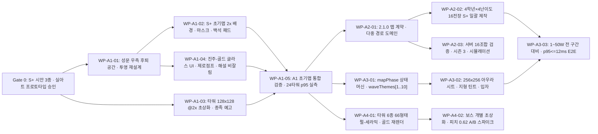

# R6 V2 세부 실행 계획서 (`DETAILED_EXECUTION_PLAN`) · `Gate 0 → A1 → A2 → A3 → A4`

- **상위 문서**: [MASTER_PLAN.md](MASTER_PLAN.md) · [../PRD-r6-v2.md](../PRD-r6-v2.md)
- **작성일**: 2026-11-28
- **대상 단계**: `Gate 0` 승인 이후 `Phase A1`(초기맵 단일 완성) → `Phase A2`(학년×난이도 16전장) → `Phase A3`(50웨이브 5단계 주기 아우라 엔진) → `Phase A4`(타워 6종 66형태 S+ 재렌더·폴리싱)

---

## 0. 전체 작업 의존성 흐름

---

## 1. Gate 0 · 시안 최종 승인 기준 (착수 선행 관문)
- [x] **S+ 전투 기준 시안**: [mockups/v2-01-master-art-direction.webp](mockups/v2-01-master-art-direction.webp) (검정 만화선 제거 · 맑은 햇살 디오라마 · 100% 한국어 · 성문 우측 안전)
- [x] **S+ 초기맵 순수 플레이트**: [mockups/v2-00-master-map-plate.webp](mockups/v2-00-master-map-plate.webp) (UI/타워 0%, 성문 우하단 비잘림)
- [x] **S+ 타워 6종/진화 시트**: [mockups/v2-02-master-towers.webp](mockups/v2-02-master-towers.webp) (펄-세라믹 · 샴페인 골드 · 보석 코어)
- [ ] **사용자 최종 확인**: 위 시안 3종과 인터랙티브 프로토타입 승인 → 승인 즉시 `WP-A1-01` 착수.

---

## 2. Phase A1 · 초기맵(`meadow_easy`, 3학년·쉬움) 단일 버티컬 슬라이스

### `WP-A1-01` · 성문 우측 후퇴 공간·투영·레이아웃 재설계
- **담당 / 선행**: 세션 A / `Gate 0` 통과
- **수정 파일**: `src/game/r6/mapProjection.json`, `src/game/r6/mapProjection.ts`, `src/ui/screens/r6Map.ts`, `src/ui/useLayout.ts`, `src/ui/game/GameScreen.module.css`
- **세부 구현**:
  1. `overview` 여백과 `center` 오프셋을 재조정해 좌상단 입구(`x=5~11%, y=14~22%`)와 우하단 성문(`x=76~88%, y=63~78%`)이 모든 목표 뷰포트(`1366×768`, `1440×900`, `1920×1080`)에서 1px도 잘리지 않도록 캔버스 안전선 확보.
  2. 우측 레일 폭(`256~272px`)과 상단-중단 높이 상한(`y ≤ 58%`)을 CSS Grid/Flex 계약으로 잠가 우하단 성문 영역을 완전히 개방.
  3. `useLayout.ts`의 폭 계산(`minRailWidth`)과 `GameScreen.module.css` 트랙 크기를 단일 계약으로 일치시켜 `400px` 여백 낭비 제거.
- **완료 기준(DoD)**: 3대 해상도에서 성문·입구 bbox가 뷰포트 안전선 내부 100% 포함, 우측 도크와 성문 겹침 면적 `0px²`.
- **검증 / 롤백**: `tests/e2e/layout.spec.ts` · 신규 뷰포트 bbox 검사 / 기존 `mapProjection.json` 값 복원.

### `WP-A1-02` · S+ 하이브리드 초기맵 `1920×1152` 2× 배경 · 분리 도로 마스크 · `128×96` 2× 백석 설치대
- **담당 / 선행**: 세션 A / `WP-A1-01`
- **수정 파일**: `tools/r6/map/scene.py`, `tools/r6/map/pack.py`, `tools/r6/map/test_pack.py`, `public/assets/r6/map/**`, `public/assets/r6/manifest-v2.json`(`maps` 키), `src/game/r6/BattleAssets.ts`, `src/game/layers/GroundLayer.ts`
- **세부 구현**:
  1. `scene.py`에서 논리 월드(`960×576`, 패드 `64×48`, 피벗 `(0.5, 19/48)`)를 유지한 채 출력 해상도만 `1920×1152` & `128×96` 2배로 분리 렌더링해 좌표 가이드·가림 마스크·도로 분리 마스크를 생성.
  2. 가이드 위에 **선라이트 알라바스터 S+** 초기맵(45거리 3단 S자 사암/백석 도로, 폭포/백석 다리, `가` 석비, 황동테 백석 8각 2× 설치대 2프레임 기본/선택)을 WebP로 패킹(`cwebp -q 88 -alpha_q 100 -m 6`).
  3. `GroundLayer.ts`에서 도로가 지형 틴트에 물들지 않게 분리 마스크/레이어로 구성하고 `data-theme` 전환 시 활성 배경 1장(`8.44 MiB`)만 로드·해제.
- **완료 기준(DoD)**: `1440×900 DPR2` 배경 확대율 `≤ 1.40×`, 활성 맵+패드 VRAM `≤ 12 MiB`, `test_pack.py` 길 중심 대비·패드 알파 일치 통과.
- **검증 / 롤백**: `python -B -m unittest discover -s tools/r6/map` / `meadow-plateau.webp`(`960×576`) fallback 유지.

### `WP-A1-03` · 타워 6종 `128×128 @2x` 전용 초상화 아틀라스 & 홈 종족 초상화 예고 연결
- **담당 / 선행**: 세션 A / `Gate 0` (병렬 가능)
- **수정 파일**: `tools/r6/blender/tower_game_pack.py`, `src/game/r6/manifest.ts`, `src/ui/game/BattleTowerPortrait.tsx`, `src/ui/game/ContextCard.tsx`, `src/ui/game/r6Forecast.ts`, `src/ui/screens/home/portraitDeck.ts`
- **세부 구현**:
  1. `tower_game_pack.py`에서 6종×11형태 알파 128 실루엣을 크롭해 긴 축이 85~90% 차도록 `128×128`로 축소, 4×3 그리드(`512×384`, `0.75 MiB`/종) 초상화 시트 발행(초기 3종 / 해금 3종 분리 유지).
  2. `manifest.ts` 스키마에 선택적 `portraits` 필드 추가, `BattleTowerPortrait.tsx`에서 `36~64 CSS px` 칸에 `≥ 28×28 CSS px` 실표시 구현(`5.9~11.2px` 버그 완전 제거).
  3. `ContextCard.tsx`·`r6Forecast.ts`에 `portraitDeck.ts`의 검증된 `256×256` WebP 종족 초상화(`stone→golem`, `machine→mech`) 연결 + 추천 대응 타워 칩 + 경로 호버 미리보기 구현.
- **완료 기준(DoD)**: `tools/r6/qa/check.py` 초상화 66개 빈 프레임 `0`·점유율 `≥ 75%` 통과, 도크 아이콘 실표시 `≥ 28px`.
- **검증 / 롤백**: `npm run validate:assets` · `python -B tools/r6/qa/check.py` / SVG `viewBox` bbox 폴백.

### `WP-A1-04` · 진주-골드 글라스 100% 한국어 UI · 제로점프 도크 · 스마트 팝오버 · 해설 비잘림
- **담당 / 선행**: 세션 A / `WP-A1-01`, `WP-A1-03`
- **수정 파일**: `src/ui/styles/tokens.css`, `src/ui/game/{GameScreen,Armory,ContextCard,FieldOverlay,TowerDetail,QuestionPanel}.*`, `src/content/theme/r6.ko.json`
- **세부 구현**:
  1. `tokens.css`에 선라이트 알라바스터 주간 팔레트(진주 아이보리 글라스 `#FAF7F0`, 샴페인 골드 `#C9A85C`, 틸 `#0E7D6F`, 앰버 `#C47A08`)와 고대비 다크 테마 연동 토큰 정의.
  2. `GameScreen.module.css`의 `order: -1` 제거 → `Armory`를 우상단 최상단에 0px 고정, 타워 선택 시 하단 `ContextCard` 영역만 무기 4단계 진화 상세로 전환.
  3. `FieldOverlay.tsx` 빈 설치대 위 `projectField` 앵커 스마트 설치 팝오버(단축키 `1~6`·추천 대응·사거리 미리보기), `QuestionPanel` 우측 해설 열 `220~248px` · 높이 `172~184px`(글자 단계 예약 + 짧은 화면 본문 스크롤).
  4. 전 화면 영어/약어(`Wave/Lv/HP/ATK`) 및 금지어(`수호/출격/징집/작전실`) `0건` 검수 (`r6.ko.json` 전용 키).
- **완료 기준(DoD)**: 타워 선택 전후 `Armory` 버튼 Y좌표 차이 `0px`, 우측 도크 빈 공백 `≤ 15%`, 보통/큰 글자 해설 3줄 잘림 `0건`.
- **검증 / 롤백**: `npx tsc --noEmit` · 단위 UI 테스트 / CSS 변수 전환 스위치.

### `WP-A1-05` · Phase A1 초기맵 통합 검증 (Go/No-Go)
- **담당 / 선행**: 세션 A (+ 세션 C 성능 스펙 정합) / `WP-A1-02`, `WP-A1-04`
- **수정 파일**: `tests/e2e/r6-battlefield.spec.ts` (2× 패드 점유율 보정 및 `1440×900 DPR2` 추가)
- **검증 항목**:
  - `npm run verify && npm run build`
  - `npm run test:e2e -- tests/e2e/r6-battlefield.spec.ts tests/e2e/r6-vfx.spec.ts`
  - `npm run test:r6-perf` (`1366×768 DPR1`, CPU 6×, 24타워 기준 `p95 ≤ 12ms` · `+15%` 이내 확인)
  - 전후 비교 스크린샷 1회 육안 검수 후 `BattleScene.ts` 제어권을 세션 C `prepareWave` 패치에 인계.

---

## 3. Phase A2 · 학년 3~6 × 난이도 4종 = 16전장 확장

### `WP-A2-01` · `balanceVersion 2.1.0` 맵 계약 · 다중 경로 도메인 확장
- **담당 / 선행**: 세션 D(계약·도메인) + 세션 A(협의) / `WP-A1-05` 완료
- **수정 파일**: `src/contracts/{maps,balanceV2}.ts`, `docs/contracts/maps.*.json`, `docs/contracts/balance.v2.json`(또는 `2.1.0`), `src/application/balanceSession.ts`, `src/game/r6/manifest.ts`, `src/domain/{run,combat}.ts`
- **세부 구현**:
  1. `balanceV2` `2.0.0` 계약을 보존한 채 `2.1.0` 추가(`balanceSession.ts:10`·`manifest.ts:5`의 `=== '2.0.0'` 확장), `mapByGradeDifficulty[3..6][Easy..Crazy]` 매핑 도입.
  2. `pathLength` 실측(`45 / 48 / 45[이중 등길이] / 53` — 쉬움·어려움은 입구 `(0,0)→(0,1)` 보강) 및 `slots` `20~24`개(`afterCompletedWave`, `trait: 'high' | 'bright'`) 확장, 설치대는 모든 길의 합집합 밖에 배치.
  3. `run.ts`에서 `WAVE_WRAPUP` 이후 다음 `PREP_QUIZ` 진입 시 `(판, 맵, 웨이브)`로 활성 경로 1회 결정. 어려움 `W11·W16`에는 **경로 전환 1건만** 소개하고 설치대 해금은 다른 준비 단계로 분리.
- **완료 기준(DoD)**: `2.0.0/garden_u` 기존 리플레이·골든 100% 호환 + `2.1.0` 16전장 계약 파싱 통과.
- **검증**: `npx vitest run tests/unit/domain/` · `npm run verify`.

### `WP-A2-02` · 4월드 바이옴 × 4전술 형태 = 16전장 S+ 디오라마 일괄 제작
- **담당 / 선행**: 세션 A / `WP-A2-01`
- **수정 파일**: `tools/r6/map/**`, `public/assets/r6/map/{meadow,river,ochre,snow}_{easy,normal,hard,crazy}.webp`, `public/assets/r6/manifest-v2.json`
- **세부 구현**: 4경로 형태(`easy`·`normal`·`hard`·`crazy`) × 4월드(`meadow`·`river`·`ochre`·`snow`) 16장 S+ 디오라마 배경 및 도로 마스크 제작. 런타임에는 선택한 `(학년, 난이도)` 1장(`8.44 MiB`)만 지연 로드.
- **완료 기준(DoD)**: 16전장 `test_pack.py` 전부 통과, 맵 전환 시 이전 텍스처 누수 `0`.

### `WP-A2-03` · 서버 `(2.1.0, 학년, 난이도)` 검증 · 시즌 3 마이그레이션 · 봇 시뮬레이션
- **담당 / 선행**: 세션 B(서버) + 세션 D(시뮬) / `WP-A2-01` & **사용자 운영 승인(시즌 3 분리)**
- **수정 파일**: `server/src/store.ts`, `server/migrations/0005_season3.sql`(가칭), `tools/build-question-keys.mjs`, `docs/renewal/r6/spec/sim-notes.md`
- **세부 구현**:
  1. `server/src/store.ts:123`에서 `(2.1.0, 학년, 난이도)`로 기대 `mapId`를 직접 검증하도록 보강하고, `build-question-keys.mjs`가 16개 승인 조합과 난이도 규칙 4행을 단일 원천에서 생성하게 통합.
  2. `0004_ranking_seasons.sql`의 `season_id UNIQUE` 제약에 맞춰 **시즌 3 분리** 마이그레이션·기간 API/오프라인 순위 고정값 반영.
  3. `41/L` 단순 비례 대신 시드 1~8 균형 봇(`20/15/12/9`)으로 16전장 시뮬레이션을 실행해 `enemyHpBP` 조정폭 확정 + `r6Mixer` 골든 해시(`meadow_easy` `e574ac9c1df5d0ad`/`c17403724a2a4702`, `ochre_hard` `da20566822de3420`/`0bafe2bcb4760775` 포함) 검증.
- **검증**: `npm run test:server` + 시뮬레이션 회귀 스크립트.

---

## 4. Phase A3 · 5웨이브 × 10단계 = 50웨이브 규격화 아우라 엔진

### `WP-A3-01` · `mapPhase.ts` 상태 머신 & `waveThemes[1..10]` 데이터 규격
- **담당 / 선행**: 세션 D(`mapPhase.ts`) + 세션 A(`r6.ko.json`, `manifest-v2.json`) / `WP-A1-05`
- **세부 구현**: 10구간(`1~5 아침 햇살` ~ `46~50 태양 왕관` + `51+` 순환/유지) 선언형 테이블, 1~20W 구간당 신규 규칙 최대 1개 제한, 100% 한국어 챕터 문구 `r6.ko.json` 수록.

### `WP-A3-02` · 공용 `256×256` 프롭·아우라 아틀라스 & 지형 전용 틴트/입자 렌더
- **담당 / 선행**: 세션 A / `WP-A3-01`
- **수정 파일**: `public/assets/r6/map/wave-aura.webp`, `src/game/layers/GroundLayer.ts`, `src/game/BattleScene.ts`
- **세부 구현**: 공용 `≤ 128KB` 아틀라스(깃발·망루·석등·성문 돌벽·청록 룬 아치·피뢰 첨탑·황금 방패·수정 방첨탑·이중 결계·태양 왕관) + 풀링 대기 입자(`≤ 24`, `reducedMotion` 정적) + 준비 단계 `1.2초` 전환(전투 중 0회) + `<3Hz` 보스 경보 + 지형 전용 틴트 밝기 하한 `≥ 0.80×`.

### `WP-A3-03` · 1~50웨이브 전 구간 대비 · 성능 E2E 검증
- **담당 / 선행**: 세션 A + C / `WP-A2-02`, `WP-A3-02`
- **검증**: 10개 구간 전수 스냅샷에서 길·몬스터 G4 대비 `≥ 2.056` 유지, `1366×768 DPR1` W20/W50 CPU 6× 평균 `≥ 55fps` · `p95 ≤ 12ms`, VRAM `≤ 12 MiB`.

---

## 5. Phase A4 · 타워 6종 66형태 S+ 재렌더 & 폴리싱

### `WP-A4-01` · `mortar_render.py` S+ 펄-세라믹 · 브러시드 골드 · 보석 코어 재질 재렌더
- **담당 / 선행**: 세션 A / `WP-A1-05` 이후 독립 병렬 가능
- **수정 파일**: `tools/r6/blender/{mortar_render,tower_game_render,pack}.py`, `public/assets/r6/towers/**`
- **세부 구현**: [v2-02-master-towers.webp](mockups/v2-02-master-towers.webp) 기준으로 키트 재질·스튜디오 광원을 펄-화이트 세라믹 + 샴페인 골드 + 보석 발광 코어로 업그레이드하고, `Lv1·2·4` 대표 형태를 `36px` 크기와 주간/야간 배경에서 먼저 합격 판정한 뒤 66형태·16방향 일괄 발행(`≤ 16.1MB` 총 예산 준수).

### `WP-A4-02` · 개체별 보스 초상화 & 선택적 피치 `0.62` 스파이크
- **담당 / 선행**: 세션 A + C(`tools/r6/spine/batch.py`) / `WP-A4-01`
- **세부 구현**: 보스 웨이브 예고용 `assembly-preview.webp` 크롭 초상화 연결 + 필요 시 단일 타워+1맵 카메라 피치 `0.62` 비교 스파이크.

---

## 6. 검증 예산 계획 및 정량 Go / No-Go 관문표

### 6.1 검증 예산 규칙 (`verification-budget` 준수)
- **문서·시안 작업 중**: `npm run wiki:sync` + `npm run wiki:stamp` + `npm run wiki:check`만 실행(무거운 코드 빌드/E2E 미실행).
- **각 WP 작업 중**: 바뀐 범위의 단위 테스트(`test_pack.py`, `vitest`, `tsc --noEmit`)만 1회 실행.
- **각 Phase(`A1`, `A2`, `A3`, `A4`) 완료 커밋 직전**: 대표 검증(`npm run verify && npm run build && npm run test:e2e && npm run test:r6-perf && npm run test:server`) 1회 실행(같은 실패 3회 시 우회/재설계).

### 6.2 최종 Go / No-Go 판정 수치
| 지표 | Go 기준 | 비고 |
| --- | --- | --- |
| 성문 위치 & UI 비가림 | 성문 bbox 100% 뷰포트 내 포함 · 도크 겹침 **`0px²`** | `1366×768`, `1440×900`, `1920×1080` |
| 배경 해상도 · VRAM | `1920×1152`(확대 `≤ 1.40×`) · 활성 VRAM **`≤ 12 MiB`** | `8.78 MiB` 밉맵 전 기준 · 전환 즉시 해제 |
| 타워 초상화 · UI 점프 | 실표시 **`≥ 28×28 CSS px`** · `Armory` 점프 **`0px`** · 해설 잘림 **`0건`** | `128×128 @2x` 전용 아틀라스 |
| 100% 한국어 · 인지 부하 | 영어·금지어 **`0건`** · 준비당 규칙 `≤ 1` · **`< 3Hz`** · 지형 **`≥ 0.80×`** | 10개 5웨이브 구간 전수 검사 |
| 성능 · 서버 무결성 | 24타워 `p95 ≤ 12ms`(+15%) · `test:server` 통과 · `wiki:check` 0오류 | `1366×768 DPR1` CPU 6배 |
