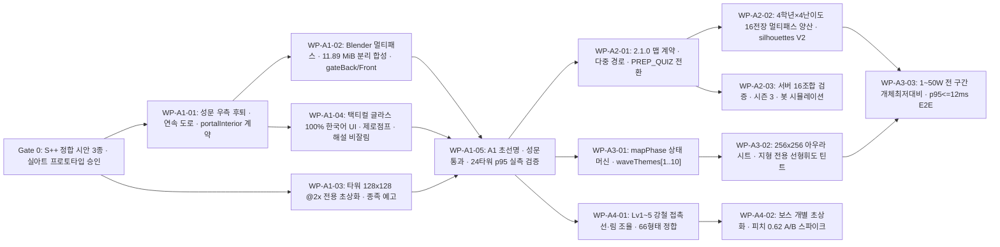

# R6 V2 세부 실행 계획서 (`DETAILED_EXECUTION_PLAN`) · `Gate 0 → A1 → A2 → A3 → A4`

- **상위 문서**: [MASTER_PLAN.md](MASTER_PLAN.md) · [RENDERING_QUALITY_ARCHITECTURE.md](RENDERING_QUALITY_ARCHITECTURE.md) · [../PRD-r6-v2.md](../PRD-r6-v2.md)
- **작성일**: 2026-11-28 (코덱스 `gpt-6.2-astra/high` `20261127T202015-ac2839` 인터페이스·수명주기·인수 로직 통합)

---

## 0. 전체 작업 의존성 흐름

---

## 1. Gate 0 · 시안 최종 승인 체크리스트
- [x] **S++ R6 정합 전투 기준 시안**: [mockups/v2-01-cohesive-master.webp](mockups/v2-01-cohesive-master.webp) (`hero-meadow-daylight`·실구현 3종 포탑/몬스터·끊김 없는 도로·에너지 포털 성문)
- [x] **S++ 순수 배경 플레이트**: [mockups/v2-00-cohesive-map-plate.webp](mockups/v2-00-cohesive-map-plate.webp) (연속 크림 석판·슬레이트 연석·빈 2단 8각 설치대·우하단 안전 성문)
- [x] **실구현 R6 타워·몬스터·기물 통일 시트**: [mockups/v2-02-cohesive-units-harmony.webp](mockups/v2-02-cohesive-units-harmony.webp)
- [ ] **사용자 최종 확인**: 위 시안 3종과 인터랙티브 프로토타입 승인 → 즉시 `WP-A1-01` 착수.

---

## 2. Phase A1 · 초기맵(`meadow_easy`, 3학년·쉬움) 초선명 단일 완성

### `WP-A1-01` · 성문 우측 후퇴 · `portalInterior` 연속 좌표 · 단일 뷰 계약
- **담당 / 선행**: 세션 A / `Gate 0` 통과
- **수정 파일**: `src/game/r6/mapProjection.json`, `src/game/r6/mapProjection.ts`, `src/ui/screens/r6Map.ts`, `src/ui/useLayout.ts`, `src/ui/game/fieldGeometry.ts`, `src/ui/game/GameScreen.module.css`, `src/game/BattleScene.ts`
- **핵심 인터페이스 & 구현**:
  - `resolveMapView(mapId, hostRect, selection): MapView`, `projectField(point, spec)`, `unprojectField(point, spec)`를 `BattleScene`, `GameScreen`, `FieldOverlay`, `InputLayer`가 단일 사양으로 공유한다.
  - 맵 계약에 `overview`, `entry`, `exit`, `portalPlane`, `portalInterior`, `lastApproach`, `gateAlphaBounds`, `padPivots`를 도입해 **성문 알파 bbox 전체가 CSS `x=76~88%, y=63~78%` 내 비잘림**, 입구→포털 내부(`portalInterior`)가 단일 연결 성분으로 이어지게 설계한다(우상단 도크 `y ≤ 58%`와 교차 `0px²`).
  - 정지 전체보기에서만 최종 화면 평행이동을 물리 px에 맞추고 `roundPixels=false`를 유지한다.
- **검증**: `tests/e2e/layout.spec.ts` · 3대 해상도 성문 bbox/도크 교차 `0px²` 검사.

### `WP-A1-02` · Blender 5.2.3 멀티패스 · `11.89 MiB` 분리 합성 · `gateBack/Front` & `128×96`/3× 패드
- **담당 / 선행**: 세션 A / `WP-A1-01`
- **수정 파일**: `tools/r6/map/{scene,pack,test_pack}.py`, `public/assets/r6/map/**`, `public/assets/r6/manifest-v2.json`(`MapArt` 확장 스키마), `src/game/r6/BattleAssets.ts`, `src/game/layers/{GroundLayer,EnemyLayer,shared}.ts`
- **핵심 인터페이스 & 구현**:
  - `render_map(spec, seed, density, passes)`, `pack_map(pass_set, budget): MapArt`, `chooseMapTier(view, physicalDpr, limits): MapTier`.
  - Blender에서 `ortho_scale`을 논리 해상도(`960×576`)에 고정한 채 출력 픽셀만 2×/3× 확장해 `terrain`, `road`, `gate-back`, `gate-front`, `entrance`, `bridge`, `pads`, `props` 패스를 분리 렌더한다.
  - **일반 티어** `1492×934`(`5.316 MiB`), **고밀도 티어** `2090×1308`(`10.428 MiB`, `2048` 상한 시 가로 2분할) + POT `512×256` 랜드마크 + POT `256²` 연속 석판/연석 UV(입구 원점 누적) + 2×/3× 패드(`setDisplaySize(64,48)`·원래 정규화 피벗) = **총 `11.89 MiB ≤ 12 MiB`**.
  - 자연 지형 `cwebp -q 92 -sharp_yuv -m 6` + NPOT `LINEAR`, 청록 문틀·황동 연석·패드·문양은 **무손실 WebP** + POT `LINEAR_MIPMAP_LINEAR` (도로 메시는 `Anisotropy 1×/2×` 비교).
  - **성문 깊이 분할**: 문 통과 구간에서 발점 부호 거리로 `gateBack < enemy < gateFront` 적용 및 포털 내부 개구 클리핑(그림자·HP바·상태표시·윤곽 동시 처리, `leak` 1회).
  - **수명주기**: `acquireMapArt(spec, view, signal)` / `releaseMapArt(handle)`로 CPU 디코드 완료 → 준비 화면 이전 전용 페이지 선해제 → 새 페이지 업로드(`24 MiB` 피크 차단).
- **검증**: `python -B -m unittest discover -s tools/r6/map` (연결 성분·매 px 이동선 커버·피벗·`12 MiB` 치수 상한 검사 포함).

### `WP-A1-03` · 타워 6종 `128×128 @2x` 전용 초상화 아틀라스 & 홈 종족 초상화 연결
- **담당 / 선행**: 세션 A / `Gate 0` (병렬 가능)
- **수정 파일**: `tools/r6/blender/tower_game_pack.py`, `src/game/r6/manifest.ts`, `src/ui/game/{BattleTowerPortrait,ContextCard,r6Forecast}.*`
- **핵심 인터페이스 & 구현**: `towerPortrait(towerId, stage)`·`speciesPortrait(species, variant)`를 전장 몸체 `getBase64()` 경로 대신 전용 `128×128 @2x` 초상화 시트(`512×384`, `0.75 MiB`/종)와 `portraitDeck.ts` 30종 `256×256` 종족 초상화에 연결한다.
- **검증**: `npm run validate:assets` · `python -B tools/r6/qa/check.py` (66개 빈 프레임 0, 실표시 `≥ 28×28 CSS px`).

### `WP-A1-04` · 택티컬 글라스 100% 한국어 UI · 제로점프 도크 · `gateScreenBounds` 비겹침 · 해설 비잘림
- **담당 / 선행**: 세션 A / `WP-A1-01`, `WP-A1-03`
- **수정 파일**: `src/ui/styles/tokens.css`, `src/ui/game/{GameScreen,Armory,ContextCard,FieldOverlay,TowerDetail,QuestionPanel}.*`, `src/content/theme/r6.ko.json`
- **핵심 인터페이스 & 구현**: `gateScreenBounds(view, alphaBounds): DOMRect`를 도크·팝오버 배치와 공유해 선택 전후 도크 이동 `0px`, 큰 글자 해설 3줄(`220~248px` 열·`172~184px` 높이) 및 팝오버에서 성문 교차 `0px²` 보장. 영어/약어/금지어 `0건`.
- **검증**: `npx tsc --noEmit` · UI 단위 테스트.

### `WP-A1-05` · Phase A1 초선명 · 성문 통과 · 24타워 `p95 ≤ 12ms` 통합 검증
- **담당 / 선행**: 세션 A (+ C) / `WP-A1-02`, `WP-A1-04`
- **수정 파일**: `tests/e2e/r6-battlefield.spec.ts`
- **검증**: `npm run verify && npm run build && npm run test:e2e -- tests/e2e/r6-battlefield.spec.ts tests/e2e/r6-vfx.spec.ts` — 3해상도 밀도(`texel/물리px ≥ 1.0`)·엣지 폭 증가 `≤ 0.5 물리px`·알파 bbox·포털 통과 잔상 `0`·작업시간 `p95 ≤ min(12ms, 기준선×1.15)` 확인.

---

## 3. Phase A2 · 학년 3~6 × 난이도 4종 = 16전장 확장

### `WP-A2-01` · `2.1.0` 맵 계약 · `PREP_QUIZ` 활성 경로 결정
- **담당 / 선행**: 세션 D(+ A) / `WP-A1-05`
- **핵심 인터페이스**: `mapArtFor(version, grade, difficulty)`, `activeRoute(map, wave)` 신설. `manifest.ts:5`·`balanceSession.ts:10`·`BattleScene`의 `'2.0.0'`/`'garden_u'` 분기 확장(기존 `2.0.0` 리플레이 보존). `pathLength` `45/48/45/53`(입구 `(0,0)→(0,1)` 보강), `WAVE_WRAPUP` 이후 다음 `PREP_QUIZ` 진입 시 1회 경로 결정, 어려움 `W11·W16` 경로 전환 1건만 소개.

### `WP-A2-02` · 16전장 S++ 멀티패스 일괄 제작 & V2 `silhouettes.json` 재산출
- **담당 / 선행**: 세션 A / `WP-A2-01`
- **핵심 인터페이스**: `buildMapSet(biomes, routes, seed)`로 4×4 16전장 분리 패스 생성 + **밝은 석판 도로용 V2 `silhouettes.json` 신설**(100개체 실제 도로·줄눈·연석 양방향 합성 → 최소 패스 선택, 개체별 최솟값 `≥ 2.056` 검증). 런타임 선택 맵 1종만 적재.

### `WP-A2-03` · 서버 `(2.1.0, 학년, 난이도)` 검증 · 시즌 3 · `r6Mixer` & 시뮬레이션
- **담당 / 선행**: 세션 B + D / `WP-A2-01` & **운영 승인(시즌 3 분리)**
- **핵심 구현**: `expectedMapId(version, grade, difficulty)` 서버 직접 검증(`server/src/store.ts:123`), `build-question-keys.mjs` 단일 원천 생성, `0004_ranking_seasons.sql` `UNIQUE`에 따른 시즌 3 마이그레이션, 시드 1~8 균형 봇(`20/15/12/9`) 시뮬레이션 `enemyHpBP` 확정 + `r6Mixer` 골든 해시(`meadow_easy` `e574ac9c1df5d0ad`/`c17403724a2a4702`, `ochre_hard` `da20566822de3420`/`0bafe2bcb4760775`) + 저장 복원 검증.

---

## 4. Phase A3 · 5웨이브 × 10단계 = 50웨이브 규격화 아우라 엔진

### `WP-A3-01` · `mapPhase(wave): MapPhase` & `waveThemes[1..10]`
- **담당 / 선행**: 세션 D + A / `WP-A1-05`
- **핵심**: `W1·5·6·45·46·50·51` 경계 및 저장 복원 상태 명시, 10구간 한국어 문구 `r6.ko.json`.

### `WP-A3-02` · `GroundLayer.applyMapPhase` & `portalPassage` + `256²` 공용 아우라
- **담당 / 선행**: 세션 A / `WP-A3-01`
- **핵심**: `GroundLayer.applyMapPhase(phase, immediate)`, `portalPassage(foot, progress, portal): Passage` 단일 소유권. `terrainImages`에만 선형광 휘도 `Y_after / Y_before ≥ 0.80` 틴트(`1.2s`, `reducedMotion` 즉시, 전투 중 0회) + `256²` 아우라(`0.25 MiB`, 입자 `≤ 24`, VRAM 증분 `0 MiB`).

### `WP-A3-03` · 1~50웨이브 전 구간 대비 · 24타워 작업시간 `p95 ≤ 12ms` E2E
- **담당 / 선행**: 세션 A + C / `WP-A2-02`, `WP-A3-02`
- **핵심**: `r6-quality-perf.spec.ts`에 `prestep→postrender` + `RunController` RAF 합산 작업시간 계측 및 24타워 실연사 fixture 추가. 16전장×10구간 도로 픽셀 차이 `0` · 개체별 최저 대비 `≥ 2.056` · 24타워 `p95 ≤ min(12ms, 기준선×1.15)` · 맵 전환 VRAM 누수 `0` 검증.

---

## 5. Phase A4 · 타워 `Lv1~5` 강철 정합 & 보스 초상화 폴리싱

### `WP-A4-01` · `mortar_render.py` Lv1~5 강철 접촉선·림 조율 (`Lv1·2·4` 36px 판정 우선)
- **담당 / 선행**: 세션 A / `WP-A1-05`
- **핵심**: 낮은 레벨에 세라믹색을 덮지 않고(진화 단계 보존), 밝은 석판 도로 위 강철 하단 카본 접촉선과 상단 모서리 림만 보정한 뒤 66형태·16방향 재발행.

### `WP-A4-02` · 개체별 보스 초상화 & 선택적 피치 `0.62` 비교 스파이크

---

## 6. 검증 예산 및 최종 Go / No-Go 관문표
- **검증 예산**: 문서/시안 작업은 `wiki:sync`/`stamp`/`check`만, 개별 WP는 범위 테스트만, 각 Phase 완료 커밋 직전에만 대표 통합 검증(`verify`, `build`, `test:e2e`, `test:r6-perf`, `test:server`) 1회 실행.

| 지표 | 합격 기준 (Go) |
| --- | --- |
| 초선명 화질 (0% 블러) | 최악 방향 `texel / 물리 px ≥ 1.0` (`1440×900 DPR2` 기준 `1.013`) · 엣지 폭 증가 `≤ 0.5 물리 px` · 흔들림 `0` |
| 성문 · 연속 도로 | 성문 bbox 100% 뷰포트 포함(`x=76~88%, y=63~78%`) · 도크 교차 `0px²` · 도로 단일 연결 · 포털 통과 잔상 `0` |
| 메모리 · 전송 | 고밀도 활성 맵 세트 `≤ 12 MiB` (`11.89 MiB`, 전환 시 이전 선해제) · 아우라 `≤ 128KB` · `0 MiB` 증분 |
| 색 · 대비 · 100% 한국어 | 도로 픽셀 변조 `0` · 지형 선형 휘도 `≥ 0.80` · 개체별/테마별 최저 G4 `≥ 2.056` · 영어/금지어 `0` |
| 성능 · 위키 | 24타워 실연사 `1366×768 DPR1` CPU 6× `p95 ≤ min(12ms, 기준×1.15)` · 평균 `≥ 55fps` · `wiki:check` 0오류 |
