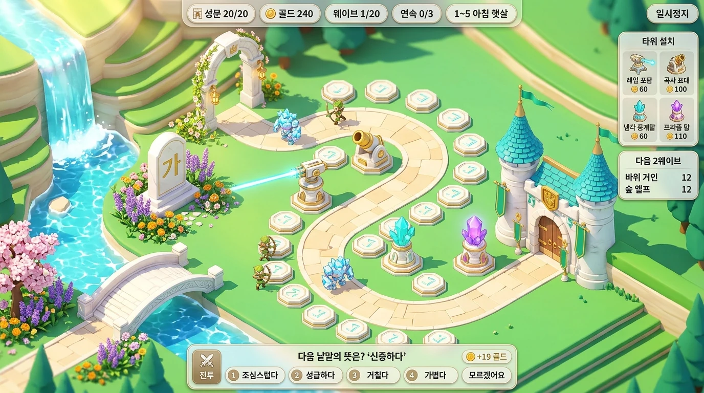
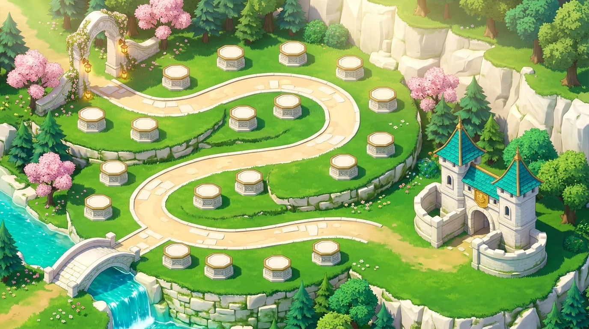
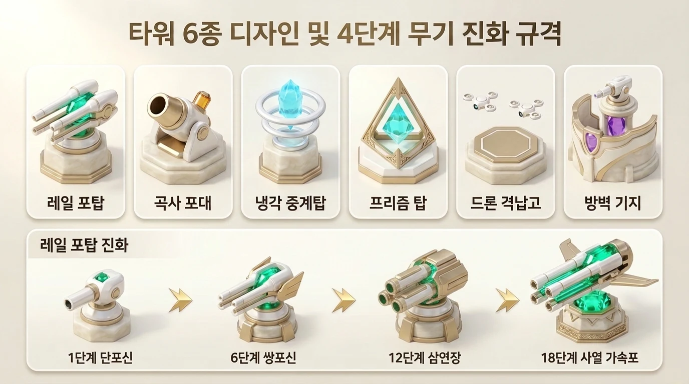

# R6 V2 마스터 계획서 (`MASTER_PLAN`) · 선라이트 알라바스터 S+ 디오라마 & 공간 재구성

- **작성일**: 2026-11-28
- **상위 기준서**: [../PRD-r6-v2.md](../PRD-r6-v2.md) (`§7~§11`, 기존 세션 C `§0~§6`·`§12`와 무충돌 통합)
- **세부 실행 계획**: [DETAILED_EXECUTION_PLAN.md](DETAILED_EXECUTION_PLAN.md) (`WP-A1-01` ~ `WP-A4-02`, 13개 작업 패키지)
- **검수 기반**: 코덱스 1차 검토(`20261127T083547-51a0f3`), 클로드↔코덱스 공동 설계 탐구(`20261127T091045-d56c0f` 1턴 클로드 · 2턴 코덱스 `20261127T102326-c1a97c` 완료), 사용자 시안 교정(`2026-11-28`, S+ 화풍 격상 · 성문 우측 후퇴 비잘림 · 우상단 슬림 도크 · 초기맵 선완성 후 확장)

---

## 1. 확정 시안 방향 · "선라이트 알라바스터 디오라마 S+"

### 1.1 최종 확정 마스터 시안 3종

### 1.2 시각 품질 4단계 진화 비교 및 5대 절대 기준
| 구분 | V1 현행 (`2.0.0`) | V2 1~2차 탐색 | **V2 최종 확정 ("선라이트 알라바스터 S+")** |
| --- | --- | --- | --- |
| 조명 · 색채 | 어두운 슬레이트/카본 + 암흑 배경 | 파스텔 단색 또는 두꺼운 검정 만화선·탁한 올리브 | **황금 정오 햇살 + 맑은 라벤더-블루 간접 그림자 + 선명한 에메랄드 초원** |
| 지형 · 수경 | 단조로운 계단 등고선(`960×576`, 2.76× 블러) | 등고선 보강이나 만화선·성문 돌출 잔존 | **백석·사암 자갈길 + 벚꽃·들꽃 + 아쿠아 폭포·백석 다리 + 금빛 `가` 어휘 석비** |
| 성문 · 입구 | 우측 하단 끝 모서리 협소/잘림 우려 | 중앙 하단 돌출 및 하단 모서리 접힘 | **성문 우측 안전선(`x=76~88%`) 후퇴 · 화면 비잘림 100% 온전** |
| 설치대 · 타워 | 흑회색 점(`5.9~11.2px`)·64×48 패드 | 회색 철판·육각 패드 | **황동 금테 백석 8각 주춧돌 + 펄-세라믹·브러시드 골드·보석 코어 3D 포탑** |
| UI 표면 | 상단 암흑/하단 백색 충돌·310px 59% 공백 | 무광 6색 각진 카드(성문 가림 우려) | **진주 아이보리 글라스 + 샴페인 골드 1px 트림 + 우상단 슬림 도크 + 100% 한국어** |

> **디자인 금지 규칙**: 두꺼운 검정 외곽선, 칙칙한 갈회색/올리브 탁색, 촌스러운 원색, 영어/약어(`Wave`, `Lv`, `HP`, `ATK`), R6 금지어(`수호`, `출격`, `징집`, `작전실`)는 S+ 모든 아트워크와 UI에서 일절 사용하지 않는다.

---

## 2. 전장 공간 효율화 및 성문 우측 후퇴 규격

1. **성문 우측 후퇴 & 비잘림 안전선 (`x = 76~88%, y = 63~78%`)**:
   - 적이 들어가는 쌍탑 백석 성문 요새(청록 기와 지붕·황금 문장·에메랄드 깃발)를 중앙으로 튀어나오지 않게 우측 하단 여백 안쪽으로 뒤로 물려 **화면 경계에 1px도 잘리지 않게 100% 수납**한다.
   - 입구 백석 꽃덩굴 아치 관문은 좌상단 안전선(`x = 5~11%, y = 14~22%`)에 고정한다.
2. **우상단 컴팩트 슬림 도크 & 중앙 전장 개방**:
   - 우측 전술 도크(`256~272px`)는 **`y ≤ 58%` 상단~중단 높이**까지만 점유하고 아래 우하단 구역을 비워, 성문 요새를 절대 가리지 않는다.
   - 하단 어휘 퀴즈 도크(`QuestionPanel`)는 `right` 여백을 충분히 두어(`right-[300~320px]` 기준) 우하단 성문과 겹치지 않으면서도 우측 해설 열 폭 `220~248px`·높이 `172~184px`로 3줄 해설을 확보한다.
3. **`15×9` 격자 & 20~24 설치대 배치**:
   - 코덱스 2턴(`20261127T102326-c1a97c`) 확정대로 `15×9` 논리 격자(5:3 = `1920×1152`)를 유지하고, 좌~중앙 넓은 공간(`x = 8~75%`)에 3단 구불 회랑(거리 `45`~`53`)과 2칸 폭 교차사격 섬, 황동테 백석 8각 설치대 20~24칸(초기맵 실아트 19~24칸)을 비인접 바둑판식으로 배치한다.

---

## 3. 4단계 순차 확장 전략 (`Gate 0 → A1 → A2 → A3 → A4`)

| 단계 | 핵심 목표 | 왜 이 순서인가 |
| --- | --- | --- |
| **Gate 0 (현재)** | **S+ 시안 3종 & 실아트 프로토타입 승인** | 디자인 퀄리티와 성문 후퇴 구도를 먼저 승인받은 뒤 코드·렌더 착수 |
| **Phase A1** | **초기맵(`3학년 · 쉬움 · 햇살 초원 고원`) 1장 단일 완성** | 1장(`meadow_easy`)만으로 S+ 2× 배경·초상화·제로점프 UI·퀴즈·성능 기준선 검증 |
| **Phase A2** | **학년(3~6) × 난이도(4) = 16전장 확장 (`balanceVersion 2.1.0`)** | A1에서 검증된 파이프라인으로 4월드(`meadow`/`river`/`ochre`/`snow`) × 4형태(`easy`/`normal`/`hard`/`crazy`) 양산 및 시즌 3/서버 검증 연결 |
| **Phase A3** | **5웨이브 × 10단계 = 50웨이브 규격화 아우라 엔진** | `1~5 아침 햇살` ~ `46~50 태양 왕관` 4계층 아우라·지형 전용 틴트(밝기 `≥0.80×`) 구현 |
| **Phase A4** | **타워 6종 66형태 S+ 재렌더 · 보스 초상화 폴리싱** | 펄-세라믹/브러시드 골드/보석 코어 재질로 66형태·16방향·8프레임 일괄 고도화 |

---

## 4. S+ 하이브리드 제작 파이프라인 & 기술·성능 예산

### 4.1 2단계 하이브리드 맵 파이프라인
1. **좌표 잠금 계층 (`tools/r6/map/scene.py`)**: `1920×1152` 해상도로 논리 월드(`960×576`, `mapProjection.json`) 1px과 정확히 일치하는 **길 중심선·설치대 발 피벗·전경 가림 깊이(`EnemyFootprint`)·도로/지형 분리 마스크**를 출력한다.
2. **S+ 디오라마 계층**: 좌표 잠금 가이드 위에 선라이트 알라바스터 S+ 아트워크(`1920×1152`, WebP)를 정합 제작·패킹한다. 이로써 클릭·사거리·타워 발 접지는 수학적으로 1px도 틀리지 않으면서, 시각 품질은 상용 S+ 디오라마 수준을 달성한다.
3. **지형 전용 틴트 분리 (`GroundLayer.ts`)**: 도로가 배경 한 장에 구워지면 시간대/테마 틴트가 길까지 탁하게 물들이므로(코덱스 2턴 지적), 도로 분리 레이어 또는 지형 전용 마스크를 적용해 길·몬스터 G4 대비 `≥ 2.056`을 항상 유지한다.

### 4.2 정량 기술·성능 예산
- **GPU VRAM (`≤ 12 MiB` 상시 유지)**: 활성 배경 `1920×1152` RGBA8 `8.44 MiB` + `128×96` 2× 설치대 시트 `96 KiB` + 공용 `256×256` 프롭·아우라 시트 `≤ 0.25 MiB` (밉맵 전 **약 `8.78 MiB`**, 테마·전장 전환 시 새 이미지 완료 후 이전 텍스처 즉시 해제). 4시간대 풀배경 동시 상주(`33.75 MiB`) 금지.
- **전송 용량 (WebP `DEC-06`)**: 초기맵·전장 배경 `≤ 150KB` 우선 목표(S+ 디오라마 고밀도 질감은 화질·대역폭 비교 후 `≤ 250KB` 시범 상한 적용), 설치대 `≤ 12KB`, 공용 아우라 시트 `≤ 128KB`, 타워 `128×128 @2x` 초상화 시트 `512×384`(`0.75 MiB`/종 RGBA8).
- **프레임 성능**: 목표 크롬북 대표 환경 **`1366×768 DPR1` · CPU 6배 감속 · 24타워 · 적 40+보스 2** 기준 평균 **`≥ 55fps`**, **프레임 작업시간 `p95 ≤ 12ms` 및 기준선 `+15%` 이내**.

---

## 5. 다중 세션(A·B·C·D) 소유 경계 · 리스크 · 운영 승인

### 5.1 소유 경계 요약 (상세는 [PRD-r6-v2.md §1](../PRD-r6-v2.md))
- **세션 A**: `docs/renewal/r6/v2/**`, `docs/renewal/r6/map-spec.md`, `tools/r6/map/**`, `public/assets/r6/map/**`, `src/game/r6/mapProjection.*`, `src/game/layers/GroundLayer.ts`, `src/ui/useLayout.ts`, `src/ui/game/*`, `src/ui/styles/tokens.css`, `src/content/theme/r6.ko.json`, `tools/r6/blender/*`.
- **세션 B / C / D**: B(학교 제거·`server/**`), C(몬스터 밉맵·모션·VFX·동의 모달 `§2~§6·§12`), D(후속 A2 계약 `src/contracts/{maps,balanceV2}.ts`, `src/domain/{run,combat}.ts`, `src/game/r6/mapPhase.ts`).
- `manifest-v2.json`은 최상위 키 부분 병합, `BattleScene.ts`는 `A1 → C 선적재 → A3 테마` 직렬 적용, `EnemyLayer` `walk.timeScale`은 `0.7~1.4` 클램프를 준수한다.

### 5.2 핵심 리스크 & 대응 + 운영 승인 2건
| 리스크 | 대응 방안 |
| --- | --- |
| 성문 우측 후퇴 후 화면 잘림/가림 | `A1` E2E(`1366×768`, `1440×900`, `1920×1080`)에 성문 100% 뷰포트 내 포함 & 우측 도크 비겹침 bbox 단언 추가 |
| 하이브리드 아트워크와 클릭 좌표 어긋남 | `scene.py` 1px 투영 가이드 위 제작 + `test_pack.py` 길 중심·패드 피벗 일치 자동 검사 |
| 16전장 `2.1.0` 서버 랭킹 혼선 (`season_id UNIQUE`) | **운영 승인 1**: `2.1.0`을 **시즌 3로 분리** 출시(코덱스 권고, `store.ts`에 `(2.1.0, grade, difficulty) → mapId` 검증 추가) |
| 44~53거리 난이도별 체감 불균형 | **운영 승인 2**: `A2` 착수 시 기존 균형 봇(`sim-notes.md`)으로 시드 1~8 시뮬레이션 재측정 후 `enemyHpBP` 조정폭 확정 |
