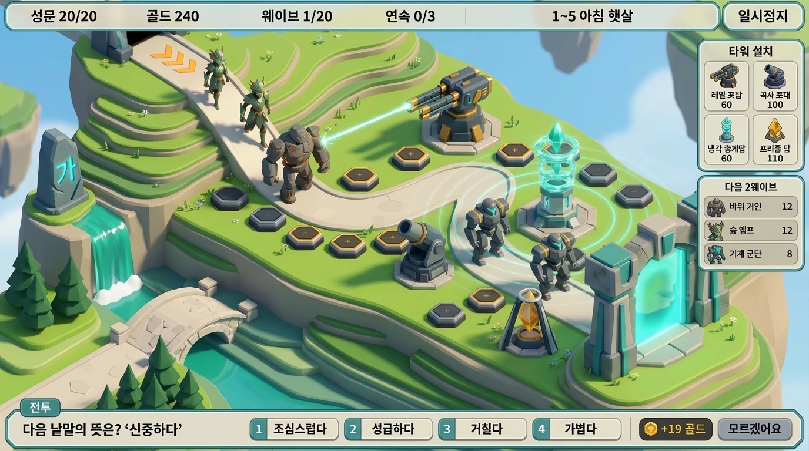
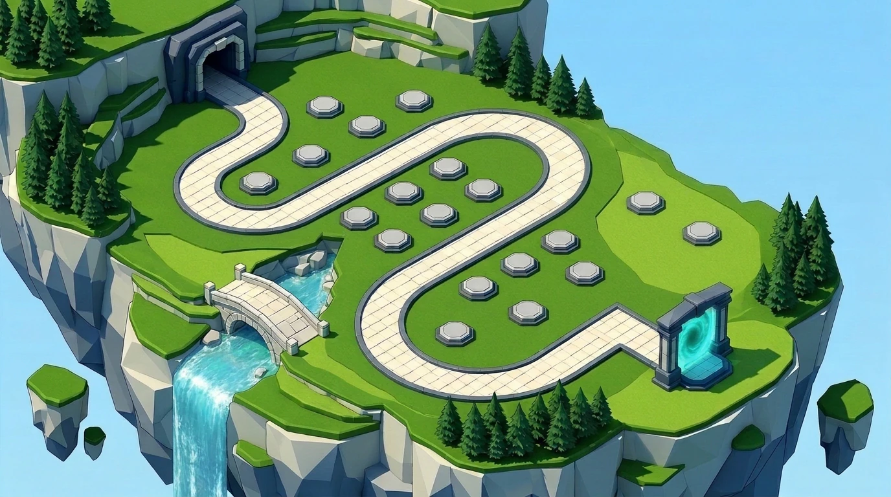

# R6 V2 마스터 계획서 (`MASTER_PLAN`) · 선라이트 택티컬 하이랜드 S++ & 초선명 렌더링

- **작성일**: 2026-11-28
- **상위 기준서**: [../PRD-r6-v2.md](../PRD-r6-v2.md) (`§7~§11`, 기존 세션 C `§0~§6`·`§12`와 무충돌 통합)
- **기술 아키텍처**: [RENDERING_QUALITY_ARCHITECTURE.md](RENDERING_QUALITY_ARCHITECTURE.md) (코덱스 `gpt-6.2-astra/high` 0% 블러·멀티레이어·깊이 분할 검증 전문)
- **세부 실행 계획**: [DETAILED_EXECUTION_PLAN.md](DETAILED_EXECUTION_PLAN.md) (`WP-A1-01` ~ `WP-A4-02`, 13개 작업 패키지)
- **검수 기반**: 코덱스 1차 검토(`20261127T083547-51a0f3`), 클로드↔코덱스 공동 탐구(`20261127T091045-d56c0f` 1턴 클로드 · 2턴 코덱스 `20261127T102326-c1a97c`), 코덱스 초선명 렌더링 심층 탐구(`20261127T202015-ac2839`), 사용자 실구현 에셋 정합 및 연속 도로/우측 성문 교정(`2026-11-28`)

---

## 1. 확정 시안 방향 · "선라이트 택티컬 하이랜드 S++" (실구현 R6 에셋 100% 정합)

### 1.1 최종 확정 마스터 시안 3종

### 1.2 시각 품질 진화 비교 및 5대 절대 기준
| 구분 | V1 현행 (`2.0.0`) | V2 이전 탐색 (동화/파스텔/이질 아트) | **V2 최종 확정 ("선라이트 택티컬 하이랜드 S++")** |
| --- | --- | --- | --- |
| 세계관 · 지형 | 어두운 슬레이트(`960×576`, 2.76× 블러) | 분홍 벚꽃·동화 성(실구현 기물과 불일치) | **`hero-meadow-daylight.webp` 직계 계단식 부유 고원 + 쿨-슬레이트 절벽 + 터쿼이즈 폭포·아치교 + `가` 모놀리스** |
| 도로 · 성문 | `overview` 하단 쏠림(92.13%) · 0.43칸 전 조기 소멸 | 중간에 흙길로 끊어짐 · 목조 중세 성문 | **입구→포털 안쪽(`portalInterior`) 1px 끊김 없는 연속 크림 석판·슬레이트 연석 + 우측 안전 에너지 포털 성문(`x=76~88%`)** |
| 타워 · 몬스터 | Lv1 `5.9~11.2px` 흑회색 점 | 백석·동화풍 타워(기존 66형태·100개체와 별개) | **실구현 R6 Blender 6종·Spine 5종족 100% 정합(다크 슬레이트·실버 세라믹·앰버 `#E69F24`·에메랄드 틸 `#2FB5A3`)** |
| 선명도 기술 | NPOT `960×576` (`0.362 texel/px`) | 단일 `1920×1152`조차 DPR2서 `0.724` (살짝 흐림) | **멀티레이어 분리 합성(`2090×1308` 가시 지형 + POT 반복 석판 메시 + 랜드마크 시트) → DPR2 `1.013 texel/px` (0% 블러)** |
| UI 표면 | 상단 암흑/하단 백색 충돌·59% 공백 | 라벨/도크가 우하단 성문과 근접 | **택티컬 프로스트 아이보리-슬레이트 45° 모따기 글라스 + 우상단 슬림 도크(`y ≤ 58%`) + 100% 한국어** |

> **디자인 & 정합 금지 규칙**: 분홍 벚꽃·동화 뾰족 지붕·중세 나무 문 등 실구현 R6 세계관(`hero-meadow-daylight` + 5종족 Spine + 6종 Blender 타워)과 어긋나는 요소, 성문 앞 도로 끊김(흙길 페이드아웃), 영어/약어, 금지어(`수호`·`출격`·`징집`·`작전실`)는 일절 허용하지 않는다. (`v2-01-cohesive-master.webp` 시안 내 소형 UI 3곳 오탈자 표현은 실제 DOM UI에서 코드 문자열로 대체 구현)

---

## 2. 전장 공간 효율화 · 끊김 없는 도로 · 성문 깊이 통과 규격

1. **성문 우측 후퇴 & 비잘림 안전선 (`x = 76~88%, y = 63~78%`)**:
   - 현행 성문 발점 `(76.39%, 92.13%)`의 하단 쏠림을 바로잡고, 청록 에너지 포털 성문 전체 알파 bbox(`gateAlphaBounds`)가 화면 경계에 **0px 잘림**으로 안쪽에 자리 잡는다.
2. **끊김 없는 연속 도로 & 조기 소멸 제거**:
   - 현행 적은 문턱 0.43칸 전에 사라지고 도로 메시와 문턱이 어긋난다. V2에서는 단일 중심선으로 **입구 → 다리 → 문턱 → `portalInterior` 최종 waypoint**까지 연속 석판·연석 UV(입구 원점 누적)를 깔아 **단일 연결 성분**으로 100% 잇는다.
3. **성문 앞/뒤 깊이 분할 (`gateBack < enemy < gateFront`)**:
   - 성문을 뒤 기둥·청록 에너지 뒷면(`gateBack`)과 앞 기둥·상인방(`gateFront`)으로 분할해 적이 포털 아치 **안쪽으로 걸어 들어가 사라지는** Y-깊이 및 클리핑을 구현한다.
4. **우상단 슬림 도크 (`y ≤ 58%`) & `15×9` 격자**:
   - 우측 도크(`256~272px`)는 상단~중단까지만 점유해 성문과 교차 면적 `0px²`를 지키며, `15×9` 논리 격자 위에 20~24개 2단 슬레이트-세라믹 8각 설치대를 배치한다.

---

## 3. 4단계 순차 확장 전략 (`Gate 0 → A1 → A2 → A3 → A4`)

| 단계 | 핵심 목표 | 왜 이 순서인가 |
| --- | --- | --- |
| **Gate 0 (현재)** | **S++ 정합 시안 3종 & 실아트 프로토타입 승인** | 실구현 에셋 정합 · 끊김 없는 도로 · 성문 후퇴 구도를 먼저 승인받은 뒤 구현 착수 |
| **Phase A1** | **초기맵(`meadow_easy`, 3학년·쉬움) 1장 단일 완성** | 멀티레이어 `11.89 MiB` 초선명 렌더·성문 `gateBack/Front`·128×128 타워 초상화·제로점프 UI·24타워 `p95 ≤ 12ms` 검증 |
| **Phase A2** | **학년(3~6) × 난이도(4) = 16전장 확장 (`balanceVersion 2.1.0`)** | Blender 멀티패스 파이프라인으로 4월드 × 4형태 양산 + 서버 `(2.1.0, 학년, 난이도)` 검증 + 시즌 3 분리 |
| **Phase A3** | **5웨이브 × 10단계 = 50웨이브 규격화 아우라 엔진** | 분리된 `terrain` 레이어에만 선형 휘도 `≥ 0.80×` 틴트 + `256²` 공용 아우라 시트(`0 MiB` 증분) + 밝은 도로 대비 검증 |
| **Phase A4** | **타워 6종 66형태 강철/림 보정 & 보스 초상화 폴리싱** | 밝은 석판 도로 대비 Lv1~5 강철 접촉선·림 조율(낮은 레벨 세라믹 덮기 금지) & 보스 초상 크롭 |

---

## 4. 0% 블러 멀티레이어 파이프라인 & 기술/성능 예산 ([상세 아키텍처](RENDERING_QUALITY_ARCHITECTURE.md))

1. **Blender 5.2.3 LTS 한 장면 멀티패스 + 절차·베이크 결합 (`scene.py`)**:
   - 직교 시야를 논리 해상도(`960×576`)로 고정하고 출력 픽셀만 2×/3× 확장해 `terrain`, `road`, `gate-back`, `gate-front`, `entrance`, `bridge`, `pads`, `props`를 분리 출력한다.
   - 자연 지형은 `cwebp -q 92 -sharp_yuv -m 6`, 청록 문틀·연석·패드 등 고주파 엣지는 **무손실 WebP**를 사용해 크로마 번짐을 없앤다.
2. **VRAM (`≤ 12 MiB` 전환 피크 방지 포함)**:
   - 고밀도 티어 합계 **`11.89 MiB`**(`2090×1308` 가시 지형 `10.428` + POT 도로/랜드마크 `1.00` + 아우라 `0.25` + 3× 패드 `0.211 MiB`). 전환 시 24 MiB 스파이크를 막기 위해 새 파일 CPU 디코드 후 준비 화면에서 이전 전용 페이지를 먼저 해제(`releaseMapArt`)한 뒤 새 페이지를 업로드한다.
3. **선명도 · 윤곽 · 성능**:
   - DPR2 최악 축 `texel / 물리 px ≥ 1.013`, 엣지 폭 증가 `≤ 0.5 물리 px`. V2 밝은 석판 도로용 `silhouettes.json`을 재산출해 개체별·테마별 최솟값 `≥ 2.056` 확보. `1366×768 DPR1` 24타워 CPU 6× **`p95 ≤ min(12ms, 기준선 × 1.15)`** 달성.

---

## 5. 다중 세션(A·B·C·D) 소유 경계 · 리스크 · 운영 승인

- **소유 경계**: [PRD-r6-v2.md §1](../PRD-r6-v2.md) 준수. `manifest-v2.json`은 `MapArt` 스키마(`worldRect`, `tier`, `pages`, `frames`, `pivot`, `alphaBounds`, `portal`, `bytes`, `hash`)를 기존 문자열과 하위 호환되게 확장한다.
- **운영 승인 항목 2건**: ① `balanceVersion 2.1.0`의 **시즌 3 분리** 출시(`season_id UNIQUE` 제약), ② `A2` 16전장 균형 봇 시뮬레이션(`enemyHpBP` 조정폭) 확정.
