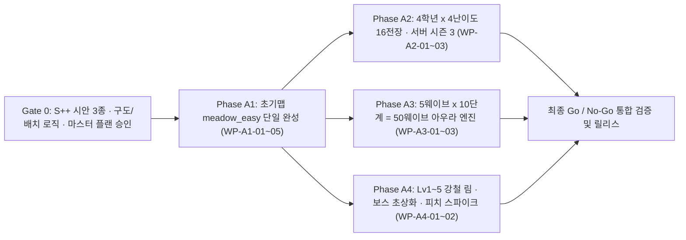

# R6 V2 마스터 계획서 (`MASTER_PLAN`) · 선라이트 택티컬 하이랜드 S++ · 초선명 렌더링 · 완벽 구도 배치

- **작성일**: 2026-11-28 (구도·기물배치·퀄리티 극대화·실행세부계획 통합 격상본)
- **상위 기준서**: [../PRD-r6-v2.md](../PRD-r6-v2.md) (`§7~§11`, 세션 C `§0~§6`·`§12` 무충돌)
- **핵심 기술 설계서 (3대 전문 규격)**:
  1. [COMPOSITION_AND_PLACEMENT_LOGIC.md](COMPOSITION_AND_PLACEMENT_LOGIC.md) — **사선 투영 기하 · `Wide V2 Overview (848×530)` · 4모서리 디오라마 · 6대 기물 배치 불변식 · 4전술 형태 실측 좌표 · Blender 4요소 셰이더**
  2. [RENDERING_QUALITY_ARCHITECTURE.md](RENDERING_QUALITY_ARCHITECTURE.md) — **0% 블러 멀티레이어(`11.89 MiB ≤ 12 MiB`) · `1440 DPR2 1.013 texel/물리px` · `gateBack/Front` 깊이 분할 · `acquireMapArt/releaseMapArt` 전환 수명주기**
  3. [DETAILED_EXECUTION_PLAN.md](DETAILED_EXECUTION_PLAN.md) — **`Gate 0 → A1 → A2 → A3 → A4` 13개 작업 패키지(`WP-A1-01`~`WP-A4-02`) 완전 실행 명세**
- **검수 기반**: 코덱스 1차 검토(`20261127T083547-51a0f3`), 클로드↔코덱스 공동 탐구(`20261127T091045-d56c0f` / `20261127T102326-c1a97c`), 코덱스 초선명 렌더링 심층 탐구(`20261127T202015-ac2839`), 실구현 R6 에셋/사선 투영 전수 시뮬레이션(`2026-11-28`)

---

## §1. 마스터 비전 · 확정 S++ 시안 3종 · 5대 절대 기준

### 1.1 최종 확정 S++ 마스터 시안 3종

### 1.2 V1 → V2 최종 확정 S++ 5대 절대 기준
| 구분 | V1 현행 (`2.0.0`) | V2 이전 탐색 (이질 아트/단일 2×) | **V2 최종 확정 ("선라이트 택티컬 하이랜드 S++")** |
| --- | --- | --- | --- |
| **세계관 · 질감** | 어두운 슬레이트(`960×576`) | 분홍 벚꽃·동화 성 | **`hero-meadow-daylight.webp` 직계 계단식 고원 + Blender 4요소 하이브리드 툰-페인티드(단일 주광축·AO `0.45`·노이즈 결 `±4%`·선별 Freestyle)** |
| **구도 · 가시 면적** | `overview 746×467` · 성문 `(76.39%, 92.13%)` | 성문 우측 쏠림 · 모호한 여백 | **`Wide V2 Overview 848×530 (+29.2%)` + 4모서리 디오라마 앵커 + 우상단 도크 배타존(`dockHits=0`) + 성문 `(82.2%, 71.2%)`** |
| **도로 · 성문 통과** | 코너 `r=0.66` 이탈 · `0.43칸` 전 조기 `leak` | 흙길 끊김 · 목조 문 | **코너 `r=0.38칸` 내측 유지 + 입구 원점 연속 UV → `portalInterior` 단일 연결 + `gateBack < enemy < gateFront` 개구 클리핑** |
| **선명도 · VRAM** | NPOT `0.362 texel/px` | `2×` 단일(`0.724` 블러) | **가시 지형 `2090×1308` + POT 도로/랜드마크 + 3× 패드 = `11.89 MiB` (`DPR2 1.013 texel/px`, 0% 블러, 무손실 엣지)** |
| **기물 배치 · UI** | 앞타워 뒤패드 가림 · 400px 도크 점프 · `5.9px` 아이콘 | 도크-성문 근접 | **`minScreenDist ≥ 61.8px` · `(1,1)` 수직 스택 0 + `128×128 @2x` 초상화 + 제로점프 `0px` + 3줄 해설 비잘림 + 100% 한국어** |

> **디자인 & 정합 금지 규칙**: 분홍 벚꽃·동화 뾰족 지붕·중세 나무 문, 도로 단절, `(1,1)` 수직 스택, 영어/약어, 금지어(`수호`·`출격`·`징집`·`작전실`)를 전면 금지한다. (`v2-01-cohesive-master.webp` 이미지 내부 소형 칩 3곳의 오탈자는 실제 DOM UI에서 정확한 코드 한국어 문자열로 구현한다.)

---

## §2. 퀄리티 극대화 4대 기술 축 (0% 블러 · 광학 일체화 · 대비 공학 · 50W 아우라)

1. **초선명(0% 블러) 멀티레이어 & `11.89 MiB ≤ 12 MiB` 수명주기** ([RENDERING_QUALITY_ARCHITECTURE.md §2](RENDERING_QUALITY_ARCHITECTURE.md))
   - `Wide V2 Overview (848×530)`는 기존과 동일한 `1440×900 DPR2` 캔버스(`2062×1292`)에 매핑되므로 가시 지형 `2090×1308`(`10.428 MiB`) + POT `512×256`/`256²` 도로·랜드마크(`~1.00 MiB`) + `256²` 공용 아우라(`0.25 MiB`) + 3× 패드(`0.211 MiB`) = **`11.89 MiB`** 안에서 가시 영역 `+29.2%`와 **`1.013 texel/물리px`**를 동시에 얻는다.
   - `terrain`만 `-q 92 -sharp_yuv -m 6` NPOT `LINEAR`를 쓰고, `road`/`gate-back/front`/`entrance`/`bridge`/`pads`는 **무손실 WebP** + POT `LINEAR_MIPMAP_LINEAR` + 도로 메시 `Anisotropy 1×/2×`를 적용한다.
   - 전환 시 새 파일을 CPU 디코드한 뒤 준비 화면에서 이전 전용 페이지를 선해제(`releaseMapArt`)하고 새 페이지를 업로드(`acquireMapArt`)해 `24 MiB` 순간 피크를 원천 차단한다.
2. **단일 주광 축 잠금 & 4요소 하이브리드 툰-페인티드 (`scene.py` V2)** ([COMPOSITION_AND_PLACEMENT_LOGIC.md §5.1~5.3](COMPOSITION_AND_PLACEMENT_LOGIC.md))
   - [mortar_render.py](../../../../tools/r6/blender/mortar_render.py#L37)의 $\vec{L} = \text{normalize}(0.27\,\text{CAMERA\_RAY} - 0.74\,\text{RIGHT} + 0.72\,\vec{Z})$를 맵 전역에 공유해 타워·몬스터·지형 간 빛 방향 불일치 `0°`를 달성한다.
   - 4단 소프트-스텝 + `AO(0.45)` 접촉 음영 + `TexNoise(±4%)` + 선별 Freestyle(`#12161B`, `0.80×densityScale`)로 평면적 V1 맵을 S++ 디오라마 품질로 끌어올린다.
3. **실구현 유닛 대비·초상화·조명 보정** ([COMPOSITION_AND_PLACEMENT_LOGIC.md §5.5](COMPOSITION_AND_PLACEMENT_LOGIC.md))
   - **V2 `silhouettes.json`**: 밝은 석판(`#ECF1F5`~`#F2ECE0`) 위 100개체 양방향 보행 합성으로 개체별/테마별 최소 대비 **`≥ 2.056`** 보장.
   - **타워 `128×128 @2x` 초상화 크롭**: 알파 `128` 타이트 크롭 + `87.5%` 스케일 정규화로 도크 실표시 **`≥ 31×31 CSS px`** 확보(기존 `5.9~11.2px` 제거).
   - **타워 `Lv1~5` 강철 보정 (`WP-A4-01`)**: 세라믹 덮기 없이 강철 하단 카본 접촉선과 상단 은회 림만 조율해 `36px` 식별성 강화.
4. **50웨이브(5×10단계) 지형 전용 선형 휘도 틴트 & `0 MiB` 아우라** ([RENDERING_QUALITY_ARCHITECTURE.md §5](RENDERING_QUALITY_ARCHITECTURE.md))
   - `terrainImages`에만 선형 휘도 $Y_{\text{after}}/Y_{\text{before}} \ge 0.80$ 틴트를 `PREP_QUIZ` 전환 시 `1.2s` 적용하고 도로·패드·유닛은 `0px` 변조. 공용 `256²` 시트 + 풀링 입자 `≤ 24`개로 증분 VRAM `0 MiB`.

---

## §3. 완벽한 기물 배치 구도 설계 요약 ([상세 수치·좌표](COMPOSITION_AND_PLACEMENT_LOGIC.md))

1. **4모서리 디오라마 앵커 + 도크 배타 구역(`dockHits = 0`)**:
   - 좌상단(`10%, 12%`) 소나무 절벽 · 우상단(`86%, 26%`) 원경 하늘(도크 전용 `x≥75%, y≤55%` 비침범) · 좌하단(`18%, 76%` & `28%, 82%`) 터쿼이즈 폭포 다리 + `가` 모놀리스 · 우하단(`92%, 84%`) 외곽 지지석으로 전장의 시선 흐름을 입구→전장 중앙→우하단 에너지 포털로 응집시킨다.
2. **6대 수학적 배치 불변식 (`validate_layout.py` 자동 검증)**:
   - ① 베지어 코너 반경 **`r = 0.38칸 ≤ 0.396칸`**(연석 이탈 0) · ② 직교 클리어런스 `8.1px`/대각선 `15.6px` · ③ **`(1,1)` 수직 스택 금지**, **`minScreenDist ≥ 56px`**, 근수직 **`|Δy| ≥ 48px`** · ④ 전 슬롯 화력 가치 **`V(s) ≥ 3`**, 특수 설치대(최대 2종, 언덕 높이 증가 `≤ 8px`) S급 배정 · ⑤ 입구→`portalInterior` 연속 UV & `gateBack < enemy < gateFront` · ⑥ CI 자동 검증 `validate_layout.py`.
3. **검증 완료 4대 전술 형태 (`Wide V2 Overview` 기준)**:
   - **`easy`** (`3단 구불 회랑`, 45칸, **21슬롯**, `minDist 73.0px`, 성문 `82.2%, 71.2%`)
   - **`normal`** (`소용돌이 성채`, 48칸, **23슬롯**, `minDist 61.8px`, 중앙 성문 `47.8%, 50.4%`)
   - **`hard`** (`상·하 완전 대칭 이중 분기`, **33/33칸**, **21슬롯**, `minDist 61.8px`, 성문 `82.2%, 71.2%`)
   - **`crazy`** (`5회랑 빗살 요새`, 53칸, **24슬롯**, `minDist 73.0px`, 성문 `82.2%, 71.2%`)

---

## §4. UI/UX 시선 응집 · 제로점프 · 100% 한국어 요약

- **제로점프 우측 슬림 도크**: `Armory` 6종 `3×2` 그리드를 최상단 고정(`order: -1` 제거 → 좌표 점프 `0px`)하고 `y ≤ 58%` 상한으로 성문과 교차 `0px²` 유지.
- **스마트 팝오버 (`FieldOverlay`)**: `gateScreenBounds(view, alphaBounds)` 공유로 성문 비가림 + 사거리·진화 미리보기 제공.
- **하단 `QuestionPanel`**: 해설 열 `220~248px`, 높이 `172~184px`로 큰 글자 3줄 해설 잘림 `0건`, 100% 한국어·금지어 `0건`.

---

## §5. 4단계 순차 실행 로드맵 (`Gate 0 → A1 → A2 → A3 → A4`)

| 단계 | 핵심 목표 | 착수 조건 & 대표 관문 |
| --- | --- | --- |
| **Gate 0 (현재)** | S++ 시안 3종 · 구도/배치/퀄리티 로직 · 마스터/세부 계획 확정 | 사용자 `Gate 0` 승인 시 `WP-A1-01` 즉시 착수 |
| **Phase A1 (`WP-A1-01~05`)** | 초기맵 `meadow_easy`(3학년·쉬움) 1장 초선명 버티컬 슬라이스 완성 | `11.89 MiB`, `DPR2 ≥ 1.013`, `gateBack/Front`, `128²` 초상화, `0px` 점프, 24타워 `p95 ≤ 12ms` |
| **Phase A2 (`WP-A2-01~03`)** | 학년(3~6) × 난이도(4) = 16전장(`balanceVersion 2.1.0`) + 시즌 3 서버 | `validate_layout.py` 16전장 0오류, V2 `silhouettes.json`, 서버 `(2.1.0, 학년, 난이도)` & 봇 시뮬레이션 |
| **Phase A3 (`WP-A3-01~03`)** | 5웨이브 × 10단계 = 50웨이브 규격화 아우라 엔진 | `terrainImages` 선형 휘도 `≥ 0.80`, 도로 변조 `0px`, 전 구간 최저 대비 `≥ 2.056`, `0 MiB` 증분 |
| **Phase A4 (`WP-A4-01~02`)** | 타워 `Lv1~5` 강철 접촉선·림 보정 & 개체별 보스 초상화 폴리싱 | `36px` 2테마 식별성 통과, 선택적 피치 `0.62` 비교 스파이크 판정 |

---

## §6. 다중 세션 소유 경계 · 리스크/완화 · 사용자 운영 승인 항목

- **배타 소유 경계**: [../PRD-r6-v2.md §1](../PRD-r6-v2.md) 준수. `manifest-v2.json`은 자기 최상위 키(`maps`, `waveThemes`, `towers`, `sheets` vs `atlases`, `rigs`, `species`)만 부분 병합한다.
- **핵심 리스크 & 완화**:
  1. *Blender 멀티패스 출력 크기/시간 증가* → `ortho_scale` 논리 고정 + 8패스 분리로 `road`/`gate`/`pads`는 1회만 구워 재사용.
  2. *GPU 전환 메모리 `24 MiB` 스파이크* → `acquireMapArt`/`releaseMapArt`로 새 파일 CPU 디코드 완료 후 구 페이지 선해제 + `MAX_TEXTURE_SIZE=2048` 2분할.
  3. *어려움 이중 분기 밸런스 편차* → 완전 대칭 `33/33` 경로 + 합집합 밖 21슬롯 + 시드 1~8 봇 시뮬레이션으로 보정.
- **사용자 운영 승인 필요 항목 (2건, `A2` 반영 전까지 결정)**:
  1. `balanceVersion 2.1.0`의 **시즌 3 분리** 출시(`0004_ranking_seasons.sql`의 `season_id UNIQUE` 제약에 따른 기술 권고).
  2. `A2` 16전장 봇 시뮬레이션 결과 기반 `enemyHpBP` 조정폭 및 `아주 어려움(53칸)` 체감 플레이테스트 확정.

---

## §7. 최종 통합 Go / No-Go 정량 관문표

| 분류 | 합격 기준 (Go) | 차단 조건 (No-Go) |
| --- | --- | --- |
| **초선명 화질** | 최악 축 `texel / 물리px ≥ 1.0` (`1440 DPR2 1.013`) · 엣지 증가 `≤ 0.5 물리px` · 떨림 `0` | `texel/px < 1.0` 또는 FBO/CAS(`10.16 MiB`) 혼입 |
| **구도 · 기물 배치** | `dockHits = 0` · `minScreenDist ≥ 56px` (`61.8+`) · `(1,1)` 스택 `0` · 코너 `r ≤ 0.396` · `V(s) ≥ 3` | 도크/경로 겹침, 수직 스택, 연석 이탈, 죽은 슬롯 |
| **성문 · 연속 도로** | 성문 bbox 비잘림(`x=76~88%`) · 도로 단일 연결 · `gateBack<enemy<gateFront` 잔상 `0` · `leak` 1회 | 성문 잘림, 도로 단절, 0.43칸 전 조기 소멸 |
| **GPU 메모리 · 전송** | 고밀도 활성 세트 **`≤ 12 MiB`** (`11.89 MiB`, 선해제 전환) · 아우라 `≤ 128KB` (`0 MiB` 증분) | 2장 상주 `24 MiB` 피크 또는 누수 |
| **색 · 대비 · 한국어** | 도로 픽셀 차 `0` · 지형 선형 휘도 `≥ 0.80` · 개체최저 G4 `≥ 2.056` · 영어/금지어 `0` | 밤 구간 대비 붕괴 또는 금지어 잔존 |
| **UI · 초상화** | `Armory` 점프 `0px` · Lv1 초상 실표시 `≥ 28×28 CSS px` · 3줄 해설 잘림 `0` · 빈 공백 `≤ 15%` | 선택 시 도크 밀림 또는 `< 20px` 점 현상 |
| **성능 · 위키** | 24타워 실연사 `1366×768 DPR1` CPU 6× `p95 ≤ min(12ms, 기준선×1.15)` · 평균 `≥ 55fps` · `wiki:check` 0오류 | `p95 > 12ms` 지속 또는 타 세션 파일 침범 |
