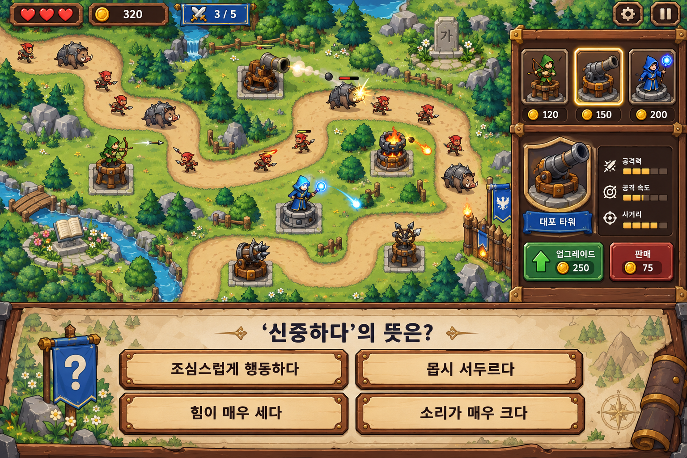

# 확정 화풍: 41번 왕국 원정대

상태: 사용자 선택 완료 · 2026-10-27 · 제작용 에셋/맵/밸런스 승인과 별개

- 밝은 모험 판타지. 선명한 둥근 실루엣, 큰 색 면, 절제된 그림자. 어둡거나 파스텔 위주의 화면은 피한다.
- 전투 자산: 궁수·대포·마법사·고블린·벌레 등. 문자/학자 테마로 통일하지 않는다.
- 고정 장식: 자연물 위주 + 작은 한글 비석/훈민정음/세종 모티프의 기념 공간. 설치 불가 셀로 관리한다.
- UI: 장비함의 홈, 방패 초상화, 목제 답안 키. 그림만 입힌 웹 카드의 반복보다 장착/선택/눌림 상태가 읽히게 한다.
- 하단 문제·우측 관리·모바일 접힘. 화면 전체가 작은 그림으로 축소되는 방식은 최종 UX가 아니다.
- 격자 중심에 큰 기물, 긴 우회 길, 충분한 설치 공간. 이 원화의 정확한 길/숫자/가격/선택지는 확정값이 아니다.
- 길의 논리 구조와 타워 위치를 유지한 채 웨이브별 무드만 바꾼다. 5의 배수는 강한 적·보상·예고 연출로 구별한다.
- 세부 질감·금장·광원은 원화보다 줄여도 된다. 전투 식별과 문항 가독성이 우선이다.

첫 제작 표본: 타워 1종(몸/포신 또는 팔/발사 소켓), 적 1종(이동 4포즈·피격·처치 표본), 자연물 1종, 문화 장식 1종, 성문, 지형 기본판과 무드 레이어, UI 외곽 1세트. 피벗·알파·작은 크기·모바일 대비를 확인한 뒤 대량 제작한다. 현재는 제작을 시작하지 않는다.

보존 이미지 SHA-256: `5150CB167DEB846DFDE633F6E5B0468A0053072435F2D92C485B869801643B13`.
생성 방식: 내장 imagegen. 사용자가 선택한 원본 그대로 보존했으며 재생성/수정하지 않았다. 과거 생성 지시문은 `archive/design-v0.7/prompts.json`의 41번 항목에 있다. 다른 시안과 표본 이미지들은 사용자 요청으로 프로젝트에서 삭제했다.
